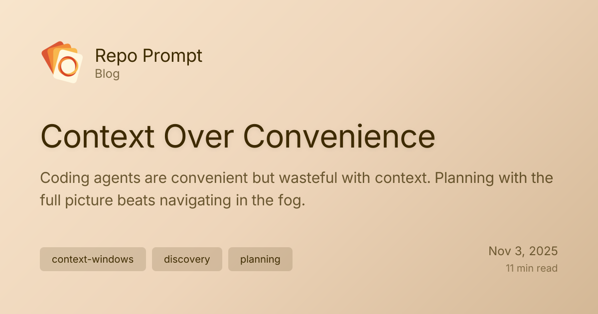

Since starting work on Repo Prompt, back in summer 2024, my workflow with AI models has not stopped changing.

One constant through all that change however, has been the importance of maximizing the relevant context fed to the model, given how much context it's able to reliably process.

{/* truncate */}

## Understanding Context Windows: Advertised vs. Effective

That last point is worth clarifying: LLMs have an advertised context window, and then an effective one.

Until this year, models had a precipitous drop when crossing the 32k token barrier.

I'd say right now most models perform admirably in the 64-128k token range, but going beyond that is perilous, as the ability for the model to effectively reason over more context drops dramatically as its intelligence drops proportionally to the context served.

One important consideration for long context reasoning, is the size of the model. In most cases, smaller models struggle a lot more than larger ones with longer context, and I expect that to remain true for a long time to come.

With that said, the battle to getting the most out of LLMs for programming, or any reasoning heavy task, lies almost exclusively in the optimal curation of context, formatted clearly, and paired with a clear task prompt.

## The Agent Orientation Problem

Now, with the importance of context in mind, it's important to understand the different ways of serving problems to LLMs and getting them to make effective changes to your files or code.

Most folks working with AI models in 2025 have probably tried a coding agent, and if you haven't I encourage you do give Claude Code or Codex a download and experiment with what it can do for you.

Coding agents are in some ways miraculous, but they are also fundamentally limited. Understanding why is again related to understanding the importance of context.

When you prompt a coding agent, it must understand your problem, and the code that relates to that problem, from scratch, without any prior knowledge. You may try to accelerate codebase understanding with meticulous rule files, but each rule file you add eats into the available context window, which in turn affects the ability for the model to reason about your problem and the codebase itself.

Sending a prompt to a coding agent to change some code in a fresh context window involves what I've come to call "agent orientation". It's the phase where an agent will search through your code, invoking tools like grep to search for keywords based on what you prompted the model, to find the files related to your problem.

Once those files are found, agents will typically read small slivers of your files to get a cursory understanding of the code, and then start enacting change in them. Better coding agents will read more code before jumping to conclusions, but they will likely also read unrelated code and fill their context window with information that doesn't serve their ability to solve the problem. The more irrelevant context included, the closer we are to hitting that context limit wall that results in diminished intelligence.

All of this stands alongside the agent harness' system prompt, the tools it's provided, any MCP tools you've added (they each come with lengthy definitions), rule files, failed tool calls, and even successful ones, where the call params remain in the context window as the agent works.

By the time the agent understands your problem, it has very likely exceeded the sweet spot of effective context, and will begin trying to solve your problem with degraded intelligence.

### The Reasoning Model Limitation

When considering reasoning models, like GPT-5, the problem is even more nuanced.

The power of a reasoning model is that it can think for many minutes before answering. Since o3 came out, these models have started to be able to call tools from their chain of thought, to gather additional information while reasoning. However, in coding agents, they must use tools to handle file changes, and so unlike research tasks where the model can collect information and then answer after the chain of thought, they have to answer from within the chain of thought, and thus never get the chance to fully utilize their ability to reason.

When you combine this nuance, with the problems outlined above of reading incomplete slices of your codebase before jumping to conclusions, you start to see a pattern of compounding inefficiencies that affect the quality of a model's output, in the name of user convenience.

Reasoning models work best when they think and then act. Repo Prompt's Pro Edit workflow has tuned this by having models reason and then only after output a formatted response that contains all the edits. It turns out that this is also the best way to get a model like GPT-5 Pro to handle files edits. 5-Pro is a special case because, while it can call tools from it's chain of thought, it is not 1 instance of GPT-5, but many. That model does well with calling tools to gather informating, but if you rely on tools to apply edits, it's one of the many strands of GPT-5 handling the edits, rather than the consensus wisdom that comes from the final response.

> It's worth noting that there are other flavors of reasoning models, like Claude's Anthropic models that do interleaved thinking, and tool calls. The above doesn't exactly apply to those models. If you're using Deepseek, Grok, Gemini or GPT models however, keep it in mind!

## Planning and Discovery: A Better Approach

Given the limitations of context windows, before making any changes to a codebase, especially above a certain threshold of complexity (could an intern do this in an afternoon with minimal guidance?), it is important to start planning your changes.

Planning can take many forms, but the most common are:

1. **Clear outcome oriented specifications** → What should the final product do after our changes?
2. **Architectural specifications** → How should the new code be structured, what parts of the codebase should be affected, and what should the new code do exactly?

### Why PRDs Aren't Enough

Many plan modes focus on the former. This is what you call a PRD (product requirements document). The problem with PRDs is that they leave all the implementation details up to ai model affecting change for you, and they don't solve the issue of agent orientation for each part of the task. You also have to carefully break up your PRD into clear, verifiable sub-tasks, or you'll just start compounding errors and may need to restart the whole process, as a single context window may not be able to fully contain all the changes required.

There's a process called compaction that often runs to alleviate some of this, but every time it runs, the model will lose many important details, including the contents of your files, and will need to rediscover important details, while working from lossy summarizations of the task and work done so far.

With all that said, the most important thing you can spend time preparing for your task is an architectural plan, so that an agent implementing the code required to complete your task encounters as little ambiguity as possible.

## The Repo Prompt Workflow

As of November 2025, here is how I go about this:

### Step 1: Discovery with the Context Builder

Repo Prompt ships with the context builder. It's a powerful agent orchestration engine that connects to either Claude Code or Codex, to take your task description, and then use Repo Prompt's MCP tools to research how your code works in relation to the task provided.

While reading around, it will pull out the most relevant files (and codemaps, which are concise api definitions to give ai models understanding of how to use a type without providing the implementation details). When a complete picture has been found, it will verify the token use of those files, and iterate on the selection to ensure that the final collection of files and codemaps fits within the allocated token budget.

> This budget is 60k tokens by default—the upper limit of what you can paste into GPT-5 Pro on ChatGPT's Pro plan before hitting an error. If you find yourself using the built in chat, or other chat apps like ai studio, you are more than welcome to raise this limit. If pasting into an ai agent directly, you probably want to max out around 24-32k tokens.

One of the most powerful tools to help with token budget adherence is file slicing, which allows the context builder agent to pull out only the most relevant parts of a file, so that even massive files can fit within our allocated budget.

Finally, with a complete picture of the task and related files, the agent will leave a handoff prompt that clarifies your instructions with remaining open questions and ambiguities (that you can address directly), while also carefully explaining how the various discovered files relate to each other and to the task.

Importantly the prompt driving this agent takes great pains to ensure the agent running discover is not opinionated about the end solution. This is essential because it prevents the model from including too little context, and for biasing it's solution in the final prompt, which needs to be as factual as possible.

### Step 2: Choose Your Implementation Path

Once we've run discovery, we will have a resulting prompt that depending on the scope can be used to either directly affect change in your codebase, or can be the seed for a highly detailed architectural plan.

#### For Modest Changes: XML Pro Edit

Typically, if the scope of edits (how many files we need to edit) is modest, the best way to handle the change from here is to simply use the `XML Pro Edit` copy preset or the `Pro Edit mode` in the built in chat.

Recall that reasoning models work best when they think and then act. With the XML Pro Edit workflow, you hand off your prompt along with all the discovered context and formatting instructions to a model like GPT-5 Thinking or Pro.

Because the model has the full file context up front, it can spend its entire reasoning budget thinking exclusively about the solution—not about what context it needs to gather. It reasons as long as it needs to, then returns the optimal set of minimal changes formatted as an XML response.

Repo Prompt then breaks up this response into per-file change lists that can be implemented in parallel by Claude Code or Codex in a sandbox for you to review before any changes hit your disk. I personally love this workflow for bug fixes, targetted fixes, and enhancing complicated algorithms.

#### For Large Changes: Architectural Planning

If the problem is too large for a model to write all required code changes in a single response, you'll want to turn to drafting an architectural plan. Assuming the context builder agent did it's job right, the best way to do this is to set Repo Prompt over to the `Plan` preset, and then paste the resulting prompt into GPT-5 Pro.

Many coding agents ship with Plan modes at this point, but none of them ensure that the model drafting the plan has a bird's eye view of the complete task related codebase context, and so you will very often get plans that stem from incomplete information. A lot of information is often hidden within the interplay of classes that may not be immediately visible to a model reading only a few lines at a time. Furthermore, coding agent plans stem from a blend of the discovery and planning phases, which results in the model spending too much of it's context window on understanding the problem before being able to reason about a solution.

Using discovery and GPT-5 Pro to generate an architectural plan, is in my opinion the state of the art for complicated change planning.
GPT-5 Pro has an incredible ability to break down your architecture, while being incredibly thorough, given it's ability to reason about the entire subset of the affected codebase at once. The one caveat to generating a plan this way is that it may still be too much for one agent to complete without needing to compact.

#### For Complex Multi-Step Changes: Pair Programming

If it doesn't all fit in the context window, you can take additional steps to break the plan up, but what works even better is to use the Repo Prompt Pair Programming workflow, which integrates planning and implementation through the most complex of plans, while a driver agent directs the Repo Prompt chat through the implementation.

This keeps the heavy reasoning to the context optimized chat, while the agent driver's job is to break up the plan into achievable pieces, and validate the work done at every step. This workflow remains my preferred one for complex changes, and using it just involves setting the Repo Prompt preset to `MCP Pair`, before pasting the prompt into your agent of choice.

Unfortunately, the interplay of Repo Prompt and an external coding agent, remains too complicated for many. Rest assured, I am working on ways to make this an integrated workflow so you can benefit from all the best practices described in this article, in an end-to-end automated workflow.

## Conclusion

At the end of the day, once you have an architectural plan in hand, ideally from GPT-5 Pro, 90% of the work is done, assuming you did a good job of defining your task to the discovery model, and it did a good job of serving the right context to GPT-5 Pro. AI models are not perfect, but if you're looking for the best approach to get a high hit rate of well designed working code, this is what I've found works best.

**As an engineer working with AI models, your job is to plan out what features make sense to work on, scope them correctly, and review the changes made, to keep a handle on the code being generated.** Review each step of this process carefully and don't fully give into the end-to-end automation. Your input still matters a lot!

I hope this article gave you some insight into context windows, and an understanding of why agents and tool calling have their place, but should not always be used for every step of the pipeline. The right combination of one shot responses to maximize reasoning with the right context, alongside the careful act of assembling prompts for discovery, planning, and execution, can make a massive difference in the quality of the code an AI model can generate.
