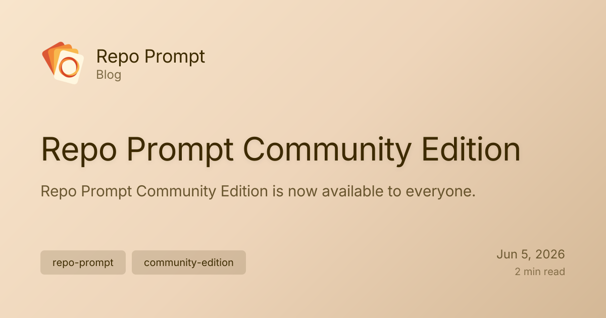

I am happy to announce that **Repo Prompt Community Edition** is now live on GitHub! The current release version download is at [github.com/repoprompt/repoprompt-ce/releases](https://github.com/repoprompt/repoprompt-ce/releases) and the code is available at [github.com/repoprompt/repoprompt-ce](https://github.com/repoprompt/repoprompt-ce).

{/* truncate */}

This is now the active development home for Repo Prompt. It is the place to open issues, contribute pull requests, follow architectural work, and experiment with the app's agent-first future.

When I first started building Repo Prompt, it was just a simple tool for copy-pasting codeblocks into Claude. But as we wrestled with token budgets, prompt compilation, and file structures, we soon stumbled into the broader world of **context engineering**.

Today, it has evolved into an extremely capable multi-agent orchestration tool. This was achieved by inverting traditional harness design, making the Model Context Protocol (MCP) server the primary agent so that the underlying CLI harnesses can be swapped out or upgraded seamlessly.

This version of the app has been designed specifically to thrive in the age of open source driven by coding agents. This means that many of the legacy features you might traditionally think of Repo Prompt for have been removed to maximize the potential of its tools for parallel agents. As a community, we've stripped the legacy baggage to focus on speed, context density, and raw agentic performance.

I have worked hard to turn Repo Prompt's source code into a lean codebase that is easy to hack on, easy to extend, and shaped around the way coding agents now work. The project includes a build system designed to scale to parallel coding agents, along with a one-click installer that compiles and installs the app.

While this is still a Mac native app, the project structure was completely redesigned to shed the need for Xcode, taking heavy inspiration from Peter Steinberger's work. You can now build, run, and contribute using standard command-line tools without having to deal with the complexities of `.xcodeproj` files.

Core work is already underway to split the project into focused packages, isolate the core, and make cross-platform versions easier to build without starting from a completely new codebase. You can follow that work in [pull request #118](https://github.com/repoprompt/repoprompt-ce/pull/118).

The repository also borrows from Mario Zechner's pragmatic example of keeping a list of approved contributors, but adds a twist where all previous customers who opted in are automatically whitelisted. It is my way of saying thank you for supporting this project.

I really think this repo can serve as a learning baseline for many to build novel agent experiences without having to maintain complete, complex harnesses. If you are looking for Repo Prompt Classic, the [archived code is available here](https://github.com/repoprompt/repoprompt-classic) and it remains available as a [standalone download here](https://d2ruaev2blr0t3.cloudfront.net/RepoPrompt.dmg). Classic preserves the original Xcode-based app and its IDE mode as a reference point for inspiration, experimentation, and bringing useful ideas back into Community Edition.

## Start by exploring

You do not need to arrive with a finished contribution. Fork the project, explore it with your coding agent, and use the technology inside it to create your own tools, workflows, or entirely new experiences.

Issues, focused pull requests, experiments, and curious exploration are all welcome. The goal is not just to preserve Repo Prompt as it exists today, but to make it a foundation that other people can build on.

As I have said previously, my new adventure at OpenAI is taking me away from active involvement in this project. The entire Repo Prompt community has been wonderful from the very start, and I look forward to all of you stewarding the next generation of Repo Prompt.

If you want to get involved with development, please join the amazing [Repo Prompt Discord community](https://discord.gg/NtbFDAJPGM)!

Let's build the future of agentic coding together.
