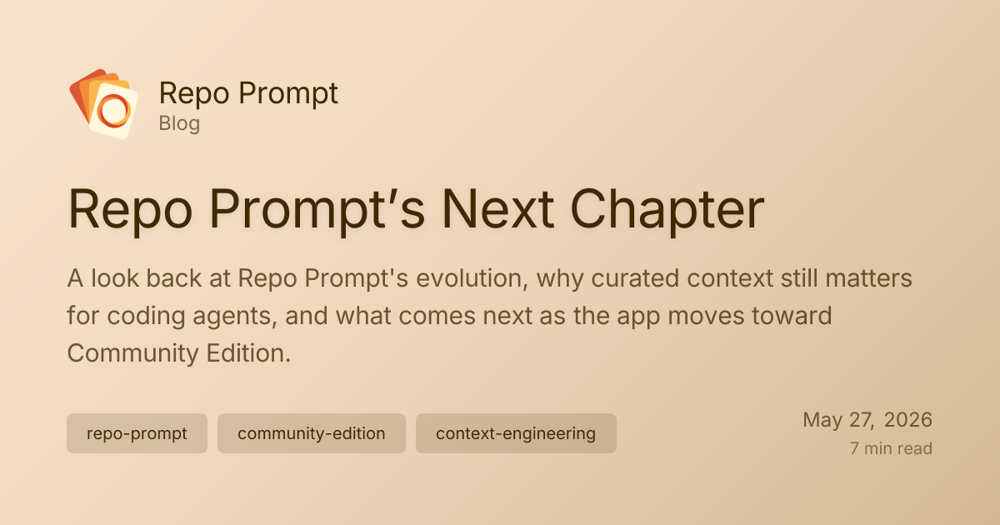

July 16th, 2024. That was the day I shipped my first build of RepoPrompt to testers who found their way to my TestFlight through a Reddit post about automating copy-pasting.

{/* truncate */}

Back then, very few coding tools existed that could really take advantage of AI. Cursor limited models to 32k token context windows, and file edits required dedicated edit models that broke down on files more than a few hundred lines long. And yet, if you pasted some files into ChatGPT, it was clear that models could greatly accelerate the work of coding.

Back in June of that year, Anthropic shipped Claude Sonnet 3.5. It was the first model to consistently deliver usable code, follow instructions competently, and support a context window large enough to start scaling model understanding to production codebases. It wasn’t obvious back then because reliable file editing was still a bit of a mirage. Tool calling was primitive, and your best bet was spoon-feeding the model with the right context and copy-pasting the results back into your files by hand.

This obviously sucked, so early RepoPrompt was focused on both of those problems. While it wasn’t 100% reliable, I’m pretty proud of how well it worked by the fall of 2024.

## When reasoning changed the workflow

Enter December 2024. A couple months after announcing o1 Preview, OpenAI released o1 Pro on ChatGPT, and boy did it change everything.

While Sonnet was capable of writing basic logic, doing frontend, and helping you think through problems, it was fundamentally unable to think through complex algorithms and needed tons of iteration in order to generate code that actually worked.

o1 Pro was different. It reliably crunched through a lot more context. It was slow as heck, but it could one-shot really hard problems, assuming you gave it sufficient context. It was reliable in a way all models that preceded it were not. More importantly, however, it allowed me to start tackling problems that I could not conceive of being able to solve without AI. It was a real early taste of superintelligence, albeit an extremely narrow one that could not check its own work.

Fast forward to February 2025. Claude Code had just shipped, but the Max plan had not, and thus the tool was just a way to light money on fire, especially since Claude at the time could barely edit a few files without spinning out and wreaking havoc. Despite that, it was a glimpse of the potential for fully self-driving coding.

While people were impressed, my RepoPrompt workflow, which was significantly more manual, saved me time and allowed me to reliably edit and grow my codebase, shipping novel features, optimizing performance for enterprise-scale codebases, and keeping bug counts low as the user base grew.

People often talk about the two extremes of working with AI for coding. On one end there is manual code writing, perhaps with some tab-to-complete. On the other, there’s fully agentic automation. In the middle, there’s this underexplored path that I was discovering: manually curating context for models to write targeted file edits you could review without getting overwhelmed.

While that form factor was a bit too clunky for people to really appreciate, the fundamental techniques involved in spoon-feeding reasoning models with curated context continued to produce such outsized gains over naive prompting that I could not ignore them.

## Context still matters

Even though models now excel at navigating your codebase with little guidance, the constraints on context windows and attention continue to mean that the models reason on solutions after only reading small fractions of your codebase. Conversely, if you figure out exactly the right context a model needs to see to solve a problem, you can maximize how many tokens are allocated to solving the problem vs. understanding its scope.

And yet, naive prompting is just so convenient, and it doesn’t require a manual. Much of RepoPrompt’s biggest hurdle to wider adoption has been that complexity, which I struggled to distill down into a set of buttons and knobs users could control without needing a masterclass.

It turns out that with enough iteration on MCP tooling, you can equip any harness with a smart enough model to use these tools that people struggled to understand, and even go down to a level of granularity that remains out of reach save for the most diligent engineers.

Enter the context builder agent. If there’s one thing I could not live without today as I continue to work with agents, it is this: a complete automation of the construction of a dense prompt that maximizes understanding around a problem, without actually trying to solve it.

The magic is then taking this prompt and feeding it to an oracle model that has its tools disabled, to simply reason about the solution with a bird’s-eye view of the codebase. It simply produces better architecture designs, code reviews, and general analysis than naive agent prompting. This may seem counter to the bitter lesson, but it actually scales with model intelligence, and proves to me how early we are in designing optimal architectures for models to do their best work.

I’m always surprised that no one ever copied the context builder agent, because it is by far the most useful tool RepoPrompt ships with, and all workflow prompts in the app depend on it as a brain. It is the number one reason the RepoPrompt codebase has not devolved into unmaintainable slop, as each task that flows through it results in a plan that stems from a deep understanding of the most relevant context in the codebase. It turns out that most problems, even in large codebases, can have their relevant context packaged up into about 120k tokens.

## A transition

Today, RepoPrompt is more capable than ever. Its built-in agent features state-of-the-art multi-agent orchestration tooling and the included workflows make driving it effortless and dependable. Yet, as the steady drum of model progress continues, so grows the volume of well-funded competition in the realm of AI coding.

My passion has always been to drive product, and the need to commercialize that product to keep going has weighed on me since the beginning. Being a bootstrapped founder is relentless, as every subscription you earn might disappear the very next month. While I am absolutely convinced that my tooling drives better results, it’s increasingly challenging to convince someone that they should pay me $15 a month to obtain those gains when they can just prompt their agent to solve problems for them, and it “just works.”

A couple of months ago, I was approached by Romain Huet, OpenAI’s head of developer experience, to join his team and help push my vision for building with these models on a scale that I could never achieve on my own. Of course, before agreeing to anything, my first request was to ensure the dedicated users of RepoPrompt, who supported my journey until this point, were taken care of.

While I won’t be able to steward RepoPrompt as I have in the last couple of years, I’m pleased to announce that I’ll soon be releasing RepoPrompt Community Edition, a fully free and open source version of the app that sheds the legacy baggage holding it back from scaling in this next phase of massively parallel agent orchestration. My hope is that all those asking for a Windows port or a mobile app will be able to build on the foundations I’ve laid out and make something truly great.

Moreover, as of the 2.1.32 update, RepoPrompt’s licensing restrictions have been fully removed and all current subscriptions have been cancelled. Transitions like this are never easy, and I’ve done my absolute best to do right by everyone in the RepoPrompt community, and set the project up for a continued flourishing life without my daily involvement.

It’s never been clearer to me that we are still at the very beginning of tapping into the potential of models and agents. Every few months we unlock new capabilities, and as part of my new role, I’ll be working to make these capabilities accessible to everyone.

To the RepoPrompt community that has been with me so far, thank you. I would not be where I am today without you.
