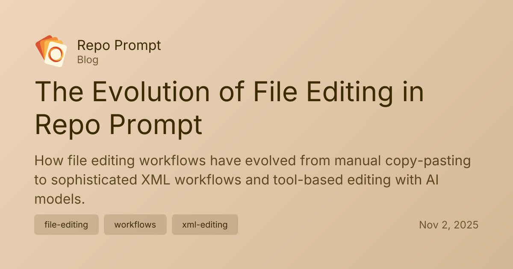

When I first started, most of the edits I'd make to my code, were by copy pasting codeblocks into my files, after serving the prompts to Claude.ai. Eventually this evolved as I developer the XML Edit workflow, which still works great today.

{/* truncate */}

This workflow allowed me to skip a step in copy pasting by having Claude's response pre-formatted in XML, in such a way that Repo Prompt can parse the path of the targetted files, and extract a diff from one or many search/replace blocks embedded in the XML.

One response could create, delete, or modify many files at once!

Initially the reliability of this workflow left a lot to be desired, both as the algos to get this working needed to be refined, and as the models (other than Sonnet) were just compeletely unreliable at handling search/replace operations.

Even today, doing it all in one shot can be somewhat error prone, as the model producing the changes doesn't have the chance to double check it's work before submitting the final response.

--

In between shipping XML Editing, and now, there were a lot of attempts to make file editing more reliable, but ultimately, many of those attempts are now moot because with tool calling AI models can now check on their work and correct erroneous edits before completing their turn.

As of last week, Repo Prompt support
