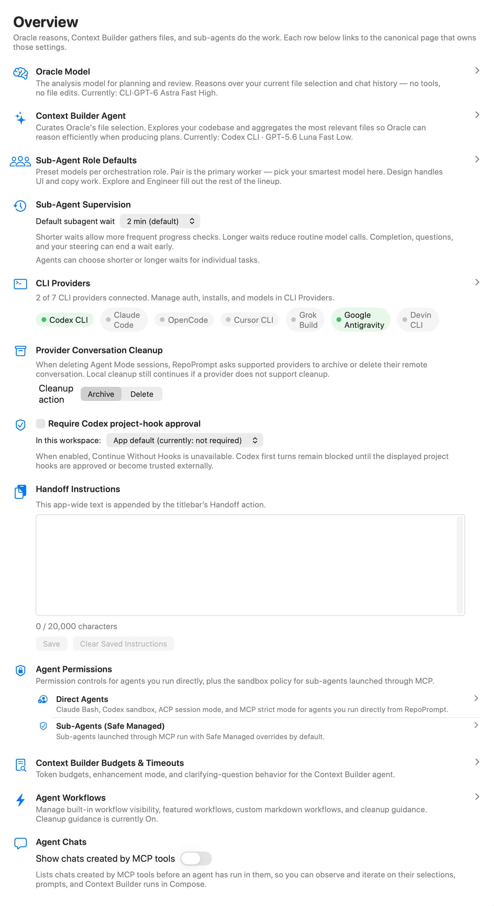
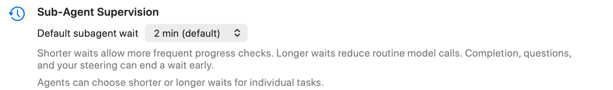
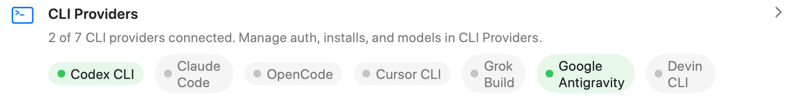
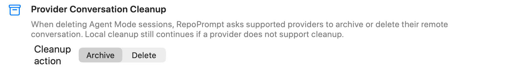
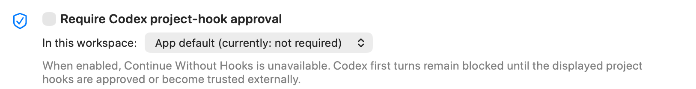
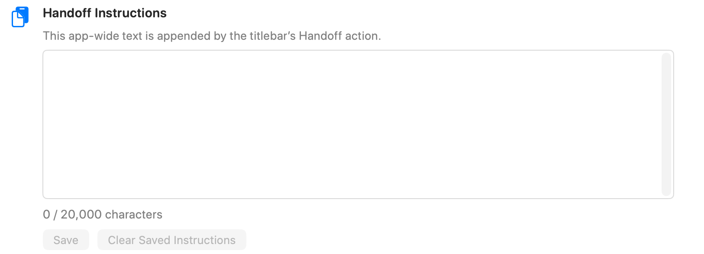
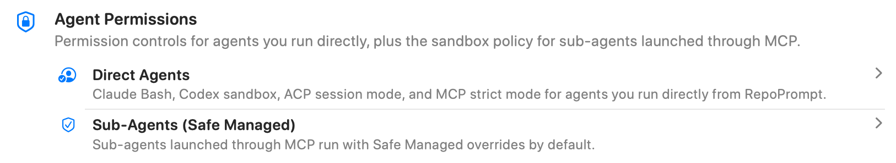
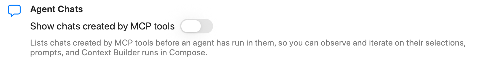

<div className="settings-reference">


<div className="settings-intro settings-panel-intro">



<div>

Configure Agent Mode behavior and find the settings for models, providers, permissions, and context building.

</div>

</div>

Open **Settings → Agent Mode → Overview**. This page combines shortcuts to detailed configuration with a few app-wide behavior controls. Screenshots illustrate the controls; the selections shown are examples rather than recommended defaults.

## Models and context

- **Oracle Model** opens [Agent Models](./agent-models.mdx). Oracle analyzes the current file selection and chat history for planning and review, without tools or file edits. Change its model on the linked page.
- **Context Builder Agent** also opens [Agent Models](./agent-models.mdx). Choose the agent and model that explore the repository and gather relevant files for Oracle.
- **Sub-Agent Role Defaults** opens [Agent Models](./agent-models.mdx). Assign models to orchestration roles: **Pair** for primary work, **Design** for interface and copy work, **Explore** for investigation, and **Engineer** for implementation.

The model names shown on Overview summarize your configuration. They are navigation links, not model pickers.

## Sub-Agent Supervision



**Default subagent wait** sets how long an orchestrating agent normally waits for a sub-agent before checking back. The available intervals are **2, 5, 10, 20, 30, and 60 minutes**.

Shorter waits allow more frequent progress checks; longer waits reduce routine model calls. Completion, questions, or your steering can end a wait early. An agent can request a different wait for an individual task, so this is a default supervision interval rather than a task time limit.

## CLI Providers



Open [CLI Providers](./cli-providers.mdx) to connect runtimes, manage authentication, test connections, and configure provider controls. Overview summarizes the connection state for Codex CLI, Claude Code, OpenCode, Cursor CLI, Grok Build, Google Antigravity, and Devin CLI.

These indicators summarize the connection information already held by the app. Use **Test Connection** on the provider page to check availability again.

## Provider Conversation Cleanup



**Cleanup action** controls what RepoPrompt requests from a supported provider when you delete an Agent Mode session:

- **Archive** requests archiving of the provider conversation.
- **Delete** requests deletion of the provider conversation.

Local session cleanup continues if the provider does not support conversation cleanup. Selecting an action does not immediately archive or delete existing sessions.

:::caution[Provider-side cleanup]

Deleting an Agent Mode session can also affect its provider conversation. Choose the cleanup action before removing sessions; support for the requested action depends on the provider.

:::

## Require Codex project-hook approval



The app-wide **Require Codex project-hook approval** switch determines whether Codex may begin without approval of the displayed project hooks.

When approval is required, **Continue Without Hooks** is unavailable. The first Codex turn remains blocked until those hooks are approved or become trusted externally. Turning off the requirement permits the continue-without-hooks path; it does not itself approve or trust hooks.

When a workspace is available, **In this workspace** can override the app-wide setting:

- **App default** follows the app-wide switch.
- **Always require approval** requires hook approval in this workspace.
- **Don't require approval** allows this workspace to use the continue-without-hooks path.

## Handoff Instructions



Enter reusable instructions that the titlebar’s **Handoff** action appends to a handoff. The saved text applies across the app.

- The editor accepts up to **20,000 characters** and displays a character count.
- **Save** stores a changed, valid draft. Text that exceeds the limit must be shortened before saving.
- **Clear Saved Instructions** removes the saved text and clears the editor.

For example, you could save:

```text
Summarize the task, decisions, changed files, and validation results.
List the remaining work and any unresolved questions.
```

:::note[Saving and concurrent changes]

If the saved instructions change elsewhere while you have an edited draft, the page warns that saving will replace the newer value. If global settings cannot be saved, a separate warning explains that changes are active only for the current launch until persistence is restored.

:::

## Agent Permissions



These links open [Agent Permissions](./agent-permissions.mdx):

- **Direct Agents** configures provider controls for agents you launch directly, such as Claude Bash access, Codex sandbox permissions, ACP session modes, and MCP restrictions.
- **Sub-Agents** configures the policy for agents launched through MCP. The displayed policy name summarizes the current setting. Safe Managed applies managed overrides; other policy choices are configured on the linked page.

:::note[Two permission scopes]

Direct-agent controls and sub-agent policy are separate. Changing a provider control does not mean every MCP-launched sub-agent will use that same setting.

:::

## Context Builder Budgets & Timeouts


**Context Builder Budgets & Timeouts** opens [Context Builder](./context-builder.mdx), which owns token budgets, prompt enhancement, question timeouts, and clarifying-question behavior.

## Agent Workflows


Open [Agent Workflows](./agent-workflows.mdx) to manage built-in workflow visibility, featured workflows, custom Markdown workflows, and cleanup guidance. Overview displays a summary; change the workflow options on their own page.

## Agent Chats



**Show chats created by MCP tools** controls whether the chat list includes Compose tabs created through MCP before an agent has run in them.

Enable it to inspect and adjust those tabs’ selections, prompts, and Context Builder runs in Compose. Disable it to omit those not-yet-run chats from this view. The switch changes visibility; it does not delete the chats.

</div>
