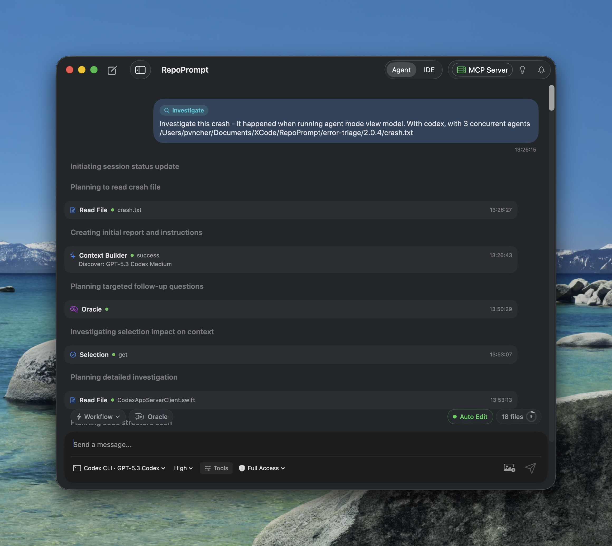
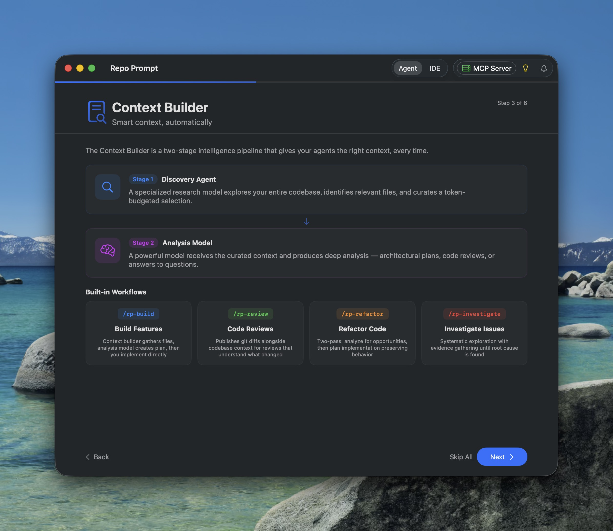

Agent Mode comes with built-in workflows that guide your agents through structured, multi-step tasks — from feature implementation to deep code reviews.

## How Workflows Work

Each workflow wraps your task description in a structured prompt that teaches the agent a proven approach. Instead of the agent figuring out how to tackle your request from scratch, the workflow provides a step-by-step protocol that leverages RepoPrompt's context tools at each stage.

Select a **What are we building?** card or use the **Workflow** selector above the message editor, then type your task. Your submitted message is wrapped in that template; the selection is cleared after submission. See [Workflow Templates](../sessions/workflow-templates.mdx) for the interface walkthrough, and choose the [execution location](../sessions/execution-location.mdx) before sending.

*Note: This screenshot is a historical capture illustrating an earlier build's Investigate session.*

## Built-in Workflows

Built-in workflows appear in the Agent Mode workflow picker in the following display order (`RepoPromptBuiltInAgentWorkflow.displayOrder`). Agent Mode sessions also support four specialized sub-agent roles: **Pair** (default when `model_id` is omitted in `agent_run`, for interactive pair programming and complex tasks), **Engineer** (balanced implementation), **Explore** (read-only reconnaissance), and **Design** (architecture and design critique producing markdown documents under `docs/`).

### Orchestrate

Plans a complex task, decomposes it into discrete work items, and dispatches sub-agents (`pair`, `engineer`, `design`, `explore`) to implement each one. The orchestrator stays lean — it coordinates and monitors, while worker agents handle the actual implementation in fresh context windows. Works with both UI-started and MCP-started sessions.

**Flow:** Workspace verification → Contextualize task & Context Builder (`plan` + export) → Decompose into work items → Dispatch sub-agents → Monitor and verify

### Deep Plan

Produces a polished, ready-to-execute architectural specification at `docs/plans/<topic>-<YYYY-MM-DD>.md` without implementing code. The workflow asks for your preferred involvement level (**Up front**, **Mid-flow**, or **Hands-off**), dispatches parallel `explore` agents across workspace seams, external research, and prior art, runs Context Builder (`plan` mode with export) to build a coverage ledger, dispatches a `design` agent to write an independent critique under `docs/reviews/`, and performs a fidelity-preserving editorial pass.

**Flow:** Involvement decision (`ask_user`) → Map seams (`explore` agents) → Scaffold plan → Context Builder (`plan` + coverage ledger) → Design critique (`design` agent) → Editorial polish & fidelity verification

### Optimize

Runs a delegation-first, evidence-driven performance optimization loop. The agent scouts bottleneck candidates with parallel `explore` agents, plans debug-gated instrumentation and a baseline procedure via Context Builder, dispatches a `pair` agent to capture baseline metrics in a persistent scoreboard (`prompt-exports/optimize-<slug>-runs.md`), and iterates one attributed change at a time — consulting the Oracle after each run until the target metric is met, diminishing returns are reached, or the 5-iteration cap is hit.

**Flow:** Bottleneck scouting (`explore` agents) → Plan metrics & instrumentation (Context Builder) → Land debug instrumentation & baseline (`pair` agent) → Serial optimization loop (Plan → Implement & measure → Verify scoreboard → Consult Oracle) → Final rollup

### Plan & Build

The comprehensive end-to-end implementation workflow. The agent does a quick scan of your codebase, calls Context Builder to gather deep context and generate an architectural plan, refines the plan through Oracle Chat when ambiguities arise, and then implements the solution directly.

**Flow:** Quick scan → Context Builder (with `plan`) → Refine with Oracle Chat → Implement with editing tools

### Review

Surveys your git changes, determines the comparison scope (uncommitted, staged, vs `main`, etc.), and uses Context Builder to produce a thorough code review grounded in your full codebase — not just the diff.

**Flow:** Survey git state → Confirm scope → Context Builder (with `review`) → Clarify findings via Oracle if needed

### Refactor

Analyzes your code for redundancies and complexity using parallel `explore` scouts and Context Builder's `review` mode, generates an incremental refactoring plan via Context Builder's `plan` mode, and dispatches `pair` or `engineer` sub-agents to implement improvements step by step while verifying that existing behavior and tests are preserved.

**Flow:** Scope & analyze (`explore` + Context Builder `review`) → Plan improvements (Context Builder `plan`) → Decompose & dispatch (`pair`/`engineer`) → Verify tests and diffs

### Investigate

Systematic codebase exploration for debugging and root-cause analysis. The current workflow template calls for read-only source inspection while creating and updating an investigation report; it explicitly rules out source-code changes. The coding agent triages symptoms into `docs/investigations/<topic>-<YYYY-MM-DD>.md`, optionally dispatches `explore` agents for git blame archaeology and external research, uses Context Builder for broad discovery, dispatches a `pair` investigator to test hypotheses, and synthesizes findings with the Oracle until the root cause is confirmed with line-level evidence.

**Flow:** Triage & scaffold report → External fact-gathering (`explore`) → Broad discovery (Context Builder) → Deep investigation (`pair`) → Oracle synthesis & final report

### ChatGPT Export

Builds focused context for your task using Context Builder (`clarify` mode), checks selection and token counts, and exports a self-contained Markdown prompt file under `prompt-exports/`. Use it with a model available in ChatGPT or another external AI service for a second opinion; the export does not select or grant access to a model.

See [How Do I Find the ChatGPT Pro Interface?](../faq/chatgpt-pro.mdx) for the browser workflow, account/model distinction, and how to return the analysis to a coding session.

**Flow:** Classify intent → Context Builder (`clarify` mode) → Verify workspace context → Export prompt file to `prompt-exports/`

## Interview Mode

Before launching into a workflow, you can enable **Interview Mode** to have the agent ask clarifying questions first. This ensures the agent fully understands the task requirements, edge cases, and constraints before it starts working. Toggle it from the agent settings — when enabled, the agent will conduct a brief interview to align on the task definition before proceeding with the selected workflow.

## Why Context Matters

Coding agents are convenient but fundamentally limited by how they gather context. When you prompt an agent, it must understand your problem and codebase from scratch — searching with grep, reading small slivers of files, and starting to make changes before fully understanding the code. By the time the agent orients itself, its context window is filled with tool calls, search results, and irrelevant code, leaving less room for actual reasoning.

This matters because models have an *effective* context window that's smaller than the advertised one. Most models perform well in the 64–128k token range, but going beyond that degrades reasoning ability significantly. Every token spent on orientation is a token not spent on solving your problem.

RepoPrompt's workflow commands solve this by separating **discovery** from **implementation**. The Context Builder handles the heavy lifting of finding and curating relevant files, so the agent receives complete, well-organized context upfront — and can spend its entire thinking budget on the solution.

Read more: [Context Over Convenience](/blog/context-over-convenience)

*Note: This onboarding screenshot is a historical capture showing an earlier subset of built-in workflows.*

## The Context Builder Pipeline

Every workflow is built around the Context Builder — a two-stage intelligence pipeline:

1. **Stage 1 — Discovery Agent:** A specialized model explores your entire codebase, identifies relevant files, and curates a token-budgeted selection. It uses codemaps (concise API signatures) and line slices to maximize context within the allocated budget
2. **Stage 2 — Analysis Model:** A powerful model receives the curated context and produces deep analysis — architectural plans, code reviews, or answers to questions — grounded entirely in your actual code

The discovery agent is deliberately non-opinionated: it gathers facts and relationships without biasing toward a particular solution. This ensures the analysis model gets a complete, neutral picture of the relevant codebase before reasoning about what to do.

## Oracle Chat

Oracle Chat is a curated context window shared between the agent and a powerful reasoning model. It leverages RepoPrompt's best practices for prompting reasoning models — optimized file selection, codemaps, and line slices — to get optimal insights, plans, and reviews.

### How It Works

The Oracle sees a carefully curated selection of your codebase — not raw grep results or piecemeal file reads, but the precise files and slices relevant to the question. The pipeline:

1. The agent describes what it needs to know
2. Context Builder curates the most relevant files within a token budget
3. The Oracle receives this optimized context and reasons deeply over it
4. The answer flows back to the agent, which continues working with new understanding

Oracle Chat maintains a conversation — the agent can ask follow-up questions in the same session, building on previous answers without re-running discovery each time.

### Shared Context, Always Current

Agent Mode automatically tracks every file the agent reads and keeps the Oracle's selection in sync. The Oracle is never less informed than the agent — it always has at least the same files the agent has seen, plus whatever additional files Context Builder discovers during its research.

The Oracle's strength is *context density*. Rather than working from whatever happens to be in the agent's context window, Context Builder curates the most relevant files for each specific question — pulling in related code the agent may not have encountered yet. This targeted curation is what enables the deepest insights.

### When Agents Use Oracle Chat

- **During /rp-build:** Clarifying architectural patterns, edge cases, or how existing code handles similar situations
- **During /rp-investigate:** Testing hypotheses about a bug's root cause with cross-file reasoning
- **During /rp-refactor:** Understanding dependencies and usage patterns before proposing changes
- **Mid-implementation:** When the agent needs to understand how something works before editing it

### Multi-Oracle Rosters (Parallel Second Opinions)

You are not limited to a single reasoning model. In **Settings → Agent Mode → Agent Models**, you can configure an **Oracle Roster** comprising 1 Primary Oracle plus up to 4 additional models (up to 5 models total). 

When an agent calls `ask_oracle` or an MCP client invokes `oracle_send`, RepoPrompt queries all roster models in parallel against the exact same curated context package. Responses return the primary analysis alongside `<additional_oracle_perspectives>` with automated reconciliation guidance:
- Where models agree, your agent proceeds with higher confidence.
- Where recommendations diverge, the agent evaluates the trade-offs against the codebase rather than blindly following a single model's blind spots.

For named configurations exposed through MCP, see [Oracle Model Presets](../settings/mcp-server/model-presets.mdx).

## Customizing Workflows

You can toggle built-in workflows on or off, clone them as starting points for your own, or create entirely new ones from scratch. Open the **Configure...** option at the bottom of the Workflow dropdown to manage your workflow list.

## Available as MCP Skills Too

Related workflows are available as installable skills for external agents, with commands such as `/rp-build` and `/rp-review`. Install the MCP or CLI variant for your client; installing a server connection alone does not install the skill prompts. See [MCP Workflow Commands](../mcp-server/workflow-commands.mdx) for the current catalog and locations.

:::tip

**Which Workflow?** Start with **Plan & Build** for most tasks. Use **Review** before committing changes. Reach for **Investigate** when debugging tricky issues that need systematic exploration.

:::
