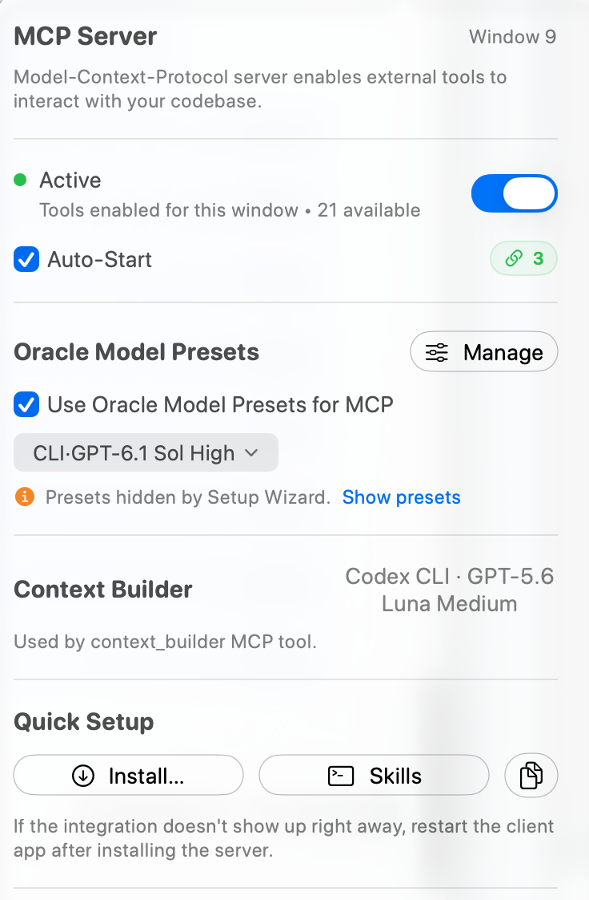

## MCP Server: An IDE for AI Agents

### What is MCP?

MCP (Model Context Protocol) is an open standard for AI tools to communicate with external services. RepoPrompt CE's MCP server exposes file selection, Code Maps, Context Builder, Oracle conversations, edits, workspace and tab lifecycle, allowlisted app preferences, and policy-controlled Agent Mode session operations. Clients discover the tools available to their connection rather than assuming every tool is always exposed. The app-backed tools are reachable two ways:

- **Direct MCP** — persistent connections for agents that natively speak MCP.
- **[rpce-cli](./mcp-setup.mdx#terminal-access)** — ephemeral shell invocations for agents and humans that prefer a terminal.

Both surfaces let you switch workspaces, create tabs, select files, run Context Builder, consult an Oracle, apply edits, and update allowlisted preferences. Tool toggles, connection policy, workspace access, and Agent Mode permissions still apply. Some capabilities are only advertised inside an eligible Agent Mode or discovery session.

### Quick Access: MCP Controls

Click the **MCP Server** indicator in the toolbar for quick access to the server popover. The adjacent lightbulb opens the [Setup Wizard](./setup-wizard.mdx), which recommends model and agent settings.

**Key settings to configure:**

- **Window access:** Enable MCP tools for the workspace window you want clients to use.
- **Auto-Start:** Request automatic listener startup when you launch RepoPrompt.
- **Oracle Model Presets:** Expose named Oracle configurations to external clients. Current source uses `oracle_utils` and `oracle_send`; Agent Mode also provides `ask_oracle`.
- **Context Builder:** Review its selected CLI agent and model, and change them in Agent Models.
- **Quick Setup:** Install the client integration and optional workflow skills.

The popover displays the count of currently advertised tools (typically **21 available** for standard external MCP clients, covering workspace lifecycle, file operations, Code Maps, context curation, Git, Oracle consultations, history, and the agent control plane). An additional set of policy-gated tools (`ask_user`, `ask_oracle`, `oracle_chat_log`, `agent_session_link`, `session_admin`, `become_overseer`, `self_compact`, `share_thoughts`, `set_status`, `wait_for_next_user_instruction`) are dynamically activated during eligible Agent Mode or oversight sessions. This guide follows the current implementation where it differs from Classic tool names.

:::tip

**Showing 0 tools?** First check that the listener is running and tools are enabled for the target window. Reconnect or restart the external client if it cached an earlier empty list. See [Setup troubleshooting](./mcp-setup.mdx#troubleshooting-setup).

:::

### RepoPrompt as an IDE for Agents

Think of RepoPrompt's MCP server as providing everything an AI agent needs to work effectively with code:

#### File Navigation

Browse file trees, search by path or content, read files with line ranges - agents can explore codebases just like developers do.

#### Code Intelligence

Access codemaps showing function signatures and type definitions - token-efficient structural understanding without reading entire files.

#### Context Building

Select files with full content, line slices, or codemap-only modes. Auto-codemap management adds dependency context automatically.

#### AI-Powered Discovery

Run Context Builder as an MCP tool - let a headless agent select relevant files within a token budget.

#### Pair Programming

Invoke an Oracle for planning, reviewing, and questions with your configured models. Oracle consultation and the agent's subsequent implementation are separate steps.

#### File Editing

Create, move, and delete files. Apply search/replace edits or full rewrites with diff previews and applicable approval checks. Review the returned result rather than assuming every requested edit was applied.

#### Workspace Management

List, switch, and create workspaces. Manage compose tabs for parallel tasks. Full programmatic control.

#### Multi-Window Support

Use multiple windows for different workspaces. Clients discover and bind workspace context through `bind_context`; compose-tab binding keeps a selection and prompt isolated from UI tab changes.

#### Agent Control Plane

External clients can orchestrate Agent Mode sessions via `agent_run` (session-based run control) and `agent_manage` (session/workflow management). See the [Tools Reference](./mcp-tools.mdx) for details.

#### App Settings

Read and update allowlisted preferences for appearance, prompt packaging, models, MCP preset visibility, Code Maps, file scanning, selected Agent Mode behavior, and notifications through `app_settings`. See [App Settings Tool](./mcp-app-settings.mdx) for the current catalog. Auto-Start and permission policies remain app controls.

### Architecture Overview

The MCP server uses a secure, local-only architecture with UNIX socket transport:

**Local Socket Transport:** External Client → repoprompt-mcp bridge (stdio) → UNIX Socket → RepoPrompt App

The app bridge uses local UNIX sockets, without exposing an MCP TCP listener. Client admission and filesystem permissions protect access. This describes the client-to-app connection: Oracle, Context Builder, and agent requests can still contact the AI providers you configure.

### Compatible Clients

RepoPrompt CE provides native one-click configuration for:
- **Claude Code** — Anthropic's official coding CLI with deep MCP and skill integration
- **Cursor** — AI-native code editor with deeplink MCP installation
- **Codex CLI** — OpenAI's CLI agent with isolated prompt and skill discovery
- **VS Code** — Visual Studio Code with standard stdio MCP configuration
- **OpenCode** — Modern open-source terminal coding assistant
- **Claude Desktop** — Anthropic's desktop application
- **Any MCP Client** — Any client supporting the open Model Context Protocol standard

Compatible clients can also install RepoPrompt's built-in [Workflow Commands](./workflow-commands.mdx), providing slash commands for orchestration, deep planning, optimization, code review, refactoring, implementation, bug investigation, and prompt exporting.

### Sibling: rpce-cli

Prefer a shell, or running on an agent that doesn't natively speak MCP? The same tools are reachable from [`rpce-cli`](./mcp-setup.mdx#terminal-access), RepoPrompt's scriptable control surface. Drive workspaces, selections, context, chats, edits, Agent Mode runs, and app settings from Bash or any shell. See [App Settings from the CLI](./mcp-app-settings.mdx) for the CLI view of the same `app_settings` surface.

### Quick Start: claude-rpce

For a preconfigured Claude Code launch, install the `claude-rpce` wrapper from **Settings → MCP Server → CLI Tools**. Use the corresponding debug command name when running a debug build.

This installs a simple command that launches Claude Code pre-configured to use RepoPrompt's MCP tools instead of Claude's built-in file operations. No global MCP configuration needed - just run `claude-rpce` instead of `claude`.

### Key Benefits

- **Better Context:** Agents get token-efficient codemaps and slices instead of dumping entire files
- **Multi-Repository:** Work across multiple project folders in a single workspace
- **Visual Feedback:** See what agents are doing in RepoPrompt's UI
- **Human Oversight:** Approve connections, review edits before applying
- **Reviewable Changes:** Inspect tool results, previews, and workspace state as agents work.

### Security Model

- External clients pass the app's connection-admission checks; approval can be required for a new client process.
- Only connections from the local machine are accepted (UNIX sockets are local-only)
- No network ports exposed - uses local UNIX sockets for communication
- Per-user isolation - socket directories are user-specific
- Individual tools can be enabled/disabled
- A shared listener serves window-scoped tools; each window's tool access and the connection's context binding determine where calls run.

:::tip

**Getting Started:** Click the **MCP Server** button in the toolbar to enable the server, configure your models, and install in your preferred client. See the Setup Guide for step-by-step instructions.

:::

