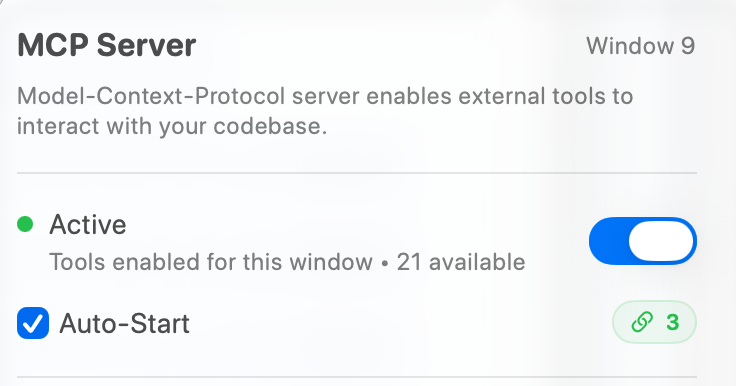
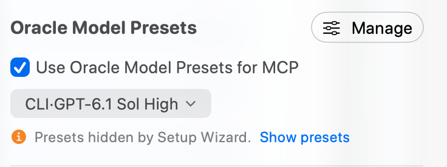
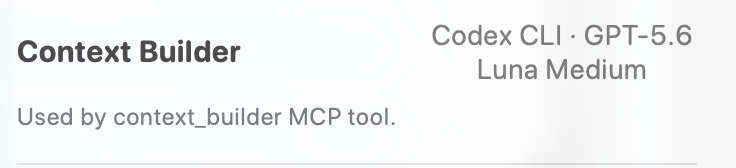
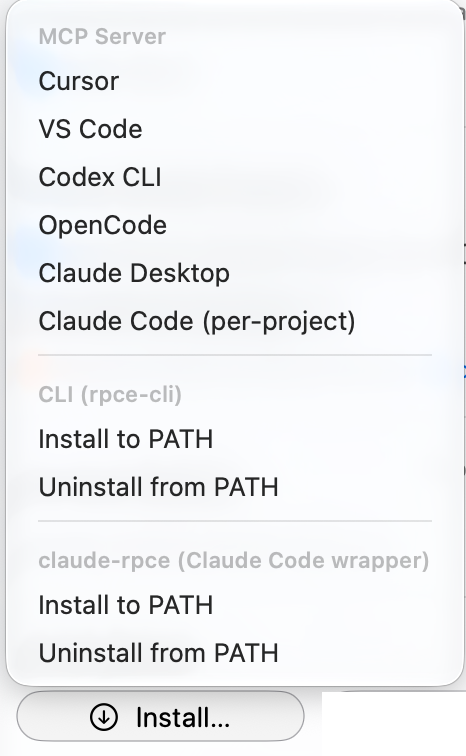
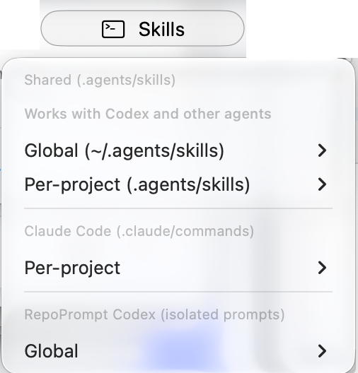

The MCP Server popover provides quick access to server configuration, model presets, and Context Builder settings. Access it via the MCP indicator in the toolbar.

## Popover Overview

Click the MCP indicator in the toolbar to open the settings popover. The indicator shows connection status and the number of available tools.


*Note: The screenshots (`mcp-server-popover.png` and `mcp-window-access.png`) are historical captures showing **21 available** tools. RepoPrompt defines **31 total domain tools**: **21 are advertised** to standard external MCP clients (**3 global** tools and **18 window-scoped** tools), while the remaining **10 policy-gated and sub-agent internal tools** are dynamically exposed within eligible Agent Mode and oversight sessions. See [Policy-Gated and Sub-Agent Internal Tools](./mcp-tools.mdx#policy-gated-and-sub-agent-internal-tools).*

This is the primary location to configure the MCP server, including:

- **Server activation** - Enable/disable MCP tools for external clients
- **Oracle Model Presets** - Expose named Oracle model configurations to external clients
- **Context Builder** - Select the agent that powers context discovery via MCP or CLI

## Server Controls

### Enable MCP Tools

The main toggle enables or disables MCP tools for the current window. When enabled, external clients can interact with your workspace through the MCP protocol.

### Auto-Start

When checked, RepoPrompt requests automatic listener startup on launch. This is useful if you always want MCP available for your AI tools. The target window must also have tools enabled.

### Status Indicator

**Active** means the shared listener is running and tools are enabled for this window. **Waiting for listener…** means window access is enabled but the listener is not running. With window access disabled, a running listener can still serve other windows. The connection badge shows attached clients; the window number identifies the window being configured.



The full Settings pane also offers **Status Dashboard** for diagnostics and **Force Stop Listener**. Force Stop affects every window and client; use the window access switch to limit only this window. A running tool can expose a **Cancel** action.

## Oracle Model Presets

Control which AI models are available to MCP clients when they use the `oracle_send` and `oracle_utils` tools.

### Use Oracle Model Presets for MCP

When enabled, configured Oracle presets are exposed to MCP clients, allowing an agent to select from named model configurations. A preset can supply the primary model, additional Oracles, and its mapped Chat Preset. Grouped Oracle requests run their models independently and keep their results separate.

When presets are disabled, the current Oracle configuration supplies the default. If no presets are defined, the popover offers the Oracle fallback model choice. If the Setup Wizard temporarily hid presets, **Show presets** restores their exposure without deleting their definitions.



### How Agents Use Presets

Use `oracle_utils` with `op="models"` to discover model choices, then `oracle_send` to consult an Oracle. A `model` override is valid only for an explicit `new_chat=true` start. An exact exposed preset UUID or name takes precedence over a raw model identifier; continuing an existing conversation preserves its established configuration.

```json
{"op":"models"}
```

The JSON above is passed to `oracle_utils`. A new consultation can then use an exposed preset:

```json
{"message":"Review the selected changes for regressions.","mode":"review","new_chat":true,"model":"Review"}
```

Pass the second object to `oracle_send`, substituting a preset name returned by your own connection. Manage definitions in [Model Presets](../settings/mcp-server/model-presets.mdx) or click **Manage** in the popover. Older Classic tool names `list_models` and `chat_send` have been replaced in the current source contract.

## Context Builder Settings

Configure which agent powers the `context_builder` MCP tool, which helps AI agents build relevant file context for their tasks.

### Context Builder Agent

The row summarizes the CLI agent and model used by `context_builder`. Change them in [Agent Models](../settings/agent-mode/agent-models.mdx), where global settings and workspace overrides are shown explicitly. Supported choices depend on configured providers and the Context Builder selection surface; the model shown in the screenshot is an example.



[Setup Wizard](./setup-wizard.mdx) recommendations use the same model-selection engine. Discovery configuration is independent of the Oracle models used for the plan, question, or review that follows.

### How context\_builder Works

When an MCP client calls `context_builder` with task instructions, RepoPrompt's Context Builder agent:

1. Analyzes the task requirements
2. Explores the codebase to find relevant files
3. Builds a selection toward the configured context budget
4. Returns the selection, or runs the requested plan, question, or review with Oracle context

This enables AI agents to automatically gather context without manual file selection.

## Quick Setup

The popover's **Install…** menu has three groups: **MCP Server** configures a client connection, **CLI (rpce-cli)** provides terminal access, and **claude-rpce (Claude Code wrapper)** provides a preconfigured Claude Code launcher. **Skills** installs reusable workflow instructions separately. Installing one of these does not install or authenticate the client application itself.

### Install MCP Server

Choose a client under **MCP Server** in **Install…**. The Settings pane labels this button **Install MCP…** and places terminal installation actions in its separate **CLI Tools** section.

| Option | What it configures |
| --- | --- |
| **Cursor** | Opens Cursor's MCP installation link with RepoPrompt's generated server configuration. Complete the installation in Cursor. |
| **VS Code** | Opens VS Code's MCP installation link with the generated stdio server entry. Complete the client-side setup. |
| **Codex CLI** | Configures and enables the server in RepoPrompt's isolated Codex configuration and installs its MCP workflow prompts there. This does not configure every separate Codex installation or its ordinary user home. |
| **OpenCode** | Adds the persistent MCP server entry to `~/.config/opencode/opencode.json`. RepoPrompt's runtime agent modes are separate from this persistent connection entry. |
| **Claude Desktop** | Adds the server entry to Claude Desktop's configuration. The installer reports failure if Claude Desktop's application-support folder is absent; install and open that client first. |
| **Claude Code (per-project)** | Runs Claude Code's MCP installation command in each loaded workspace root. Open the intended project folders first and make sure the Claude Code CLI is installed. |

The two **Install to PATH** and **Uninstall from PATH** pairs belong to different commands, as described below. Restart or reconnect the selected client if it does not discover its new MCP configuration immediately.



### CLI Installation (rpce-cli)

Under **CLI (rpce-cli)**, **Install to PATH** installs the managed `rpce-cli` command in `/usr/local/bin` for terminal access to RepoPrompt's MCP tools. This enables scripting, automation, and interactive codebase exploration. macOS can request administrator authorization to write that location; the directory must be on your shell's PATH to invoke the command by name.

**Uninstall from PATH** removes that managed terminal command. It does not uninstall RepoPrompt CE or remove MCP configurations already added to external clients. Debug builds use `rpce-cli-debug`, so use the command name displayed by the running build.

```bash
rpce-cli -e 'call get_file_tree {"type":"roots"}'
rpce-cli -e 'call workspace_context {"include":["selection","tokens"]}'
```

### claude-rpce Wrapper

Under **claude-rpce (Claude Code wrapper)**, **Install to PATH** installs a managed launcher in `/usr/local/bin`. It runs an already-installed Claude Code CLI with RepoPrompt's MCP configuration, strict MCP configuration mode, and the built-in Read, Write, Edit, Glob, and Grep tools disabled. This directs those file operations through RepoPrompt's tools.

The wrapper's **Uninstall from PATH** removes its managed launcher, not Claude Code itself or the separate `rpce-cli` command. Debug builds use `claude-rpce-debug`. The wrapper requires the Claude Code CLI and a running RepoPrompt app with MCP tools enabled.

**Why use claude-rpce?**

- **Frees up context:** RepoPrompt's codemaps and slices are more token-efficient than dumping entire files
- **No global MCP setup needed:** The wrapper configures everything automatically via command-line flags
- **Visual feedback:** See what Claude is doing in RepoPrompt's UI
- **Better file selection:** Use RepoPrompt's selection, slicing, and codemap features

```bash
# Instead of running:
claude

# Run:
claude-rpce

# This automatically:
# - Points to RepoPrompt's MCP config
# - Enables strict MCP mode (ignores other configs)
# - Disables Claude's built-in Read, Write, Edit, Glob, Grep tools
```

:::info

**Prerequisite:** RepoPrompt must be running with MCP Server enabled for `claude-rpce` to work.

:::

### Skills Menu

**Skills** installs reusable workflow prompts: `/rp-orchestrate`, `/rp-deep-plan`, `/rp-optimize`, `/rp-review`, `/rp-refactor`, `/rp-build`, `/rp-investigate`, `/rp-oracle-export`, and `/rp-reminder`. Choose a destination based on which client should discover them and whether they should apply across projects or only within the loaded project folders.

| Menu group and option | Scope and destination |
| --- | --- |
| **Shared (.agents/skills) → Global (~/.agents/skills)** | Installs shared skill directories under your home folder for clients that discover this convention, including Codex and other compatible agents. |
| **Shared (.agents/skills) → Per-project (.agents/skills)** | Installs shared skills in each loaded workspace root's `.agents/skills` folder. Use this to keep instructions project-specific. |
| **Claude Code (.claude/commands) → Per-project** | Installs Claude Code workflow skills for the loaded roots. The menu retains the older `.claude/commands` label; the current implementation writes `.claude/skills/<name>/SKILL.md` and migrates legacy flat command files. |
| **RepoPrompt Codex (isolated prompts) → Global** | Installs workflow prompt files in the `prompts` directory of RepoPrompt's isolated Codex home. Global here means that isolated environment, not every external Codex installation. |

Each destination submenu offers **MCP skills**, **rpce-cli skills** (or the running build's CLI name), and **Uninstall**. The MCP variant instructs an agent to call RepoPrompt tools directly. The CLI variant instructs it to use the installed terminal command and uses skill names with a `-cli` suffix. Choose the variant that matches how your client accesses RepoPrompt; installing a CLI variant does not install the executable for you.

**Uninstall** removes RepoPrompt-managed MCP and CLI workflow files from the chosen destination, leaving unrelated skills alone. Per-project install options require loaded workspace folders and are disabled or report **Open a folder first** when none are available. The grey section labels and **Works with Codex and other agents** text are descriptions, not additional actions.



This installs workflow instructions as skill folders or prompt files for the chosen destination; it does not connect a client, authenticate a provider, or expand tool permissions. If the client has already loaded its instruction files, refresh its picker or restart it. See [Workflow Commands](./workflow-commands.mdx) for the current command catalog.

### Copy JSON

Copies the MCP server configuration to your clipboard for manual installation in any MCP-compatible client:

```json
{
  "mcpServers": {
    "RepoPromptCE": {
      "command": "/path/to/repoprompt-mcp",
      "args": ["--backend", "app"]
    }
  }
}
```

:::info

**Note:** After installing, restart the client application if the integration isn't detected immediately.

:::

## Advanced Settings

The Settings pane contains **CLI Tools** and expandable **JSON Configuration** sections beyond the popover. CLI rows report **Installed**, **Not installed**, **Needs update**, or **Exists but not managed**, with actions appropriate to that state. Debug builds use their separate debug command names.

Use **Status Dashboard** for connection diagnostics and active-client inspection. Individual tool enablement is documented in [MCP Tools settings](../settings/mcp-server/tools.mdx). Workspace context routing is described in [Connection Management](./mcp-connections.mdx).

See [Transport & Security](./mcp-transport.mdx) and [Connection Management](./mcp-connections.mdx) for details.

