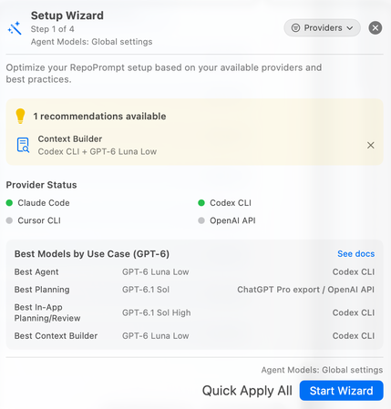
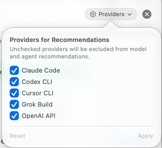
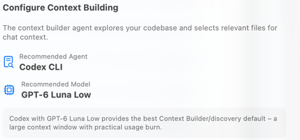
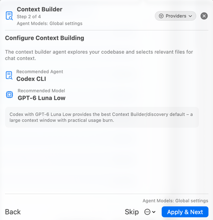
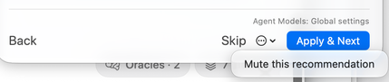
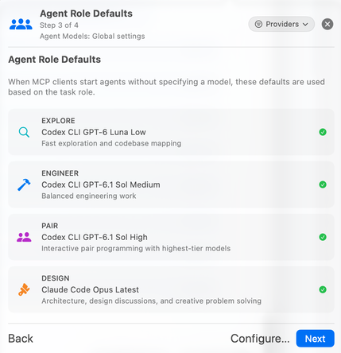
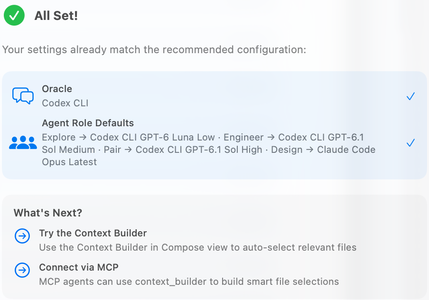
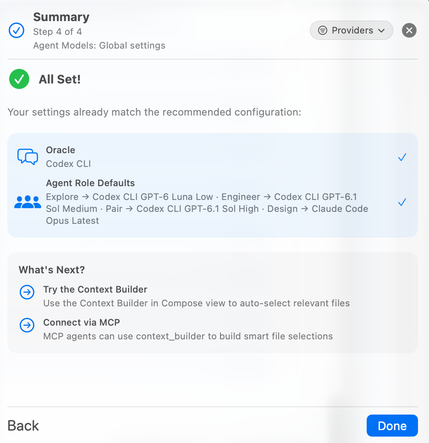
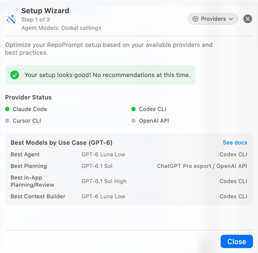

The Setup Wizard recommends a configuration based on your available providers and the app's best-practice profiles. It helps align Oracle models, Context Builder, MCP preset exposure, and sub-agent role defaults. It configures model choices; installing the external MCP client connection remains a separate step in [Setup Guide](./mcp-setup.mdx).

## Open the Wizard

Click the toolbar's lightbulb to open **Setup Wizard**. The neighboring server icon opens the MCP Server popover. A yellow lightbulb indicates active recommendations.

The intro lists recommendations, provider status, and a **Best Models by Use Case** reference. **Start Wizard** reviews the recommendations step by step. **Quick Apply All** applies eligible, unsatisfied recommendations that have not been muted.

The screenshots show particular models, connected providers, and a four-step walkthrough. They are examples from the captured build. Recommendations can change with the app's model catalog, provider availability, existing settings, and provider filter. The number and order of steps also vary: satisfied or muted recommendations can be omitted, while an available role-defaults review can still be shown.

## Check the Settings Scope

Read the **Agent Models** label near the heading and footer before applying a recommendation. **Global settings** means the workspace inherits the global Agent Models profile, so changes affect that profile. **Workspace — [name]** means the wizard targets that workspace's overrides. The wizard follows the effective Agent Models scope; it is not always creating workspace-local changes.

MCP preset exposure has its own global scope. A recommendation to hide or show presets changes what MCP can discover without deleting the saved presets. Use [Agent Models](../settings/agent-mode/agent-models.mdx) to inspect inheritance, workspace overrides, Oracle models, and role defaults.

## Choose Providers for Recommendations

Open **Providers** to choose which provider families the recommendation engine may consider. The screenshot includes Claude Code, Codex CLI, Cursor CLI, Grok Build, and OpenAI API. Unchecked providers are excluded from the next recommendation calculation.

Choose **Apply** to recompute recommendations using the selected set, or **Reset** to restore all providers. This filter shapes recommendations; it does not install a provider, authenticate an account, disconnect an integration, or change which provider a manually selected session can use. Provider readiness and the selection filter are separate facts.

## Review Context Builder

The Context Builder step shows a recommended agent, model, and explanation. Context Builder explores your codebase and selects files toward a context budget before the requested follow-up analysis. Its discovery model is distinct from the Oracle model used for a plan, review, or answer.

**Apply & Next** saves the recommendation to the displayed settings scope and advances. **Skip** advances without applying it. **Back** returns to an earlier step. The recommendation in the screenshot is not a model you must choose; configure a supported, authenticated provider that fits your account and task.

Change the discovery model later in [Agent Models](../settings/agent-mode/agent-models.mdx); question behavior and context budgets live in [Context Builder settings](../settings/agent-mode/context-builder.mdx).

## Skip or Mute a Recommendation

Skipping leaves the current settings as they are. To dismiss a recurring recommendation, open the step's overflow menu and choose **Mute this recommendation**. The intro also offers a dismissal control beside active recommendations. Muting suppresses that recommendation in the wizard; it does not apply the recommended value.

Muted differences can appear under **Dismissed Recommendations**, with **Restore** to make them eligible for review again. This is separate from **Show presets** in the MCP popover, which restores preset exposure.

## Review Agent Role Defaults

The role-defaults step shows the recommended CLI agent and model for each task label. External callers use these roles when launching agents without pinning an exact compound model target. The current `agent_run` contract resolves an omitted `model_id` through the `pair` role; clients can discover the authoritative role mappings with `agent_manage op="list_agents"` and its `task_labels` response.

| Role | Intended work |
| --- | --- |
| **Explore** | Fast exploration and codebase mapping. |
| **Engineer** | Balanced engineering work. |
| **Pair** | Interactive pair programming with a higher-capability model. |
| **Design** | Architecture, design discussion, and creative problem solving. |

Use **Configure…** to inspect or adjust the role configuration, then **Next** to continue. The model names shown are examples, not permanent defaults for every installation. An explicit model target from the live agent catalog can pin a different provider/model/effort combination.

## Summary and Next Steps

The Summary shows the resulting Oracle and role configuration, including settings that already matched. **All Set!** can therefore appear without applying a change during this walkthrough. Check the summary and choose **Done** to close it.

Try Context Builder from the Compose view to curate context, or connect an external client and invoke `context_builder` over MCP. Consult the [Tools Reference](./mcp-tools.mdx) for the current names and parameters rather than using tool names from older Classic guides.

## When No Recommendations Are Needed

If the effective configuration already matches the selected best-practice profile, the wizard can report **Your setup looks good!** and offer **Close**. Some builds present this as **Setup Status** with provider status, reference models, and any dismissed recommendations. It confirms the recommendation check; it does not prove that an external client is installed or connected.

Use the [MCP Server popover](./mcp-settings.mdx) to verify window access and connections, and [Setup Guide](./mcp-setup.mdx) to install the client integration.

