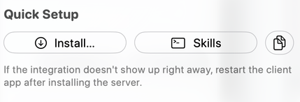

RepoPrompt's workflow instructions guide an external coding agent through a process: understanding a task, finding relevant code, planning, delegating, implementing, or reviewing. Commands such as `/rp-build` select those instructions; they are not additional MCP tools or server-enforced execution pipelines.

Depending on the installation target, the instructions are packaged as on-disk skills or prompt files. A **skill** is the discoverable package; the **workflow instructions** are the procedure it contains. The MCP connection supplies the tools that the procedure can request.

Install these separately from the MCP server configuration through **Quick Setup → Skills**. Then use your client's skill or slash-command picker to find commands such as `/rp-orchestrate`, `/rp-deep-plan`, and `/rp-build`. The picker and invocation syntax depend on the client; `/repo` is not a universal command that every integration provides.



## Installing workflow instructions

The **Skills** menu offers shared global or per-project `.agents/skills`, Claude Code integration, and RepoPrompt's isolated Codex prompts. Select the **MCP** variant when the agent uses native MCP tools, or the **CLI** variant when it calls `rpce-cli`. CLI variants use the corresponding `-cli` skill names (such as `/rp-orchestrate-cli` or `/rp-deep-plan-cli`). Install the CLI executable as well when choosing that variant.

| Menu Group and Option                            | Scope and Destination                                | Variant and Invocation                                                                         |
| ------------------------------------------------ | ---------------------------------------------------- | ---------------------------------------------------------------------------------------------- |
| **Shared (.agents/skills) → Global**             | `~/.agents/skills/<command>/SKILL.md`                | Shared convention for Codex CLI and compatible agents across all projects.                     |
| **Shared (.agents/skills) → Per-project**        | `<workspace_root>/.agents/skills/<command>/SKILL.md` | Installs in each loaded workspace folder for project-isolated workflows.                       |
| **Claude Code (.claude/commands) → Per-project** | `<workspace_root>/.claude/skills/<command>/SKILL.md` | Installs modern Claude Code skills in each loaded root and migrates legacy flat command files. |
| **RepoPrompt Codex (isolated prompts) → Global** | `~/.repoprompt/codex/prompts/<command>.md`           | Installs workflow prompts in RepoPrompt's isolated Codex environment.                          |

Each destination submenu offers **MCP skills**, **rpce-cli skills** (or the running build's CLI name), and **Uninstall**. The MCP variant instructs an agent to call RepoPrompt tools directly. The CLI variant instructs it to use the installed terminal command (`rpce-cli`). Choose the variant that matches how your client accesses RepoPrompt.

:::note[Skills and Agent Mode Workflows]

Installed workflow instructions, Agent Mode's workflow templates, and Copy/Chat Workflow Presets are distinct configuration surfaces. The server connection alone does not install the external instruction files. Use [Agent Workflows](../settings/agent-mode/agent-workflows.mdx) for the in-app Workflow picker and [Workflow Presets](../settings/prompting/workflow-presets.mdx) for copy and built-in chat packaging.

:::

## How Workflow Commands Work

The installed implementation, planning, review, and investigation workflow templates instruct the coding agent to use repository discovery, explore-agent delegation, and the appropriate Context Builder/Oracle calls. Their templates direct workflows such as `/rp-build` and `/rp-orchestrate` through steps like these:

1. **Workspace verification** — The agent verifies that the target repository is bound and loaded before initiating any planning or tool execution.
2. **Surface mapping & reconnaissance** — The agent contextualizes the prompt into actual codebase nouns, optionally fanning out parallel read-only `explore` agents for targeted reconnaissance.
3. **Context curation via Context Builder** — A specialized research model explores the codebase, selecting files within a token budget using full content for key files and codemaps for reference files.
4. **Analysis & specification** — An advanced analysis model receives the curated context and produces an architectural plan, review, or investigation report.
5. **Delegated execution or implementation** — The agent acts on the result: either directly implementing changes with `apply_edits` or orchestrating specialized sub-agents (`pair`, `engineer`, `design`) with clean context boundaries.

The intended separation keeps the coordinator focused while sub-agents or Context Builder handle the heavy reading. These are workflow instructions, not an MCP-enforced execution order: the host application and its coding agent control whether and in what order tools are invoked, subject to available tools and permissions.

## Available Commands

RepoPrompt installs a comprehensive suite of workflow commands. External agents discover these as slash commands matching their installed variant (`/rp-<name>` for MCP, `/rp-<name>-cli` for terminal CLI):

### 1. Orchestrate (`/rp-orchestrate`)

**Plan, decompose, and delegate complex tasks across multiple agents.**

```text
/rp-orchestrate <task>
```

- **Arguments:** `task` (required) — Description of the complex task to plan, decompose, and delegate.
- **Primary Roles:** Orchestrator (coordination), `pair` (default for complex multi-file work), `engineer` (clear/well-scoped items), `design` (UI, layout, polish, text), `explore` (narrow reconnaissance).
- **Core Philosophy:** The orchestrator coordinates, plans, and verifies; it does **not** implement code directly or perform deep reading itself. Sub-agents execute each work item in fresh context windows to prevent context exhaustion and hallucination.

**Workflow Phases:**

- **Phase 0: Workspace Verification** — Confirms the target codebase is loaded and identified before planning.
- **Phase 1: Contextualize the Task** — Translates user instructions into concrete codebase nouns (modules, filenames, patterns). Dispatches a narrow `explore` agent if ambiguous, then calls `context_builder` with `response_type: "plan"` and `export_response: true` to generate an architectural plan file.
- **Phase 2: Decompose into Work Items** — Breaks the plan into up to 5 discrete, ordered work items with explicit "done when" criteria, file boundaries, dependencies, and verification steps.
- **Phase 3: Dispatch (Verify-then-Dispatch Loop)** — Dispatches fresh sub-agents for each work item. Sub-agents read the exported plan file via `read_file` as read-only context. Alternatively, tightly coupled items can steer an existing agent. The orchestrator updates the plan file via `apply_edits` as items are completed.
- **Phase 4: Monitor and Verify** — Verifies each completed item against its acceptance criteria, runs tests, and produces a final rollup of completed work and known follow-ups.

---

### 2. Deep Plan (`/rp-deep-plan`)

**Deep planning workflow that produces a polished, ready-to-execute plan document without implementation.**

```text
/rp-deep-plan <topic>
```

- **Arguments:** `topic` (required) — Description of what to plan (feature, refactor, migration, redesign).
- **Sole Deliverable:** A polished, executable specification document at `docs/plans/<topic>-<YYYY-MM-DD>.md`.
- **Core Philosophy:** Strictly planning only. Explore agents map seams and external research; Context Builder generates the implementation specification baseline; a design agent performs an independent critique; the orchestrator retains authorial ownership, ensuring lossless consolidation and verified references.

**Workflow Phases:**

- **Phase 0: Workspace Verification** — Confirms workspace readiness.
- **Phase 1: User Involvement Decision (Required First Interactive Action)** — Uses `ask_user` to prompt the user for their preferred involvement level:
  - **Up front** — Grounded interview before broad exploration begins (pauses in Phase 1.5).
  - **Mid-flow** — Review the draft before the design agent critique (pauses in Phase 5).
  - **Hands-off** — Complete the full plan autonomously, then refine interactively (pauses in Phase 7).
    _(Note: If Up front or Mid-flow is chosen, a subsequent timeout on `ask_user` halts the run rather than guessing.)_
- **Phase 1.5: Grounded Interview** _(only if Up front)_ — Dispatches 1–2 narrow ambiguity scouts, then asks 2–4 code-grounded questions before proceeding.
- **Phase 2: Map the Seams** — Fans out parallel explore agents across three distinct lanes: in-workspace seams (always), external research (APIs/libraries/RFCs), and prior art (`docs/plans/`, commit history).
- **Phase 3: Scaffold the Plan File** — Creates `docs/plans/<topic>-<YYYY-MM-DD>.md` seeded with Goal, Background (distilled evidence), Open Questions, and References.
- **Phase 4: Context Builder Plan Pass** — Calls `context_builder` with `response_type: "plan"` and `export_response: true`. Builds a coverage ledger of all implementation-bearing facts, interfaces, error cases, and verification requirements.
- **Phase 5: Mid-flow Check-in** _(only if Mid-flow)_ — Pauses to ask 2–4 targeted draft ambiguity questions via `ask_user`.
- **Phase 6: Bounded Completeness and Design Critique** — Dispatches a `design` agent to evaluate the draft against the codebase and original Context Builder export, writing a focused review under `docs/reviews/`.
- **Phase 7: Fidelity-Preserving Editorial Polish** — Integrates critique findings, verifies every symbol/link/line reference, removes transcript narration, and ensures the document is directly executable.
- **Phase 7.5: Final Fidelity Check & Cleanup** — Walks the coverage ledger to confirm no supported detail was dropped, then safely deletes the temporary export file.

---

### 3. Optimize (`/rp-optimize`)

**Iterative performance optimization loop run as a delegation-first orchestration.**

```text
/rp-optimize <target>
```

- **Arguments:** `target` (required) — Metric, scope, and stop criterion (e.g., `"reduce p95 latency of PathMatcher.match under PathMatchingTests"`).
- **Core Philosophy:** Performance work only improves what can be measured. Gathers evidence outward from callers, inputs, and shared infrastructure; gates all instrumentation behind debug flags; preserves causality with one attributed change per serial loop; and records all runs in a persistent scoreboard.

**Workflow Phases:**

- **Phase 0: Workspace Verification** — Confirms the target repo is loaded.
- **Phase 1: Surface Mapping & Bottleneck Scouting** — Fans out parallel `explore` agents across five areas: bottleneck candidates around target callers and inputs, target & call graph, prior perf work (benchmarks/traces), conventions (sanctioned test/bench commands in AGENTS.md), and scope boundaries.
- **Phase 2: Plan Setup with Context Builder** — Runs `context_builder` (`response_type: "plan"`, `export_response: true`) to define the metric, debug-gated instrumentation strategy in a secondary support file, baseline procedure, ranked first-pass candidates, and the scoreboard scaffold.
- **Phase 3: Land Instrumentation & Baseline** — Dispatches a `pair` agent to land debug-only instrumentation, verify release builds strip it, take 3–5 baseline samples, and initialize `prompt-exports/optimize-<slug>-runs.md`.
- **Phase 4: The Optimization Loop (Serial)**:
  - **4a. Plan next optimization** — Uses Context Builder with the scoreboard in selection to plan one single change.
  - **4b. Dispatch optimize-and-harden** — Dispatches one `pair` agent to implement the change, run tests, re-measure, and append a new row to the scoreboard.
  - **4c. Verify via scoreboard** — Compares results against the variance band and confirms test passage.
  - **4d. Consult Oracle on next step** — Prompts the Oracle (`oracle_send` or `ask_oracle`) with the updated scoreboard to decide whether to continue or stop.
  - **Termination:** Exits when the Oracle signals diminishing returns, the target metric is met, or the hard 5-iteration cap is reached.
- **Phase 5: Final Rollup** — Summarizes starting vs. final metric deltas, landed optimizations, reverted attempts, and state of instrumentation.

---

### 4. Review (`/rp-review`)

**AI-powered code review combining Git diffs and branch comparisons with architectural codebase understanding.**

```text
/rp-review [scope]
```

- **Arguments:** `scope` (optional) — Comparison scope: `'uncommitted'` (default), `'staged'`, `'back:N'` (last N commits), or a branch/commit range like `'main...HEAD'`.
- **Core Philosophy:** Surface-level reviews catch typos; deep reviews catch subtle architectural regressions, security oversights, broken error paths, and API contract violations. Combines Git diff inspection with RepoPrompt's semantic context.

**Workflow Steps:**

- **Step 0: Verify Workspace** — Confirms the target repository window.
- **Step 1: Survey Changes** — Runs `git op="status"`, `git op="log"`, and `git op="diff" detail="files"` to inspect modified files and commit history.
- **Step 2: Determine Scope** — Infers or confirms the comparison target (e.g. comparing current branch against `main` or merge-base).
- **Step 3: Deep Review via Context Builder** — Calls `context_builder` with `response_type: "review"`, supplying diff files and comparison scope. Context Builder gathers relevant surrounding types and architecture, invoking the review model to evaluate correctness, security, breaking changes, and edge cases.
- **Step 4: Clarify Findings** — Optionally continues the conversation via `oracle_send` (or `ask_oracle`) in the returned chat session to explore remediation steps or investigate specific findings.

---

### 5. Refactor (`/rp-refactor`)

**Refactoring assistant that analyzes code organization, identifies duplication and complexity, and safely implements improvements.**

```text
/rp-refactor [target]
```

- **Arguments:** `target` (optional) — Files, directory, or module to analyze (e.g., `'Sources/Auth'`, `'the networking layer'`).
- **Core Philosophy:** Strictly preserves external behavior while improving readability, cohesion, and testability. Uses explore agents to scout before planning, and verifies tests after every individual change.

**Workflow Steps:**

- **Step 0: Verify Workspace** — Confirms repository binding.
- **Step 1: Scope & Analyze** — Dispatches parallel `explore` agents to map types, dependencies, and duplication across the target area, then runs `context_builder` with `response_type: "review"` informed by those findings.
- **Step 2: Plan** — Runs `context_builder` with `response_type: "plan"` and `export_response: true` to generate an incremental, risk-assessed refactoring plan.
- **Step 3: Decompose & Dispatch** — Breaks the refactoring plan into discrete work items and dispatches `pair` or `engineer` sub-agents to implement changes step by step.
- **Step 4: Verify** — Runs project tests after each step, spot-checks diffs for semantic preservation, and confirms that public API contracts remain unchanged.

---

### 6. Plan & Build (`/rp-build`)

**End-to-end implementation workflow for new features, bug fixes, and significant codebase additions.**

```text
/rp-build <task>
```

- **Arguments:** `task` (required) — Description of the feature or task to implement.
- **Core Philosophy:** Avoids shallow implementations by requiring orientation and deep context gathering before touching code. Context Builder generates the architectural blueprint; the agent then executes changes directly using RepoPrompt's editing tools.

**Workflow Phases:**

- **Phase 0: Workspace Verification** — Confirms workspace context.
- **Phase 1: Quick Scan** — Runs lightweight directory tree (`get_file_tree`) and targeted searches (`file_search`, `get_code_structure`) to map user instructions to exact codebase components.
- **Phase 2: Context Builder** — Calls `context_builder` with `response_type: "plan"` using the reformulated prompt. Context Builder curates full files and codemaps into context, returning an actionable implementation plan.
- **Phase 3: Consult Oracle (Optional)** — If the plan leaves concrete ambiguities, consults the Oracle (`oracle_send`) to resolve specific questions before editing.
- **Phase 4: Implement Directly** — Applies changes iteratively using `apply_edits` (single search/replace, edits array, or full rewrite) and `file_actions`, verifying results against diff previews and running relevant unit tests.

---

### 7. Investigate (`/rp-investigate`)

**Systematic, hypothesis-driven bug and root-cause investigation.**

```text
/rp-investigate <issue>
```

- **Arguments:** `issue` (required) — Description of the bug, crash, regression, or research topic.
- **Core Philosophy:** Read-only source inspection, with findings, traces, and hypotheses written to an investigation report. The current template explicitly prohibits source-code changes; it gathers concrete evidence before forming conclusions and separates external fact-finding from workspace context.

**Workflow Phases:**

- **Phase 0: Workspace Verification** — Confirms workspace readiness.
- **Phase 1: Initial Assessment & Triage** — Reads error logs, crash reports, or issue descriptions, forms initial hypotheses, and creates `docs/investigations/<topic>-<YYYY-MM-DD>.md`.
- **Phase 1.5: External Fact-Gathering** _(conditional)_ — Dispatches parallel `explore` agents for facts outside the workspace (git history/blame archaeology, web searches, external documentation), recording results in `## Background / Prior Research`.
- **Phase 2: Broad Context Gathering** — Runs `context_builder` with instructions referencing the investigation report to discover relevant source files and populate context.
- **Phase 3: Deep Investigation** — Dispatches a `pair` investigator to trace code paths, test hypotheses, and record concrete findings under `## Investigator Findings`.
- **Phase 4: Selection Curation & Oracle Synthesis** — Curates the file selection to include newly surfaced files and line slices, then calls Oracle (`oracle_send` or `ask_oracle`) to synthesize cross-component insights.
- **Phase 5: Final Report Synthesis** — Finalizes the report with confirmed root causes, supporting line-level evidence, and proposed remediation steps.

---

### 8. ChatGPT Export (`/rp-oracle-export`)

**Builds optimized codebase context and exports a self-contained, ChatGPT-ready prompt file.**

```text
/rp-oracle-export <problem>
```

- **Arguments:** `problem` (required) — Description of the question, plan, or review to export.
- **Core Philosophy:** Extracts the real underlying task, selects the optimal files within token limits, and exports a clean markdown prompt to `prompt-exports/` ready to be copied into ChatGPT or other external models for a second opinion.

**Workflow Steps:**

- **Step 0: Workspace Verification** — Confirms repository context.
- **Step 1: Determine Intent & Scope** — Classifies the prompt intent into **Question** (specific bounded query), **Plan** (architectural/design problem without diffs), or **Review** (git diff / branch comparison).
- **Step 2: Choose Context Path** —
  - _Fast Path_: Used only when the scope is already tiny, concrete, and file-local.
  - _Deep Path (Default)_: Uses `context_builder` with `response_type: "clarify"` to curate optimal full files, slices, and codemaps within token budgets.
- **Step 3: Review and Export** — Verifies prompt text and token counts with `workspace_context`, then exports a unique markdown prompt file under `prompt-exports/<slug>-export.md`.

---

### Utility & Helper Commands

#### Tools Reminder (`/rp-reminder`)

A token-efficient prompt (available as `/rp-reminder` or `/rp-reminder-cli`) that reminds agents to use RepoPrompt's specialized MCP tools (`file_search`, `read_file`, `get_file_tree`, `get_code_structure`, `apply_edits`, `file_actions`, `git`, `manage_selection`, `workspace_context`, `context_builder`, `oracle_send`, `ask_user`, `agent_run`, `agent_manage`) instead of generic shell commands like `grep`, `cat`, `sed`, `find`, or `ls`.

| Task                         | Recommended MCP Tool | Avoid Shell Alternatives         |
| ---------------------------- | -------------------- | -------------------------------- |
| Search paths/content         | `file_search`        | `grep`, `find`, `Glob`           |
| Read file (whole or sliced)  | `read_file`          | `cat`, `head`, `tail`            |
| Project directory tree       | `get_file_tree`      | `tree`, `ls -R`                  |
| Code signatures & structure  | `get_code_structure` | Reading entire source files      |
| Edit file contents           | `apply_edits`        | `sed`, custom rewrite scripts    |
| Create / move / delete files | `file_actions`       | `touch`, `mv`, `rm`              |
| Git status / diff / blame    | `git`                | Shelling out to raw git commands |

---

## Context Builder Response Types

The workflow commands above leverage the `context_builder` MCP tool. You can also invoke Context Builder directly with different response types:

- **`clarify`** _(default)_ — Builds curated file context only. Returns selected files, slices, and codemaps without running follow-up analysis.
- **`plan`** — Generates a comprehensive architectural and implementation plan grounded in actual codebase patterns.
- **`question`** — Answers complex architectural or code questions using deep contextual understanding.
- **`review`** — Generates an in-depth code review evaluated against Git diffs and surrounding system architecture.

Use `export_response: true` on any analysis response type (`plan`, `question`, `review`) to write the generated response to a shareable markdown file. The returned `oracle_export_path` and `oracle_export_instruction` allow seamless hand-off to child agents or persistent project records.

## Git Integration

The `git` tool provides safe, token-efficient git operations for MCP agents: `status`, `diff`, `log`, `show`, `blame`, and snapshot diff artifacts. It also natively supports Jujutsu (`jj`) repositories.

For complete tool arguments, comparison specs, and worktree options, see the [Git reference](./mcp-tools.mdx#git).

## Custom Skills

Beyond the supplied workflow commands, you can write your own workflow instructions and package them as skills for a compatible external host to discover. The instructions can describe specialized testing, migrations, or project-specific procedures; the host determines how they are invoked and followed.

Learn how to create and install custom skills in [Skills & Slash Commands](../agent-mode/skills.mdx).

:::tip[Getting Started]

After setting up the MCP connection, open your client’s skill or slash-command picker to discover the installed commands. For more detail on each workflow and the Context Builder pipeline, see [Agent Mode Workflow Commands](../agent-mode/workflows.mdx).

:::
