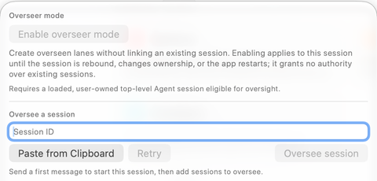

Link existing sessions when work is already underway and you want one agent to coordinate it. The direction matters: an **overseer** receives authority over an **overseen session**. Linking A to oversee B does not automatically make B an overseer of A.

## Link from the composer

1. Open the intended overseer's session and its oversight popover. Start a first message if the session is still an empty composer.
2. In the target session's sidebar controls, copy its **Session ID**.
3. Return to the overseer and enter that ID under **Oversee a session**, or choose **Paste from Clipboard**.
4. Inspect the target preview. Choose **Retry** if the session has just loaded and availability needs refreshing.
5. Choose **Oversee session**, read the confirmation naming both conversations, and choose **Allow oversight** only for the intended relationship.

The sidebar also offers **Oversee** and **Link overseer** entry points. **Oversee** chooses which session the current row will oversee; **Link overseer** chooses who will oversee that row. Session-ID sheets support selecting a session that is not convenient to find in the visible list.

## Understand the confirmation

The confirmation explains that the overseer can read the target's status and conversation, send instructions, steer or stop its run, answer questions and eligible one-time approval requests, compact context, and receive updates. This is active coordination, so link conversations whose work you intend the overseer to direct.

**Don't ask again** suppresses repeated confirmation dialogs after an accepted choice. It does not expand the relationship to every session or bypass runtime eligibility. Session-wide approvals, hook trust, merge reviews, and secret inputs remain your responsibility.

Not every session is eligible. An unavailable candidate can be loading, closing, controlled by another agent, or otherwise unsuitable for the requested role. Follow the displayed reason. **Sessions changed. Please choose again.** means the selection is stale; choose the target again rather than assuming the old preview is still valid.

## Read relationship marks

The sidebar uses a filled eye for an overseer, an outline eye for an overseen session, and a combined mark when a session has both roles. Tooltips name the relationships: **Overseeing**, **Overseen by**, and, for lanes, **Created by**. The popover also lists outbound and inbound relationships so you can inspect who controls whom.

Saved relationship information can be restored when the relevant sessions are available, but the live dashboard determines what can currently be used. Check **Unavailable** rows, saving warnings, and recovery notices after reopening workspaces or restarting the app.

## Unlink and recover

Use **Unlink** from either end to revoke the relationship. Unlinking does not delete the conversation, roll back file changes, or automatically cancel a turn already in progress. Inspect any running task separately if it should stop.

The popover can offer a short-lived **Undo** for the most recent unlink. Read its result: the original relationship must still be eligible. Closing the popover or another unlink can end that recovery opportunity.

Turning off routine Auto-wake does not revoke access or block every explicit attention request. Unlink when the purpose of the relationship has ended. See [Best Practices](./best-practices.mdx) for wake behavior and coordination limits.
