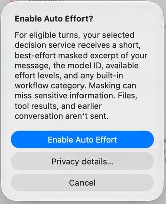
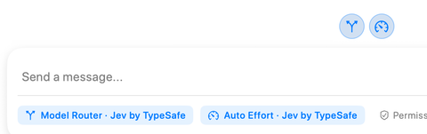

**Auto Effort** is the gauge control above the message editor. It chooses reasoning effort before an eligible user turn while keeping the model you selected. Use it when you want effort to respond to the task rather than manually choosing a level for every message.

Choose **Enable Auto Effort** after reviewing the disclosure. **Privacy details…** opens its settings; **Cancel** leaves it disabled. The highlighted composer label identifies the decision service, such as **Auto Effort · Jev by TypeSafe**. Newer builds let Auto Effort and Model Router use independently selected services.

## Which turns are eligible?

The selected supported model must be explicit and advertise multiple effort levels. Auto Effort can apply to an eligible first launch and to follow-up messages sent after the previous turn has settled. Model aliases, default selections, and custom workflows keep manual effort.

A start already handled by Model Router retains the effort chosen by routing. Steering an agent while it is already working does not change effort mid-turn. Effort is held through that turn's tool calls. Auto Effort can be enabled independently of Model Router.

## Understand feedback and fallback

While a decision is being made, the control can show a busy state. After a service choice, its tooltip reports the chosen effort; directional feedback compares service choices or the initial selected effort. It does not prove that every intervening message used that effort.

If the service cannot make a valid decision, RepoPrompt uses the manual effort. You can turn Auto Effort off and select effort directly through [Model and Effort](./model-and-effort.mdx). Different effort choices can affect latency, usage, and provider caching; savings are not guaranteed.

## What the service receives

For each eligible turn, the service receives a short, best-effort-masked excerpt of the message, model ID, supported effort choices, and any built-in workflow category. The workflow template body, attached files, tool output, and earlier conversation are not added. Masking can miss private information in your message.

Review the service's privacy details before enabling it. For service configuration, manual fallback, and eligibility details, see [Auto effort settings](../settings/router/model-router.mdx#auto-effort).
