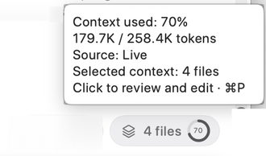
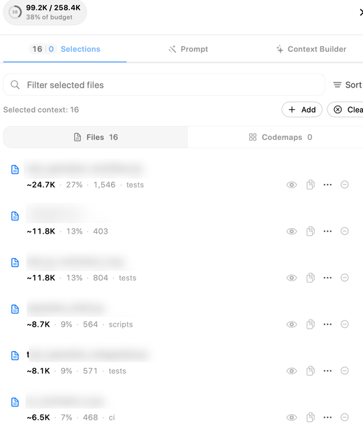
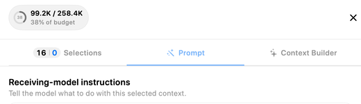
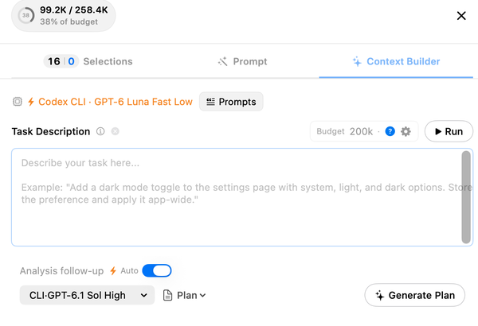

Open the files/stack control at the right of the composer toolbar to review context. Its file count describes the selection, while the usage ring describes context consumption. Hover for the token count, percentage, and source. **Source: Live** identifies live usage information; it is not simply the sum of the selected files. **⌘P** opens the Context Composer by default.

## Selections: inspect what is included

The drawer's **Selections** tab lists selected files and Code Maps separately. Filter the selection, change **Sort**, use **Add** for more context, or **Clear** to remove the selection. Each row reports size information and offers preview, copy, additional actions, and removal. Inspect large entries when you want to reduce the package or keep the agent focused.

Selected context is useful preparation, but it is not an access-control boundary: an agent with repository tools can discover other files permitted by its tools and permissions. Use narrower instructions and the appropriate permission policy when you need to constrain work.

## Prompt: tell the receiving model what to do

The **Prompt** tab contains **Receiving-model instructions** for the selected context. Use it to specify the question, scope, constraints, or expected result for the model receiving that package. This is distinct from the Context Builder's discovery task.

The drawer can also expose prompt-packaging controls for stored prompts, the file tree, Code Maps, and Git context. Review those before copying or exporting a package; different presets can change its contents and size.

## Context Builder: discover relevant code

Choose the **Context Builder** tab. The top line identifies the discovery agent and model. **Prompts** selects additional discovery instructions. In **Task Description**, explain the task and known constraints; let the agent find the relevant code rather than preselecting the whole repository.

**Budget** sets the target size for the package. The help and settings controls explain or adjust the related configuration. Choose **Run** to start discovery. The agent explores the codebase, builds a selection toward that budget, and can improve the prepared prompt according to your settings. A budget is a target for useful context, not a promise that every relevant file will fit.

## Optional analysis follow-up

**Analysis follow-up → Auto** can run the selected plan, review, or question after discovery. Choose the analysis model and response type independently of the discovery model. The action button, such as **Generate Plan**, identifies the analysis you can request using the prepared context.

Review the resulting selection and answer before using them for implementation. Discovery and analysis can consume separate provider usage. Configure budgets, rewriting behavior, clarification, and follow-up defaults in [Context Builder settings](../settings/agent-mode/context-builder.mdx); choose the discovery runtime in [Agent Models](../settings/agent-mode/agent-models.mdx).
