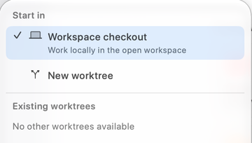

The execution-location control sits at the left of the toolbar above the message editor. It usually begins as **Work locally**. This is the filesystem location where the session's agent works, including its repository reads, edits, and shell commands within the applicable permissions.

## Choose where to start

Open the control to see **Start in**. Select a location before sending the first message:

| Choice | Use it for |
| --- | --- |
| **Workspace checkout** | Work directly in the checkout already open in the workspace. Edits appear alongside your existing local work. |
| **New worktree** | Give the task a separate Git checkout, useful for parallel implementation or an alternative approach. |
| **Existing worktrees** | Continue in an already-created checkout. Read the branch, worktree name, and path before choosing. |

The screenshot's **No other worktrees available** is an empty state. When worktrees are available, the list identifies them by branch or detached commit and directory. Unusable, prunable entries cannot be selected. A worktree requires a suitable Git repository; a plain folder does not acquire Git isolation merely because you choose a workflow.

Your initial worktree selection is prepared when you first send. Check the location indicator and any creation error before assuming the task has started in a new directory. For repository setup and local file copying, see [Worktrees](../worktrees/overview.mdx).

## Keep parallel tasks from colliding

Two sessions in **Workspace checkout** can edit the same files. Their conversation histories are separate, but their working directory is shared. Use different worktrees for tasks that may touch overlapping files, then review and integrate their changes deliberately.

A worktree separates repository files; it does not change the provider's permissions or automatically isolate databases, remote services, or other resources the agent can access. Configure [Tools and permissions](./tools.mdx) for the intended task.

## Change an existing session's location

After a session starts, the menu is labeled **Execution location** and the toolbar can show its bound checkout. Changing it restarts the agent's provider context. If a run is active, RepoPrompt asks you to confirm stopping it; the in-flight request is not replayed automatically. An idle session can also lose some conversational continuity when its provider context restarts.

Finish or stop the current task, review its changes, and decide which checkout should receive the next message. Read the confirmation before proceeding. Switching the visible workspace tab is not a substitute for changing a session's execution binding.

Once the location is correct, select a [Workflow Template](./workflow-templates.mdx) and describe the task.
