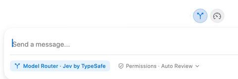

**Model Router** is the branching-arrow control above the message editor. Enable it when you want RepoPrompt to choose a suitable execution model for a new task using your connected providers, routing settings, and the task description. Routing chooses the model and then its initial reasoning effort.

## Read the composer state

An enabled control is highlighted, and the composer can show **Model Router · [service]** where the ordinary model choice would appear. In the screenshot the service is **Jev by TypeSafe**. Click the service label to open routing settings. If the service is unavailable, the control directs you to configuration.

Configure and verify the decision service and connect an eligible execution provider before enabling routing. The decision service chooses among execution models; it is not itself the coding agent that edits your repository. Available candidates depend on provider connections, model support, and routing configuration.

## New tasks and existing sessions

The Router switch is global and stays enabled across sessions until you turn it off. It applies to new primary sessions and eligible RepoPrompt-managed sub-agents. It does not replace an established session's model on every follow-up. Explicit model pins in agent launches remain respected.

If routing fails or yields no valid choice, the task continues with the current selection or applicable role default. Local usage balancing can adjust a recommendation to a comparable eligible model. Paid Fast variants require separate eligibility settings; the router does not make those costs disappear.

## Review information sent for a decision

Routing sends a short task excerpt, custom routing guidance, role references, and descriptions of candidate models and effort levels to the selected service. RepoPrompt attempts to mask sensitive text, but masking is best effort. Attached files, repository context, chat history, tool results, and execution-provider credentials are not automatically included. Sensitive information typed directly into the task or guidance can still be shared.

The full task is then sent to the chosen execution agent. Review service privacy details and disable routing for tasks you do not want excerpted to that service.

See [Routing settings](../settings/router/model-router.mdx) for service verification, available models, usage balancing, Fast-tier eligibility, and guidance. [Auto Effort](./auto-effort.mdx) makes a narrower decision for eligible turns on a model you selected.
