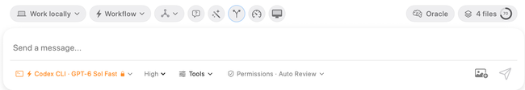

**Oracle** is the brain-shaped control above the message editor. It opens Oracle conversations associated with the current context so you can inspect the reasoning model's questions, plans, reviews, and answers. Use Oracle when the executing agent would benefit from a second perspective or a model with different strengths.

For an introduction to its role and when to use it, read [What Is an Oracle?](../faq/what-is-an-oracle.mdx).

## Execution agent and Oracle

The execution agent continues to own the coding task: it searches, edits, runs tools, and responds to your instructions. Oracle is a consultation that receives its prepared context and returns analysis. Consulting Oracle does not automatically replace the model shown below the message editor or apply its suggested changes.

Choose the primary Oracle and up to four additional Oracles in [Agent Models](../settings/agent-mode/agent-models.mdx). A grouped request runs those models independently and keeps their results separate in roster order. The control can display **Oracles · 2**, for example, when multiple Oracles are configured or represented in the current grouped consultation. A displayed count is not a count of coding agents editing your files.

## Open and review consultations

Click **Oracle** to inspect the relevant conversation. Oracle consultations can be created by a workflow, a direct agent request, or a Context Builder analysis follow-up. The popover favors conversations associated with the current agent session so results remain connected to the task you are viewing.

Read each model's result when a consultation has several lanes. They can disagree or focus on different risks. Bring the useful conclusions back into the coding task with a clear follow-up rather than assuming every suggestion should be implemented. Where offered, **Copy All** collects a grouped consultation's results for reuse.

## Supply useful context

Oracle's answer depends on the context assembled for the consultation. Check selected files, relevant Code Maps, instructions, and any requested Git diff. For a review, identify which changes should be inspected; for a plan, state constraints and the intended outcome.

[Context Builder](./context-builder.mdx) can discover files first and then generate a plan, review, or answer using Oracle. Its discovery model is configured separately from the Oracle roster. External clients can use exposed [Oracle Model Presets](../settings/mcp-server/model-presets.mdx) to select named consultation configurations.

For tool-level send, continuation, model-selection, and export behavior, see [Oracle tools](../mcp-server/mcp-tools.mdx#oracle--model-tools).
