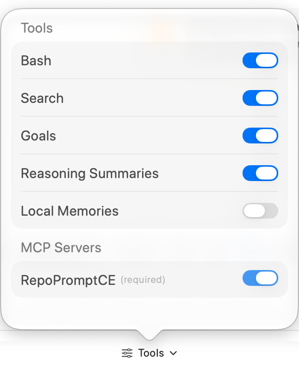
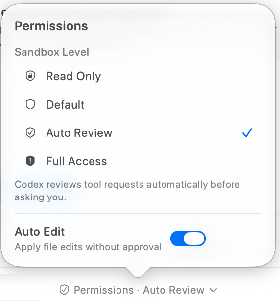

The **Tools** menu below the editor controls capabilities offered to the selected execution provider. It is useful when you want to constrain shell access, adjust provider features, or decide which configured MCP servers the session may use. The available switches depend on the provider.

## Codex controls in the screenshot

| Control | Effect |
| --- | --- |
| **Bash** | Permits Codex shell commands under the selected permission level. |
| **Search** | Permits Codex's built-in search capability. RepoPrompt's own repository tools have separate MCP availability controls. |
| **Goals** | Enables Codex goal support for continuing tasks. |
| **Reasoning Summaries** | Controls whether Codex supplies reasoning summaries in Agent Mode; it does not select reasoning effort. |
| **Local Memories** | Allows Codex to generate and reuse local memories across chats. Background or startup generation can consume quota; a new or restarted session may be needed. |
| **MCP Servers** | Enables individual servers from RepoPrompt's isolated Codex configuration. **RepoPromptCE** is required and cannot be disabled here. |

Tool settings are locked during an active Codex run. If a setting is unavailable, wait for the turn to finish or stop it deliberately before changing the configuration. Other providers expose different controls; [CLI Providers](../settings/agent-mode/cli-providers.mdx) describes their runtime options.

## Choose permission behavior

Open **Permissions** beside Tools to inspect the current provider's approval mode. For Codex, the pictured choices are **Read Only**, **Default**, **Auto Review**, and **Full Access**. Auto Review evaluates tool requests automatically before asking you. Full Access removes the normal provider sandbox restriction and per-request tool approval prompts; separate RepoPrompt edit reviews, hook-trust decisions, and worktree merge reviews can still apply.

**Auto Edit** applies file edits without a separate edit approval. It is distinct from a tool being available and from the provider's sandbox or approval policy. Read the current labels and explanation instead of assuming an enabled Tools switch approves every operation.

For the actual decision cards, including rejection reasons and remembered approvals, see [Approvals and Paused Sessions](./approvals.mdx).

## RepoPrompt tools and sub-agents

[Settings → MCP Server → Tools](../settings/mcp-server/tools.mdx) controls which RepoPrompt tools are advertised. Window access, individual tool availability, and operation-specific checks still apply. Consult the [MCP Tools Reference](../mcp-server/mcp-tools.mdx) for those tools' behavior.

Sub-agents launched through MCP have a separate policy under [Agent Permissions → Sub-Agents](../settings/agent-mode/agent-permissions.mdx#sub-agents). Changing the current direct session's permission level does not by itself establish the policy for every child or overseen session.
