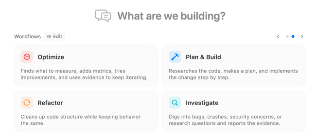
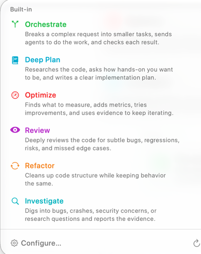

A workflow template gives the agent a method for handling your request. You provide the task; the template supplies instructions about research, planning, delegation, implementation, or review. Choose a workflow when you want that structure without writing the full procedure yourself.

## Choose from the welcome screen

On an empty session, select a card under **What are we building?**. The selected card prepares the next message and focuses the editor. Selecting it again clears that choice. Use the arrows or page dots to browse more cards; the cards reflect your visible workflows and featured choices.

## Choose from the Workflow selector

Open the lightning-bolt **Workflow** control above the editor. This selector offers the workflow catalog while you compose, including custom workflows you have added. The name and short description help you choose a method before sending. **Configure…** and the welcome screen's **Edit** control open workflow configuration; the refresh control reloads the available definitions.

| Template | What it asks the agent to do |
| --- | --- |
| **Orchestrate** | Break a complex request into tasks, delegate work, and check the results. |
| **Deep Plan** | Research the code, establish how involved you want to be, and produce a detailed implementation plan. |
| **Optimize** | Establish measurements, instrument the relevant behavior, and iterate using evidence. |
| **Plan & Build** | Research the request, plan the change, and implement it step by step. |
| **Review** | Examine code for bugs, regressions, risks, and missed edge cases. |
| **Refactor** | Improve code structure while preserving its intended behavior. |
| **Investigate** | Research a bug, crash, security concern, or question and report supporting evidence. |
| **ChatGPT Export** | Assemble code and context into a prompt you can take to ChatGPT. |

The list depends on visibility settings; a hidden built-in template remains configurable. See [Agent Workflows settings](../settings/agent-mode/agent-workflows.mdx) to show, hide, feature, reorder, or clone templates and create custom Markdown workflows.

## Send the request through the template

Select the template, then write a specific request: “Review the checkout changes for cancellation bugs; focus on session cleanup” is more useful than “Review.” Choose the [execution location](./execution-location.mdx), check the model and permissions, and send. RepoPrompt wraps the message in the selected template and clears the selection after accepting the submission. Select another template when a later message needs a different method.

Templates are instructions to an agent, so the actual work depends on the task, connected models, tools, and permissions. Selecting **Orchestrate** does not itself start other sessions, and selecting **Review** does not grant additional repository access.

These Agent Mode templates are configured separately from [Copy/Chat Workflow Presets](../settings/prompting/workflow-presets.mdx) and external [Skills & Slash Commands](../agent-mode/skills.mdx). For longer explanations of built-in procedures, see [Agent Mode Workflow Commands](../agent-mode/workflows.mdx).
