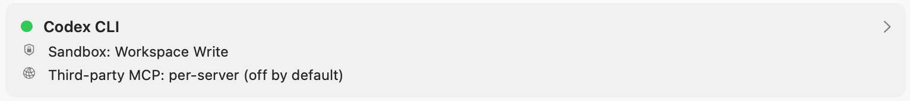
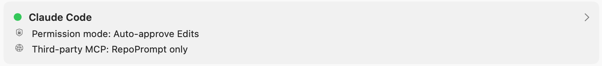
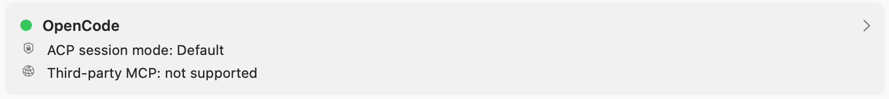
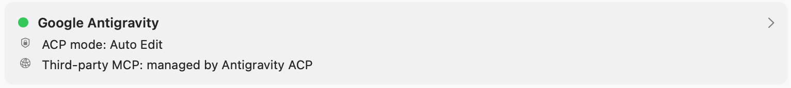
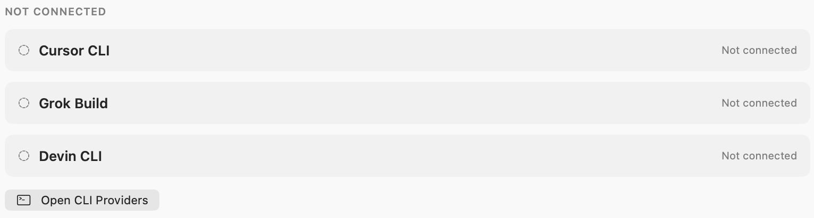
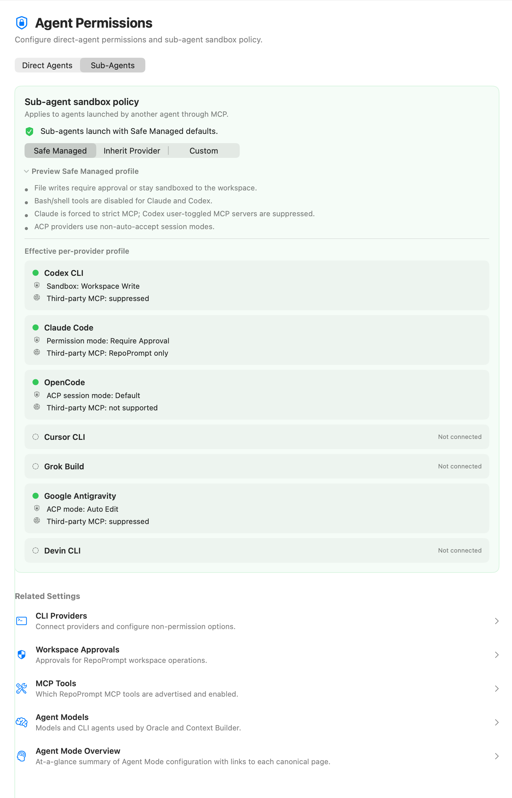
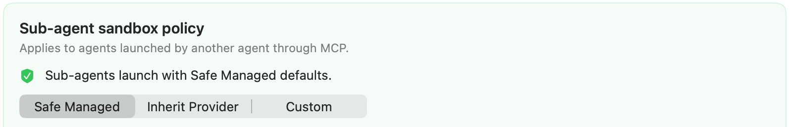
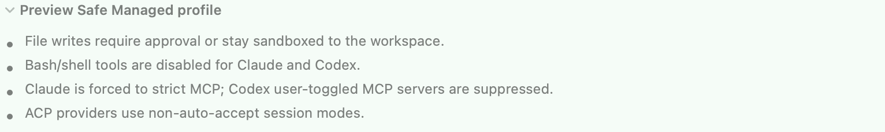
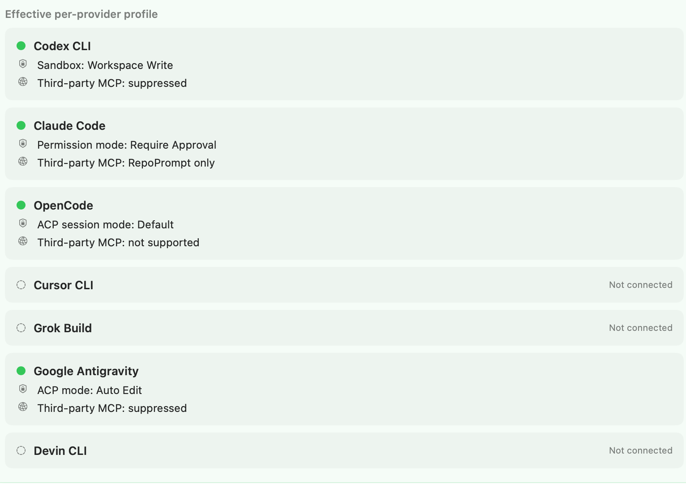
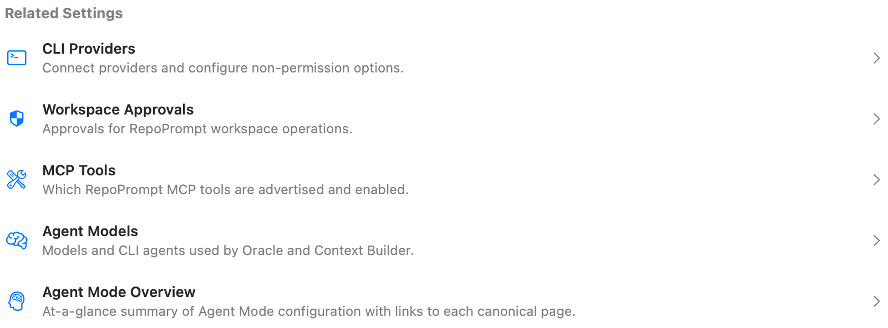

Configure permissions for agents launched directly from RepoPrompt and the separate policy for sub-agents launched through MCP. Sub-agent policy can use Safe Managed behavior, inherit direct-agent settings, or use custom settings.

Open **Settings → Agent Mode → Agent Permissions**. The page has two tabs with separate responsibilities: **Direct Agents** and **Sub-Agents**. Model selection remains in [Agent Models](./agent-models.mdx).

## Direct Agents

This tab configures provider-native permissions for agents you launch directly from RepoPrompt. Expand a connected provider row to change its permission level and, where supported, **Tools & Runtime Options**.

Connection indicators and summary values describe your current setup. A green indicator means the provider is available; it does not mean it has unrestricted access.

### Codex CLI

The row summarizes the sandbox and third-party MCP policy. Expand it for Codex permission levels and runtime tool controls. Third-party MCP servers are controlled individually and are off by default; that control is separate from the RepoPrompt MCP tool list.

### Claude Code

The summary shows the selected Claude permission mode and MCP scope. Expand it to configure Claude's provider permissions and tool/runtime settings. **Auto-approve Edits** and **RepoPrompt only** are the selections pictured, not a recommendation to enable broader access.

### OpenCode and Google Antigravity

These rows expose each provider's ACP session mode. The provider's capabilities determine which permission and tool controls are available. The screenshot reports no third-party MCP support for OpenCode and provider-managed MCP for Antigravity; do not assume the same MCP controls apply to both.

### Disconnected providers

Unavailable providers are listed under **Not connected** and cannot be expanded for editing. **Open CLI Providers** opens connection setup. A provider moves into the connected list when it becomes available.

## Sub-Agents

View the complete Sub-Agents tab

This policy applies when another agent launches a sub-agent through MCP:

| Policy | Behavior |
| --- | --- |
| **Safe Managed** | Applies RepoPrompt's managed provider profiles instead of the direct-agent settings. |
| **Inherit Provider** | Uses the direct-agent provider settings, including permissive modes you enabled there. |
| **Custom** | Uses independent per-provider sub-agent permission levels. |

Custom mode exposes **Per-provider sub-agent modes**. These affect future sub-agent launches without changing Direct Agents settings. Inherit Provider can pass through Full Access; review direct-agent settings before choosing it.

### Preview Safe Managed profile

The preview explains the policy and shows an effective profile for each available provider.

:::note[The captured policy differs from the current source]

The screenshot says shell tools are disabled for both Claude and Codex. The current implementation disables Claude Bash but **enables Codex Bash**, using Codex's managed Auto Review sandbox/approval profile. It still forces Claude to strict MCP and suppresses user-enabled third-party MCP servers for Codex.

Current source also notes a Grok Build exception: MCP launches use its Default mode, and its own rules, including inherited Claude Code permission rules, can allow requests without asking RepoPrompt. Safe Managed does not guarantee an approval prompt for every provider action.

:::

### Effective per-provider profile

Read these summaries for the active build and connected providers. They show the resulting sandbox or permission mode and third-party MCP handling. The rows are a preview of policy, not a second set of editable Direct Agents settings.

## Related settings and storage

- [CLI Providers](./cli-providers.mdx) configures connections and other runtime options.
- [Workspace Approvals](../mcp-server/workspace-approvals.mdx) controls requests that change RepoPrompt workspace records.
- [MCP Tools](../mcp-server/tools.mdx) controls tool availability.
- [Agent Mode Overview](./overview.mdx) summarizes the wider setup.

Both tabs share secure-permission storage diagnostics. If a degraded-storage banner appears, check it before assuming a permission change was saved; failed writes can return to the effective stored value.

