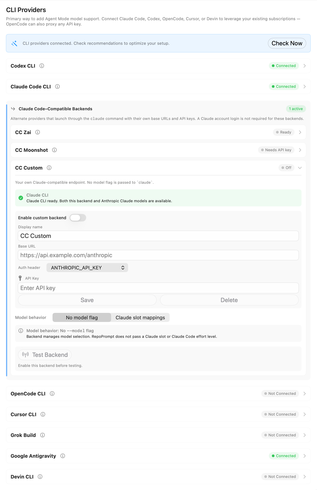
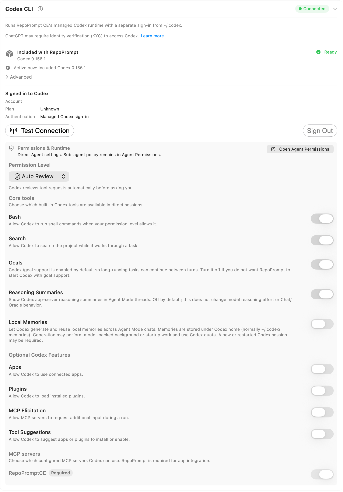
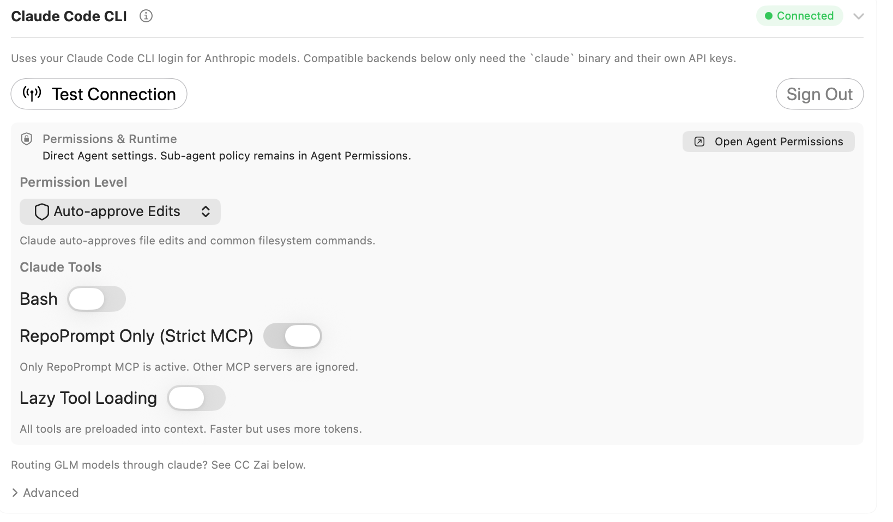
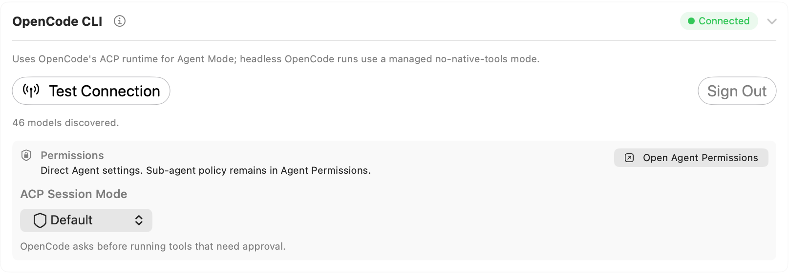
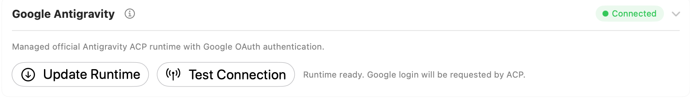
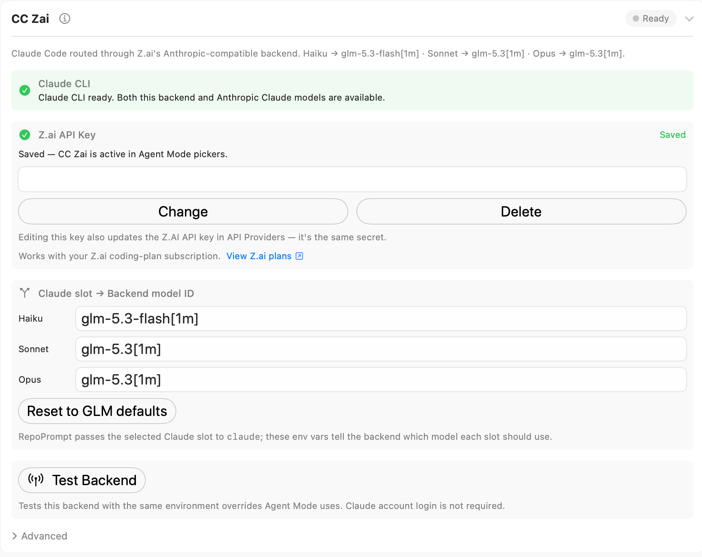
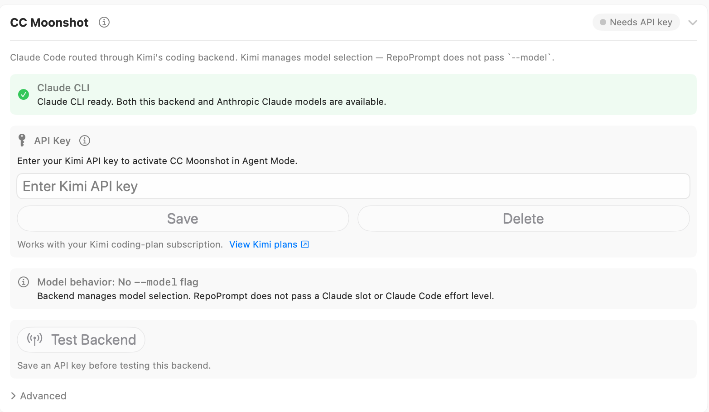
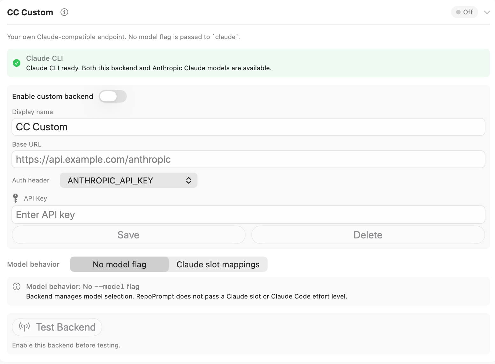

<div className="settings-reference">


<div className="settings-intro settings-panel-intro">



<div>

Connect coding-agent runtimes and configure their authentication, permissions, tools, and compatible backends.

</div>

</div>

Open **Settings → Agent Mode → CLI Providers**. Expand a provider’s row to see its available controls. The information button opens the provider’s website or documentation. Controls change with runtime availability and connection state. Screenshots illustrate the controls; the selections shown are examples rather than recommended defaults.

:::note[Historical Screenshot Note]

The overview screenshot (`cli-providers.png`) is a historical capture that may not reflect the expanded details or latest layout for newer provider integrations such as **Grok Build** and **OpenCode CLI**. Refer to the dedicated [OpenCode CLI](#opencode-cli) and [Grok Build](#grok-build) sections below for complete setup, authentication, and permission controls.

:::

## Connection and setup controls

**Connect** checks whether RepoPrompt can use a provider. For providers with an established connection, **Test Connection** checks it again. Errors appear in the provider card or a result dialog. Where available, **Save Trace to Downloads** exports a diagnostic trace after a failed test.

Status badges distinguish connection or installation availability from backend configuration. Compatible backends may be **Off**, need an **API key**, or be **Ready**; use **Test Backend** to check the configured route rather than treating readiness as a successful request.

The **Check Now** banner opens setup recommendations when the app has connected CLI providers. It is separate from the individual connection tests.

:::note[Direct agents and sub-agents]

The inline **Permissions** or **Permissions & Runtime** controls apply to agents launched directly from RepoPrompt. **Open Agent Permissions** takes you to [Agent Permissions](./agent-permissions.mdx), where MCP-launched sub-agent policy is configured separately.

:::

## Codex CLI

Provider reference: [Codex CLI](../../providers/codex-cli.mdx).



RepoPrompt uses a managed Codex runtime and a managed sign-in separate from your ordinary `~/.codex` sign-in.

### Runtime and sign-in

- **Included with RepoPrompt** shows the bundled runtime’s version and availability. The active-runtime summary identifies what this app launch is using.
- Under **Advanced**, open the runtime menu and select a detected executable, or choose **Choose…** to select a custom Codex executable. RepoPrompt checks its version and reports availability or compatibility problems.
- In the same runtime menu, select **Included Codex [version]** to switch the pending choice back to the bundled runtime.
- **Connect** checks the selected runtime’s connection. When sign-in is needed, use **Login with ChatGPT** or **Use device code instead**. The device-code flow provides **Copy code** and **Open verification page**; keep the panel open while completing the browser step.
- After authentication, the account summary shows account, plan, and authentication information. **Test Connection** checks the integration again.
- **Sign Out** requires confirmation to stop Codex sessions and sign out of the managed account.

:::note[Runtime changes require relaunch]

Runtime selection takes effect on the next RepoPrompt launch, when the model list is refreshed. Saved model choices are preserved. Custom executables are not managed or verified by RepoPrompt and may be incompatible with its integration; the version check does not guarantee full compatibility.

:::

### Permission Level

- **Read Only** uses a read-only sandbox with approvals requested when needed.
- **Default** allows workspace writes and asks you for approvals when needed.
- **Auto Review** allows workspace writes and uses automatic review of tool requests before asking you.
- **Full Access** removes the sandbox restriction and runs without approval prompts.

### Core tools and runtime features

Each switch enables or disables the named capability:

- **Bash** permits Codex shell commands within the selected permission level.
- **Search** permits built-in project search while Codex works.
- **Goals** enables Codex goal support for tasks that continue between turns.
- **Reasoning Summaries** shows Codex reasoning summaries in Agent Mode. It does not change model reasoning effort or Chat/Oracle behavior.
- **Local Memories** permits Codex to generate and reuse local memories across Agent Mode chats. Memories are stored under the runtime’s Codex home. Generation can perform background or startup model work and consume Codex quota; applying the change may require a new or restarted session.

### Optional Codex Features

- **Apps** permits use of connected apps.
- **Plugins** permits loading installed plugins.
- **MCP Elicitation** permits MCP servers to request additional input during a run.
- **Tool Suggestions** permits suggestions to install or enable apps and plugins.

Under **MCP servers**, toggle the configured servers that Codex may use. **RepoPromptCE** is required for the integration and cannot be disabled here. This list is read from RepoPrompt’s isolated Codex configuration.

## Claude Code CLI

Provider reference: [Claude Code CLI](../../providers/claude-code-cli.mdx).



Claude Code uses the installed `claude` command and its login for Anthropic models. Complete its terminal login if necessary, then select **Connect**:

```sh
claude login
```

**Test Connection** rechecks access. **Sign Out** clears RepoPrompt’s recorded Claude connection state; it is not a replacement for logging out of the standalone CLI.

### Permission Level

- **Require Approval** asks before running tools.
- **Auto-approve Edits** automatically approves file edits and common filesystem commands.
- **Auto (Preview)** approves tool calls that pass background safety checks. The provider treats this as a preview feature.
- **Full Access** runs tools without approval prompts.

### Claude Tools

- **Bash** enables or disables Claude’s shell tool.
- **RepoPrompt Only (Strict MCP)** restricts the session to RepoPrompt’s MCP server when enabled. When disabled, MCP servers from the Claude configuration may also be loaded.
- **Lazy Tool Loading** lets Claude search for tools as needed, reducing context use but adding discovery latency. With it disabled, tools are preloaded into context.

Changes to Claude tool settings apply to the next Claude turn.

### Advanced: Sys Prompt Packaging

Expand **Advanced** inside the Claude Code CLI card to reveal **Sys Prompt Packaging**. This menu controls where RepoPrompt places its Agent Mode instructions and whether Claude Code keeps its native system prompt. An explanation below the menu updates to describe the selected mode:

- **User Message (Keep Native)** puts RepoPrompt instructions in the user message and retains Claude Code’s native system prompt.
- **User Message (No Native)** puts RepoPrompt instructions in the user message and removes the native system prompt.
- **Replace System Prompt** uses RepoPrompt instructions in place of Claude Code’s native system prompt.

The choice is saved when you select it; there is no separate Save button. With no saved preference or legacy override, RepoPrompt uses **Replace System Prompt**. This setting controls instruction delivery, while **Permission Level** and **Claude Tools** control tool access.

## OpenCode CLI

Provider reference: [OpenCode CLI](../../providers/opencode-cli.mdx).



Authenticate the installed OpenCode CLI, then select **Connect**:

```sh
opencode auth login
```

- **Test Connection** rechecks the integration. A summary reports discovered models; discovery can refresh in the background.
- **Sign Out** clears the connection and cached model availability in RepoPrompt. Manage the standalone CLI’s credentials through OpenCode.
- **ACP Session Mode → Default** asks before tools that need approval.
- **ACP Session Mode → Full Access** runs available tools without approval prompts.

Interactive Agent Mode uses OpenCode’s Agent Client Protocol (ACP) runtime. Headless OpenCode runs use a managed mode without native tools.

## Cursor CLI

Provider reference: [Cursor CLI](../../providers/cursor-cli.mdx).


**Connect** checks the installed Cursor runtime. Complete Cursor login when prompted, or provide the credentials supported by that runtime, such as `CURSOR_API_KEY` or `CURSOR_AUTH_TOKEN`.

- **Test Connection** rechecks access.
- **Refresh Models** requests an updated list from the runtime.
- **Sign Out** disconnects Cursor in RepoPrompt and clears its cached model availability.
- **ACP Auto-Approve → Default** asks before tools requiring approval.
- **ACP Auto-Approve → Full Access** makes RepoPrompt automatically approve Cursor ACP tool-permission requests.

RepoPrompt supplies its MCP integration through the ACP session. The provider’s **Auto** model option lets Cursor choose the model.

## Grok Build

Provider reference: [Grok Build](../../providers/grok-build.mdx).


**Connect** checks the installed Grok runtime. Authenticate with `grok login` or configure a Grok API key in API Providers.

```sh
grok login
```

- **Test Connection** rechecks access and reports discovered models.
- **Sign Out** disconnects Grok Build in RepoPrompt and clears cached model availability.
- **Always-Approve Launch → Default** leaves Grok’s approval prompts enabled.
- **Always-Approve Launch → Full Access** launches Grok with `--always-approve`, allowing its shell and editing tools to run without per-request confirmation.

The launch setting applies to newly started Grok processes.

## Google Antigravity

Provider reference: [Google Antigravity](../../providers/google-antigravity.mdx).



- **Install Runtime** installs RepoPrompt’s managed Antigravity ACP runtime.
- **Update Runtime** updates an installed runtime.
- **Test Connection** checks runtime support and refreshes model discovery. It is available after installation.

Google authentication is requested through ACP when needed. The card’s availability indicator reflects runtime installation; it does not by itself establish that Google login is complete or that selectable models were returned. This card does not include its own sign-out or inline permission picker.

## Devin CLI

Provider reference: [Devin CLI](../../providers/devin-cli.mdx).


Install and authenticate Devin so the `devin acp` runtime is available. Devin manages its own authentication and internal tools. The card’s availability indicator reflects whether the runtime is installed.

**Refresh Models** requests the model list. **Permission Mode** controls newly started Devin processes:

- **Provider Default** passes no permission flag and uses Devin’s own configured default.
- **Normal** automatically approves read-only tools and asks before actions requiring approval (`auto`).
- **Accept Edits** also automatically accepts workspace edits (`accept-edits`).
- **Smart** additionally runs actions judged safe by a fast model (`smart`).
- **Full Approval** runs tools without approval prompts (`dangerous`).

This integration does not offer Devin’s autonomous mode. Use Devin’s own authentication tools to manage its login.

## Claude Code–Compatible Backends

These backends reuse the installed `claude` executable with their own endpoint and credentials. They do not require an Anthropic Claude account login. The prerequisite row explains whether the Claude executable is available and offers a connection or installation action when needed.

**Test Backend** sends a minimal message using the same backend environment overrides as Agent Mode. Enable and configure the backend, save a credential, and make sure the Claude executable is available before testing. The result appears in the card. Saving display, endpoint, authentication-mode, or model-mapping changes updates the backend configuration; credential fields use their separate **Save** or **Change** action.

### CC Zai

Provider reference: [CC Zai](../../providers/cc-zai.mdx).



CC Zai routes Claude Code through Z.ai’s Anthropic-compatible endpoint.

- **Z.ai API Key** accepts the backend credential. **Save** or **Change** stores it; **Delete** removes it.
- **Claude slot → Backend model ID** maps the **Haiku**, **Sonnet**, and **Opus** slots to backend model identifiers. Fill all three slots. RepoPrompt passes the selected slot to Claude and supplies the mappings through environment variables.
- **Reset to GLM defaults** restores the backend preset, including its standard slot mappings.
- **View Z.ai plans** opens the provider’s coding-plan information.

:::note[Shared Z.ai credential]

This field uses the same saved secret as Z.AI in [API Providers](../models-and-providers/api-providers.mdx). Changing or deleting it here also changes that API-provider credential.

:::

#### Advanced

Expand **Advanced** inside the CC Zai card to edit the preset’s connection settings:

- **Display name** changes the backend’s label in RepoPrompt, including its card title. A blank name falls back to **CC Zai**.
- **Base URL** sets the Anthropic-compatible endpoint. The preset is `https://api.z.ai/api/anthropic`. The address must include an `http` or `https` scheme and a host to be valid.
- **Auth header** chooses how the saved credential is supplied to Claude Code: **ANTHROPIC_API_KEY** or **ANTHROPIC_AUTH_TOKEN**. CC Zai defaults to **ANTHROPIC_AUTH_TOKEN**. Choose the option expected by the endpoint; this menu does not enter or replace the saved key.
- **Reset to defaults** restores the entire CC Zai preset, including its display name, endpoint, authentication choice, enabled state, and model-slot mappings. Inspect the restored fields for the exact model IDs supplied by your app version; see [model-slot mappings](../../providers/cc-zai.mdx#model-slot-mappings) for their meaning.

Name, URL, and authentication changes are saved as you edit them. They clear the previous backend test result; use **Test Backend** to check the new configuration. Resetting keeps the saved Z.ai credential. Use the credential’s **Delete** button to remove it.

### CC Moonshot

Provider reference: [CC Moonshot](../../providers/cc-moonshot.mdx).



CC Moonshot routes Claude Code through Kimi’s coding backend.

- **API Key** accepts the Kimi credential. **Save** or **Change** stores it; **Delete** removes it. The key information button opens the Kimi Code console.
- **View Kimi plans** opens the provider’s coding-plan information.
- **Test Backend** checks the configured Kimi route.

Kimi manages model selection. RepoPrompt sends neither a `--model` flag nor a Claude Code effort level for this backend.

#### Advanced

Expand **Advanced** inside the CC Moonshot card to edit its connection settings:

- **Display name** changes the backend’s label in RepoPrompt, including its card title. A blank name falls back to **CC Moonshot**.
- **Base URL** sets the Kimi coding endpoint. The preset is `https://api.kimi.com/coding/`. The address must include an `http` or `https` scheme and a host to be valid.
- **Auth header** offers **ANTHROPIC_API_KEY** and **ANTHROPIC_AUTH_TOKEN**, selecting the environment variable through which Claude Code receives the saved credential. CC Moonshot defaults to **ANTHROPIC_API_KEY**. Changing this choice does not replace the saved key.
- **Reset to defaults** restores the entire CC Moonshot preset: its name, endpoint, authentication choice, enabled state, and backend-managed model selection with no `--model` flag.

Name, URL, and authentication changes are saved as you edit them and clear the previous backend test result. Run **Test Backend** again to check them. Resetting keeps the saved Kimi credential; use the credential’s **Delete** button to remove it.

### CC Custom

Provider reference: [CC Custom](../../providers/cc-custom.mdx).



Use CC Custom for your own Claude-compatible endpoint:

- **Enable custom backend** controls whether the configured backend is active.
- **Display name** sets its label in the app.
- **Base URL** identifies the compatible endpoint.
- **Auth header** chooses **ANTHROPIC_API_KEY** or **ANTHROPIC_AUTH_TOKEN**, the environment variable through which the Claude process receives the credential.
- **API Key** or **Auth Token** accepts that credential. **Save** or **Change** stores it; **Delete** removes it.
- **Model behavior → No model flag** leaves model selection to the backend. RepoPrompt sends no Claude slot or Claude Code effort level.
- **Model behavior → Claude slot mappings** exposes **Haiku**, **Sonnet**, and **Opus** model-ID fields. All three must be filled before the backend can launch. **Reset custom backend** restores the custom backend preset.
- **Test Backend** checks the enabled, configured endpoint.

:::caution[Approval-free modes]

Full Access, Grok’s always-approve launch, and Devin’s Full Approval allow actions without individual confirmation. Codex Full Access also permits writes outside the workspace sandbox. Use these modes only where that access is intended. Sub-agent policy remains separately controlled in [Agent Permissions](./agent-permissions.mdx).

:::

</div>
