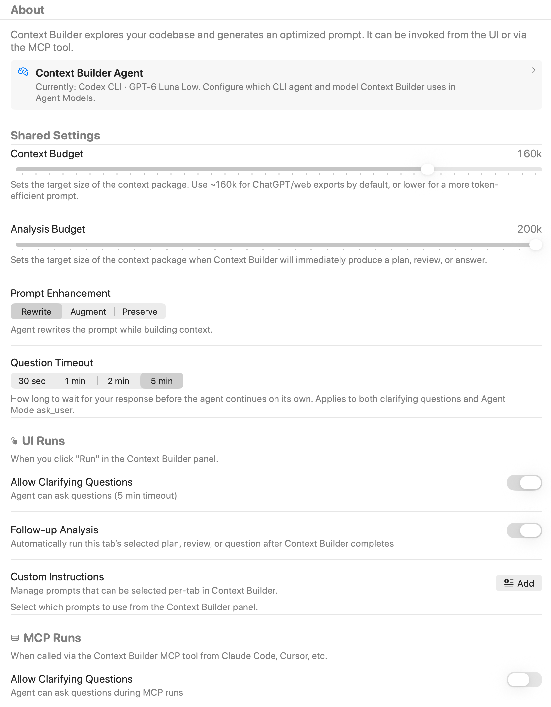
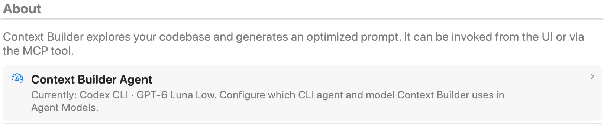
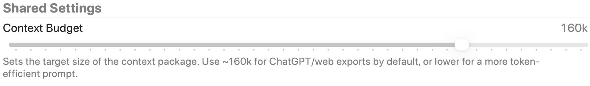
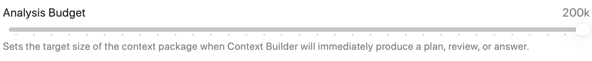
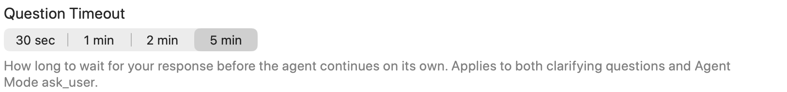
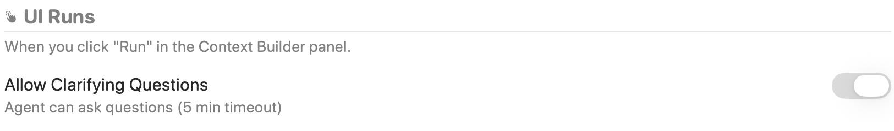
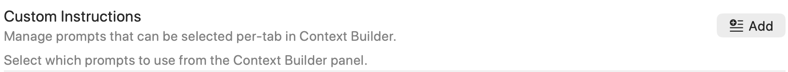
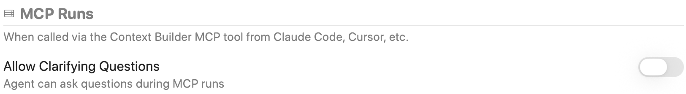

Configure context and analysis token budgets, prompt enhancement, question timeouts, and clarifying-question behavior. This page also manages custom instructions and distinguishes runs started in the interface from runs requested through MCP.

Open **Settings → Agent Mode → Context Builder**. Shared settings apply to context building from the interface and MCP, while each run type has its own clarifying-question switch. Screenshot selections are examples, not all factory defaults.

## Context Builder Agent

The **Context Builder Agent** row shows the current CLI agent and model. Open it to change those choices in [Agent Models](./agent-models.mdx). This page controls context-building behavior rather than model selection.

## Context Budget

Sets the target size of the selected context package for context-only runs, such as preparing a web export. The slider spans **10,000–200,000 tokens** in **5,000-token steps**; the default is **160,000**.

A lower target can produce a smaller package. This is a context-selection budget, not an output-token limit or a guarantee about a model's supported context window.

## Analysis Budget

Sets the context-package target when Context Builder will immediately produce a plan, review, or answer. The range is **40,000–200,000 tokens**, in **5,000-token steps**. The default is **120,000**, even though this capture shows **200k**.

## Prompt Enhancement

| Mode | Result |
| --- | --- |
| **Rewrite** | Rewrites the prompt while building context; the default mode. |
| **Augment** | Keeps your instructions and appends relevant context. |
| **Preserve** | Updates file selection while leaving instructions unchanged. |

## Question Timeout

Choose **30 seconds**, **1 minute**, **2 minutes**, or **5 minutes**. This is how long the agent waits for your answer before continuing on its own; it applies to clarifying questions and Agent Mode `ask_user`. It is not the total Context Builder run timeout.

## UI Runs: clarifying questions

For runs started with **Run** in the Context Builder panel, **Allow Clarifying Questions** lets the agent ask you for more information. It is on by default. The description reflects the selected Question Timeout.

Turning this UI setting off also clears the MCP clarifying-question setting. Re-enabling UI questions does not automatically opt MCP runs back in.

## UI Runs: follow-up analysis

**Follow-up Analysis** automatically runs the current tab's selected plan, review, or question after context building completes. It is off by default, though it is enabled in the capture. The follow-up type is selected per tab.

## Custom Instructions

**Add**, or the saved-prompt count, opens the custom-instructions manager. Choose **New**, enter a title and instructions, then **Save**; the same manager edits existing prompts. The settings page previews up to three saved titles.

Saving a prompt here does not select it for every run. Select the instructions to use in the Context Builder panel for the current tab.

## MCP Runs

The MCP **Allow Clarifying Questions** switch is separate and off by default. Enable it when you intend to watch RepoPrompt and answer questions from an external client's `context_builder` request. Questions use the shared timeout and remain disabled for inactive target workspaces.

MCP callers choose their requested response type through the tool. The UI-only Follow-up Analysis switch does not replace that request. See [MCP Tools](../mcp-server/tools.mdx#context_builder) for the tool overview.

