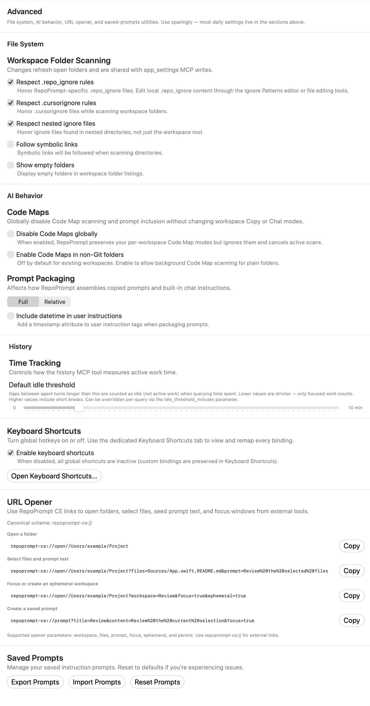
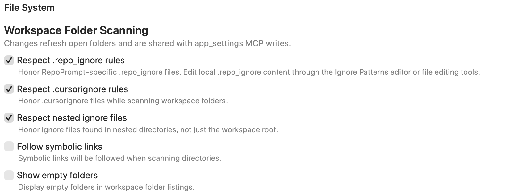
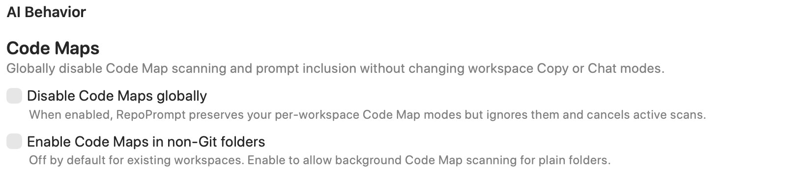
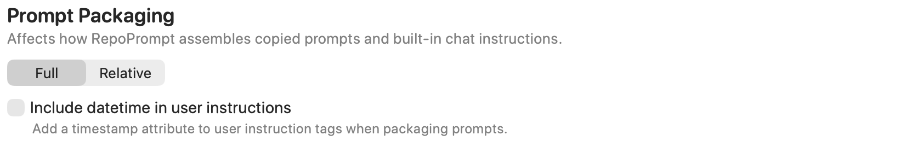
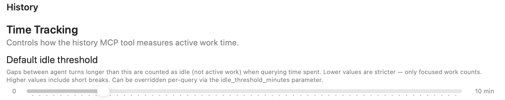
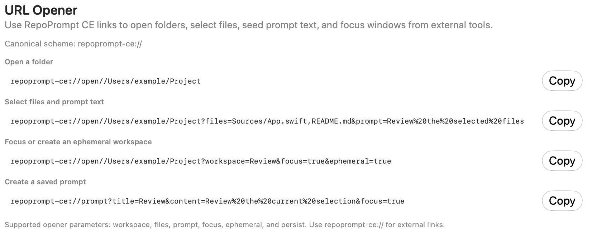

<div className="settings-reference">

<div className="settings-intro settings-panel-intro">



<div>

Configure workspace folder scanning, ignore rules, symbolic links, Code Maps, prompt packaging, history time tracking, keyboard-shortcut availability, URL opening, and saved-prompt utilities.

</div>

</div>

Open **Settings → General → Advanced**. The screenshot shows example values. These controls combine app-wide preferences with prompt-editor options and one-time utilities.

## Workspace Folder Scanning



Changes refresh open folders and use the same preferences as the `app_settings` MCP tool.

| Control | Effect |
| --- | --- |
| **Respect .repo_ignore rules** | Honors RepoPrompt-specific ignore files. Edit their contents in the Ignore Patterns editor or with file-editing tools. |
| **Respect .cursorignore rules** | Honors `.cursorignore` files during scans. |
| **Respect nested ignore files** | Reads ignore files in nested directories as well as the workspace root. |
| **Follow symbolic links** | Follows symbolic links while scanning directories. |
| **Show empty folders** | Includes empty folders in workspace folder listings. |

These switches control scanning behavior; they do not edit your ignore files.

## Code Maps



**Disable Code Maps globally** stops Code Map scanning and prompt inclusion, cancels active scans, and temporarily ignores saved workspace Copy and Chat Code Map modes. Those modes are preserved and take effect again when you turn the global disable switch off.

**Enable Code Maps in non-Git folders** permits background Code Map scanning for plain folders. It is off by default for existing workspaces. It does not override a global Code Maps disable setting.

## Prompt Packaging



**Full** and **Relative** choose how file paths appear in packaged prompts. **Include datetime in user instructions** adds a timestamp attribute to the user-instruction tags. These controls affect copied prompts and built-in chat instructions; they do not rename files.

## History time tracking



**Default idle threshold** controls the `history` MCP tool's active-work calculation. Gaps between agent turns longer than the threshold count as idle rather than active work.

The range is **0–60 minutes**, in one-minute steps; the default is **10 minutes**. Lower values count only more tightly spaced work, while higher values include short breaks. A query can override the setting with `idle_threshold_minutes`. This changes the calculation, not the underlying session history.

## Keyboard Shortcuts


**Enable keyboard shortcuts** is the same master switch used on the [Keyboard Shortcuts](./keyboard-shortcuts.mdx) page. Turning it off leaves custom bindings saved. **Open Keyboard Shortcuts…** opens the complete binding editor for this window.

## URL Opener



Use the **`repoprompt-ce://`** scheme for links from external tools. The page's **Copy** buttons copy examples so you can replace the sample paths and URL-encode your text.

```text
repoprompt-ce://open//Users/example/Project
repoprompt-ce://open//Users/example/Project?files=Sources/App.swift,README.md&prompt=Review%20the%20selected%20files
repoprompt-ce://open//Users/example/Project?workspace=Review&focus=true&ephemeral=true
repoprompt-ce://prompt?title=Review&content=Review%20the%20current%20selection&focus=true
```

The opener supports `workspace`, `files`, `prompt`, `focus`, `ephemeral`, and `persist` parameters. The examples respectively open a folder, select files and seed instructions, focus or create an ephemeral workspace, and create a saved prompt. Copying an example does not execute it.

## Saved Prompts


- **Export Prompts** writes saved prompts to a JSON file you choose, with `SavedPrompts.json` suggested as the filename.
- **Import Prompts** reads a JSON file and adds imported prompts, reporting how many were added.
- **Reset Prompts** asks for confirmation, removes custom prompts, and restores the defaults. This action cannot be undone through the reset dialog; export first if you want a backup.

</div>
