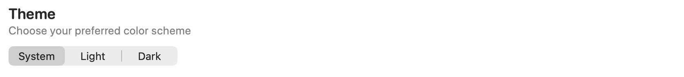
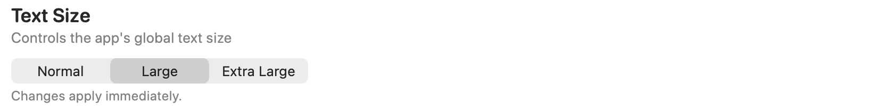
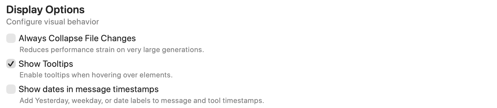
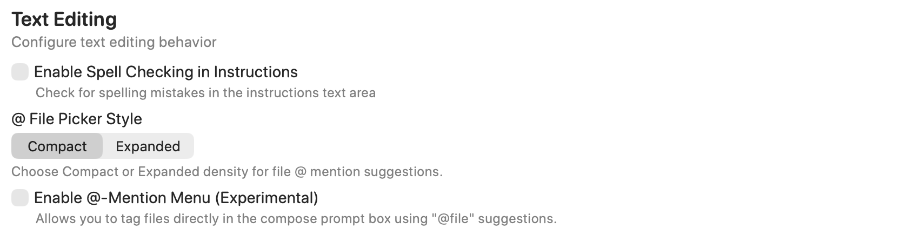

Adjust the app’s appearance, theme, and interface text size.

Open **Settings → General → Appearance**. Most choices apply app-wide and are saved for later launches. The screenshot shows example selections, not recommended defaults.

## Theme

Choose **System** to follow macOS appearance, or **Light** or **Dark** to keep a specific color scheme. The selected theme is applied when you change it.

## Text Size

**Normal**, **Large**, and **Extra Large** set the app's global text-size preset. You can also step through these presets with the font-size controls in [Keyboard Shortcuts](./keyboard-shortcuts.mdx).

Changes normally apply immediately. During a response that freezes text scaling to keep the streaming layout stable, the new size is held until scaling is unfrozen.

## Display Options

- **Always Collapse File Changes** keeps file-change displays collapsed, reducing rendering work for very large generations.
- **Show Tooltips** enables the app's hover explanations.
- **Show dates in message timestamps** adds labels such as Yesterday, a weekday, or a date to message and tool timestamps.

These settings change presentation; collapsing file changes does not undo edits.

## Text Editing

**Enable Spell Checking in Instructions** checks spelling in the instructions text area.

**@ File Picker Style** changes the density of file-mention suggestions: **Compact** or **Expanded**. **Enable @-Mention Menu (Experimental)** enables file suggestions when typing `@` in the Compose prompt editor. Picker style and enabling the experimental menu are separate controls.

