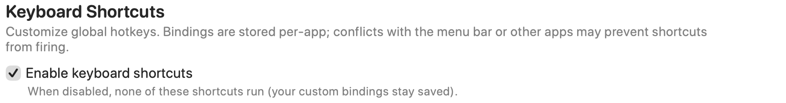
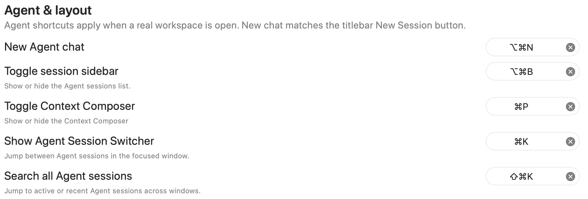

Review and customize keyboard shortcuts for RepoPrompt actions, including workspace, Compose, preset, and agent commands.

Open **Settings → General → Keyboard Shortcuts**. Click a shortcut recorder and press the desired key combination to change that action's binding. Use its clear button to remove a binding. Bindings are stored per app; menu-bar shortcuts or other apps can conflict with them.

The tables below list the implementation defaults. Your current bindings can differ. On a Mac, **Command** is ⌘, **Option** is ⌥, **Control** is ⌃, and **Shift** is ⇧.

## Enable keyboard shortcuts

Turn off **Enable keyboard shortcuts** to stop these registered shortcuts from running while keeping your custom bindings saved. [Advanced](./advanced.mdx#keyboard-shortcuts) exposes the same master setting.

Although this pane calls them global hotkeys, action handlers still check the app and window context. Workspace and session actions need an appropriate focused RepoPrompt window; agent shortcuts need a real workspace.

## Agent & layout

| Action | Default |
| --- | --- |
| New Agent chat | Option+Command+N |
| Toggle session sidebar | Option+Command+B |
| Toggle Context Composer | Command+P |
| Show Agent Session Switcher | Command+K |
| Search all Agent sessions | Shift+Command+K |

**New Agent chat** follows the titlebar's New Session action. The session switcher navigates sessions in the focused window; searching all sessions includes active and recent sessions across windows.

## Workspace & presets

| Action | Default |
| --- | --- |
| Save workspace | Command+S |
| Save workspace and switch to system workspace | Shift+Command+S |
| Save current preset, or create one if none exists | Option+Command+S |
| Create new preset | Option+Command+P |
| Switch to preset 1–9 | Option+Command+1–9 |

Preset numbers follow the workspace manager's preset order. Saving the current preset opens the creation flow if the workspace has no presets. See [Manage Presets](../workspaces/manage-presets.mdx) for preset configuration.

## Agent session tabs

| Action | Default |
| --- | --- |
| New Agent session tab | Command+T |
| Close active Agent session tab | Command+W |
| Next Agent session tab | Control+Tab |
| Previous Agent session tab | Control+Shift+Tab |
| Next parent Agent session | Option+Command+] |
| Previous parent Agent session | Option+Command+[ |
| Focus Agent session tab 1–9 | Command+1–9 |

Numbered session shortcuts follow the Agent session sidebar order. Parent-session navigation cycles only root rows; child sessions stay grouped under their parent.

## Display

**Command+=** increases text size and **Command+-** decreases it. These step through the same global text-size presets as [Appearance](./appearance.mdx#text-size).

