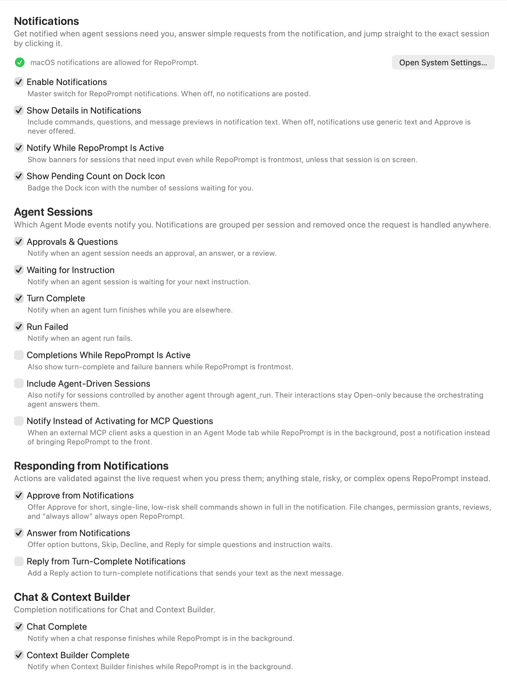
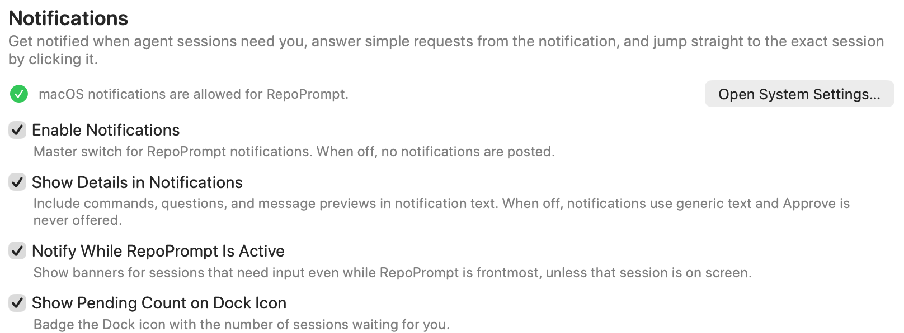
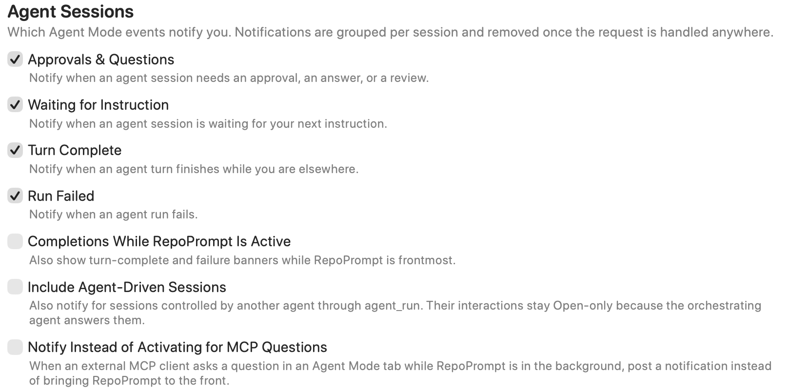
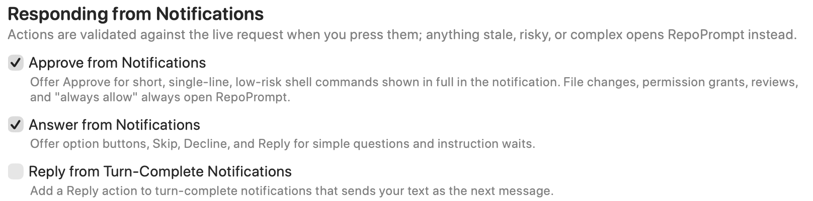
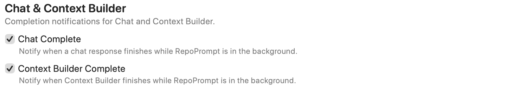

Choose which events notify you, whether previews include details, and which requests you can answer from a notification.

Open **Settings → General → Notifications**. These preferences apply app-wide and also appear in the `notifications` group of the `app_settings` MCP tool.

## Notification delivery and previews

**Enable Notifications** is the master switch. Turning it off stops notification posting and disables the event-specific controls below. macOS permission is separate: the status row reports whether delivery is allowed, and **Open System Settings…** opens the macOS notification settings. When macOS permission is denied, RepoPrompt can fall back to bouncing its Dock icon.

- **Show Details in Notifications** includes commands, questions, and message previews. Turn it off for generic text; the **Approve** action is then never offered.
- **Notify While RepoPrompt Is Active** allows input-needed banners while the app is frontmost, unless the relevant session is already on screen.
- **Show Pending Count on Dock Icon** badges the Dock icon with the number of sessions waiting for you.

These four switches are on by default. Notification previews can expose task content on screen; choose the details setting accordingly.

## Agent Sessions

The following event notifications are on by default:

| Control | Event |
| --- | --- |
| **Approvals & Questions** | A session needs approval, an answer, or a review. |
| **Waiting for Instruction** | A session is waiting for your next instruction. |
| **Turn Complete** | An agent turn finishes while you are elsewhere. |
| **Run Failed** | An agent run fails. |

Notifications are grouped by session and removed when the request is handled elsewhere.

Three additional options are off by default:

- **Completions While RepoPrompt Is Active** also allows completion and failure banners while RepoPrompt is frontmost. It is separate from the input-needed banner setting above.
- **Include Agent-Driven Sessions** includes sessions controlled by another agent through `agent_run`. Their interactions offer **Open** only, because the orchestrating agent handles the answers.
- **Notify Instead of Activating for MCP Questions** posts a notification when an external MCP client asks a question in an Agent Mode tab while RepoPrompt is in the background, instead of bringing the app forward.

## Responding from Notifications

**Approve from Notifications** is on by default, but only offers approval for short, single-line, low-risk shell commands displayed in full. File changes, permission grants, reviews, and persistent “always allow” decisions open RepoPrompt instead. Showing notification details must also be enabled.

**Answer from Notifications** is on by default. Simple questions and instruction waits can offer option buttons, **Skip**, **Decline**, or **Reply**.

**Reply from Turn-Complete Notifications** is off by default. Enable it to send typed notification replies as the session's next message.

Every action is checked against the live request when pressed. Stale, risky, or complex requests open the app instead of applying an outdated response.

## Chat & Context Builder

**Chat Complete** notifies when a chat response finishes in the background. **Context Builder Complete** does the same when Context Builder finishes. Both are on by default.

