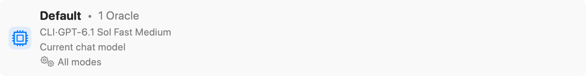

Create and manage named model configurations for common tasks and expose model presets through the MCP interface.

Open **Settings → MCP Server → Model Presets**, or choose **Manage Presets** from Chat Settings. These are named Oracle configurations, distinct from [workspace presets](../workspaces/manage-presets.mdx) and [Copy/Chat workflow presets](../prompting/workflow-presets.mdx).

## Read a model preset

The pictured row contains:

- **Default**: the preset name.
- **1 Oracle**: the number of models in its ordered Oracle roster.
- The configured model name: the model used by that roster entry.
- **Current chat model**: this preset's description.
- **All modes**: no Chat, Plan, or Review restriction.

The model and description are saved preset values. “Current chat model” does not make the preset a live alias that automatically follows later model-picker changes.

## Create and edit

If the list is empty, **Create Default Preset** creates one from the currently selected chat model and opens its editor. Otherwise, use **Add Preset**. Hovering an existing row reveals **Edit** and the delete control; those actions are not visible in this capture.

The editor configures the name, ordered Oracle models, optional description, supported modes, and optional Chat Preset mappings. The first model is the **Primary Oracle**; additional entries can be reordered or removed. Save persists the configuration. Deleting a preset removes the named configuration, not the provider account or model itself.

## Expose presets to MCP

Enable **Use Oracle Model Presets for MCP** in [MCP Server](./mcp-server.mdx#oracle-model-presets) or [Chat Settings](../prompting/chat-settings.mdx#oracle-model-presets). These controls use the same saved setting.

When recommendations temporarily hide presets, the **Presets Hidden** banner offers **Show Presets**. The presets remain stored while hidden. Mode restrictions can limit which presets are available for a particular Oracle request.

