

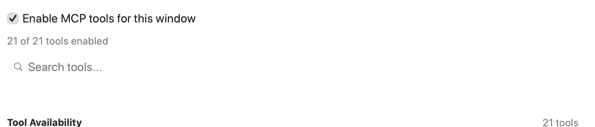

Manage window-level MCP access, search the tool catalog, and configure individual tool availability. The sections below show each tool separately so its controls and description remain readable.

Open **Settings → MCP Server → Tools**. The screenshot shows all 21 visible tool descriptions expanded. Tool counts and descriptions depend on the build and discovered catalog; they are not a fixed promise that every client can use every tool.

View the complete MCP Tools screenshot

## Access, search, and availability

**Enable MCP tools for this window** is the same window-level gate as the switch on [MCP Server](./mcp-server.mdx). Turning it off disables the individual switches in this pane.

Individual tool switches are saved in an **app-wide** disabled-tools list shared by windows. They are not separate per-window preferences, despite the captured pane's introductory wording. Changes notify connected clients that the tool list changed.

**Search tools…** filters names and descriptions without changing enablement. The count shows how many tools are enabled; with a search, the list also shows how many matching tools are enabled. **More…** expands a long description and **Show less** collapses it. Expanding a description does not run the tool.

If the list says **No tools discovered**, start the MCP server and connect a client. Tools restricted to particular agent contexts are omitted from this general settings list. Enabling a tool does not bypass workspace permissions or the tool's own input and approval checks.

## agent_explore

Launches short-lived, read-only child agents for narrow repository investigations. Each gets a fresh context and the Explore role. Operations are `start`, `poll`, `wait`, and `cancel`; a batch can start multiple independent probes.

Explore children cannot edit files, call Oracle, or spawn more agents. They inherit worktree bindings by default, with an opt-out. When Model Router is enabled, new explore children can be routed across eligible targets.

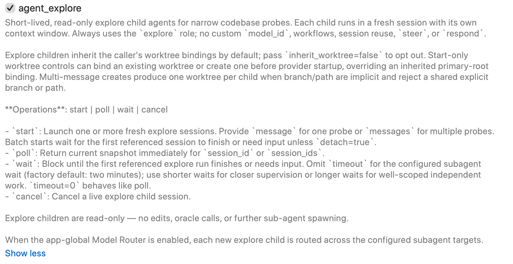

## agent_manage

Lists agent choices, model and role mappings, sessions, and workflows. It also reads session logs, exports handoffs, creates or resumes sessions, stops sessions, and cleans up eligible MCP-created sessions.

`list_agents` supplies the current role mappings and exact model identifiers. `get_log` reads transcript turns; handoff export prepares context for continuing elsewhere. Cleanup targets specified MCP-originated sessions and does not delete user-created sessions.

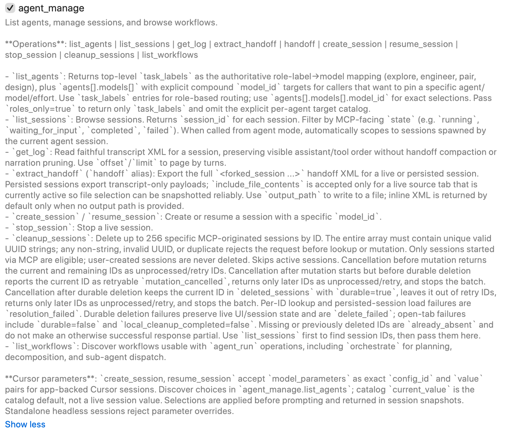

## agent_run

Starts and controls Agent Mode runs. `start` creates a new session; `steer` continues an existing one. `poll` checks immediately, `wait` waits for completion or input, `respond` resolves a pending interaction, and `cancel` stops an active run.

Use the returned session and interaction identifiers for follow-up calls. Role labels use the configured Agent Models mapping; an exact compound model identifier pins a target. Model Router can choose for eligible starts using a role or omitted model. See [Model Router](../router/model-router.mdx).

## app_settings

Reads and updates the allowed set of app-wide preferences. `list` discovers settings, `get` reads values, `set` writes one key, and `options` discovers supported choices where available.

Only exposed settings can be changed; invalid or out-of-range values are rejected. The current implementation also exposes notification preferences, matching the [Notifications](../general/notifications.mdx) pane.

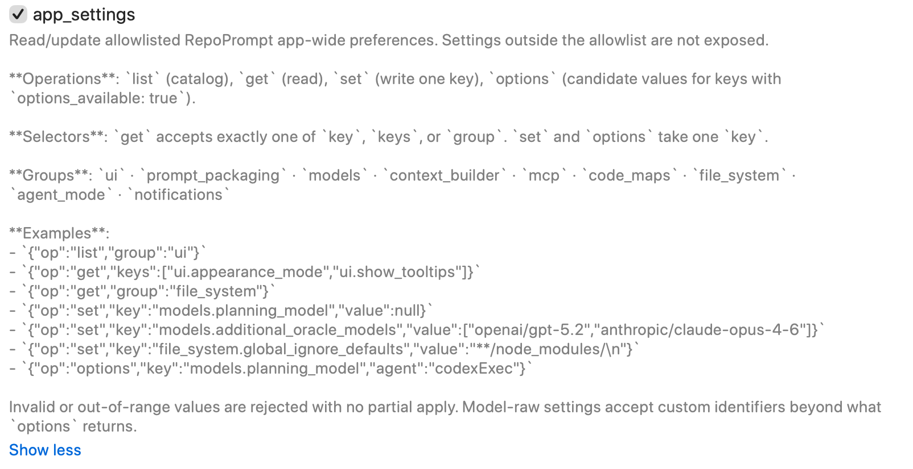

## apply_edits

Edits file contents using exactly one mode: replace the whole file with `rewrite`, replace matching text with `search` and `replace`, or apply a list of `edits`. Mixing modes is rejected.

Replacements are literal text. A rewrite can opt into creating a missing file with `on_missing`; otherwise a missing file is an error. Enable this tool only when clients should be able to request file-content changes under the applicable permissions.

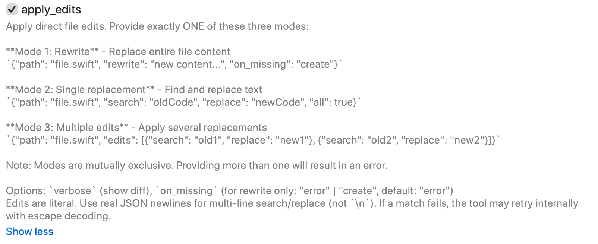

## bind_context

Lists available contexts, reports the connection's current binding, and binds a client to a specific workspace context. Prefer absolute workspace root paths in `working_dirs`, or use a returned `context_id`.

The binding is retained for that MCP connection. Switching the visible tab does not redirect an existing binding. The captured description includes legacy window selectors; newer builds make this a global context tool without an app-window selector. Use the schema advertised by your connected build.

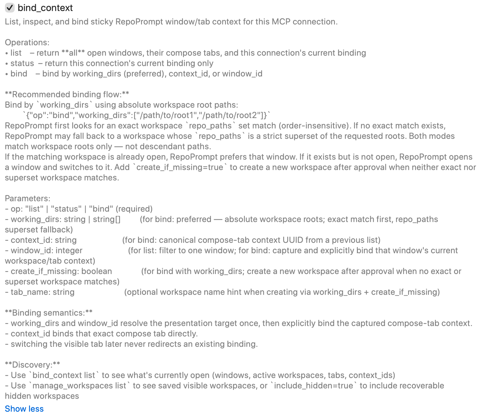

## context_builder

Runs a Context Builder agent to discover relevant code, select files within a token budget, and prepare a clarified prompt. Describe the task and known constraints; exhaustive file selection beforehand is not required.

The default or `clarify` response returns context for later use. `question`, `plan`, and `review` request a follow-up answer, implementation plan, or review. Response export can produce a shareable file. Configure discovery in [Context Builder](../agent-mode/context-builder.mdx) and its model in [Agent Models](../agent-mode/agent-models.mdx).

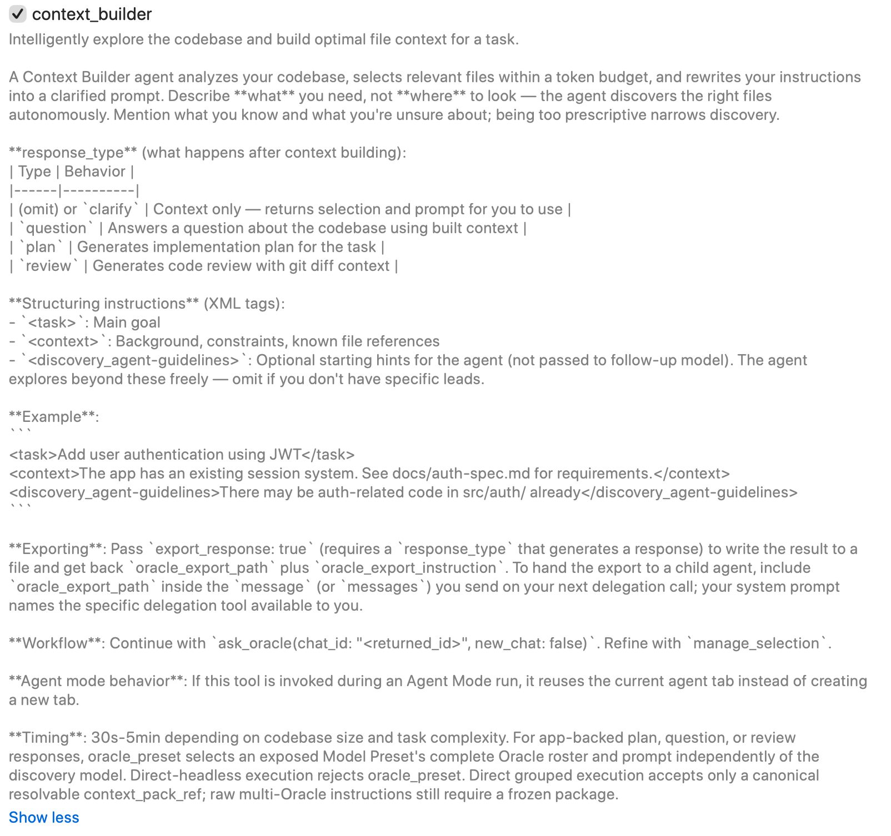

## file_actions

Creates, moves, or deletes files using absolute paths. A created file is automatically selected. Creation rejects existing files unless overwrite is explicitly requested; a move fails when the destination already exists.

Deletion moves files or folders to the macOS Trash, where they remain recoverable until Trash is emptied. Moving a file transfers its selection state.

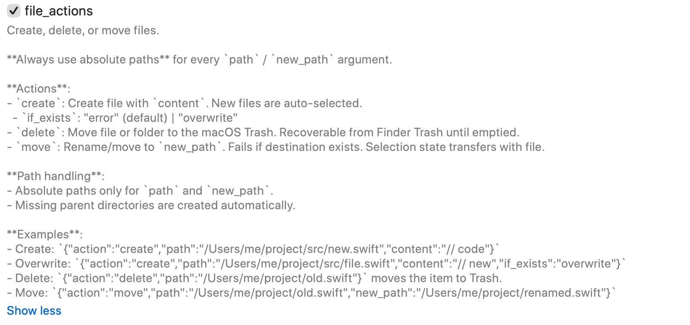

## file_search

Searches file paths, file contents, or both. `auto` selects the mode from the pattern; explicit modes are `path`, `content`, and `both`. Filters can limit extensions and directories or exclude paths.

Regex matching is available; set `regex=false` for literal content matching or glob-style path matching. Result and output limits can truncate large searches. For an agent bound to a worktree, filesystem searching uses that worktree even when returned paths retain the canonical workspace form.

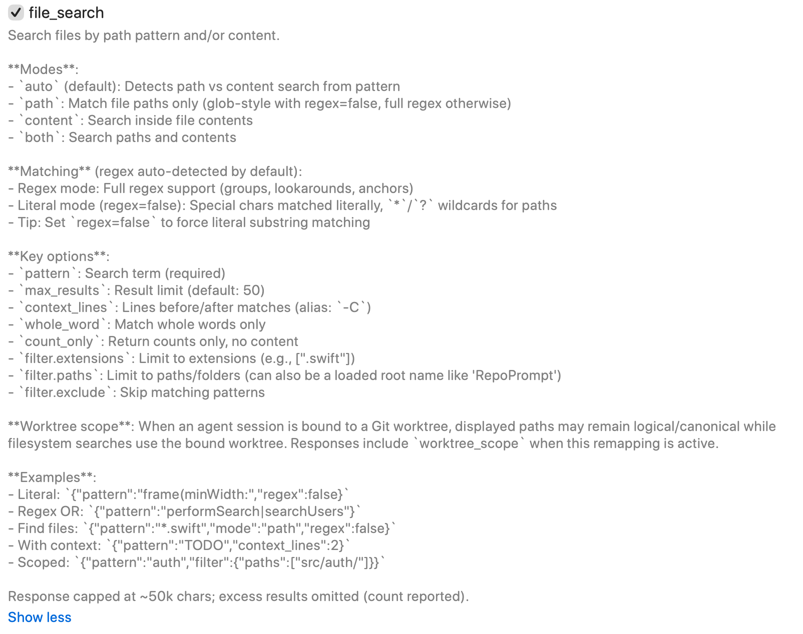

## get_code_structure

Returns root-local committed code structure for supplied files or directories, or the current selection when paths are omitted. It can include signatures and expand relationships through `uses`, `used_by`, or both.

Output size and relationship depth limit the response. If a result reports truncation, request a larger size or narrow the seeds. Update-pending information distinguishes a usable committed graph from work still being refreshed.

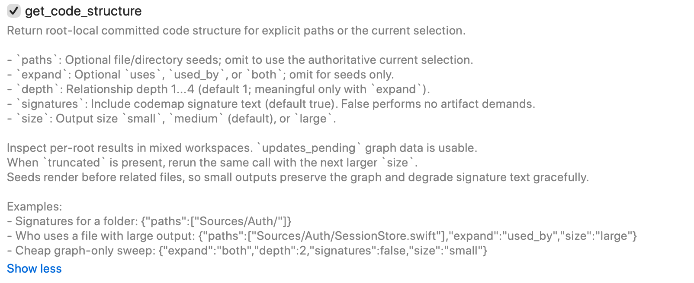

## get_file_tree

Returns a text directory tree or lists loaded root folders. Tree modes include automatic sizing, full output, folders only, and selected files with their parent directories.

Use `path` to focus a subtree and `max_depth` to limit traversal. Selection and Code Map markers describe workspace state. Bound-worktree searches follow the session's worktree.

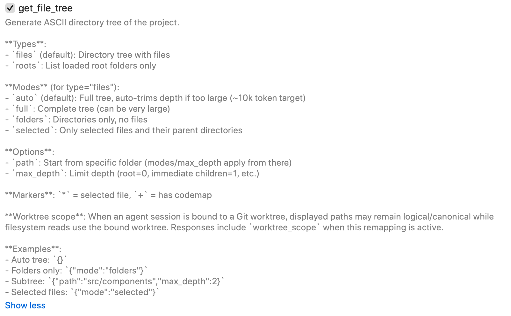

## git

Provides read-only Git inspection: `status`, `diff`, `log`, `show`, and `blame`. Diff comparison choices include staged, unstaged, uncommitted, branch, and merge-base comparisons. Detail levels range from summary to full patches.

Artifact output writes review files and can make them available for later context selection. This tool does not commit or push. Use repository selectors when working with multiple roots; some history operations use the primary repository only.

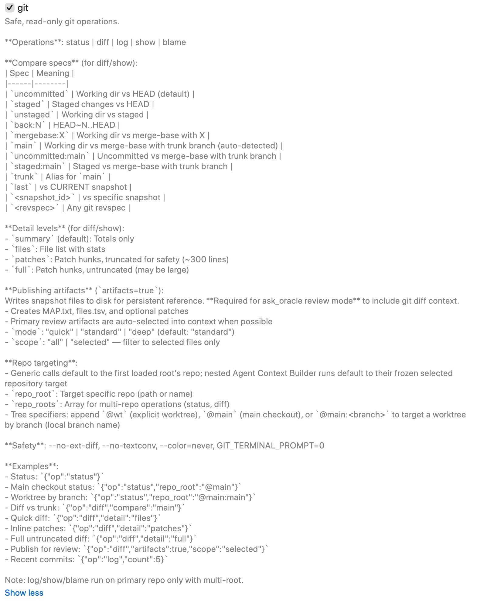

## history

Queries past Agent Mode sessions across saved workspaces. Operations list sessions, search transcripts and summaries, retrieve a bounded session excerpt, and calculate time spent. These operations are read-only.

Use workspace filters when you want a narrower scope; binding the MCP connection to a window does not itself restrict historical searches. Time calculations use the [Advanced idle threshold](../general/advanced.mdx#history-time-tracking) unless overridden per query.

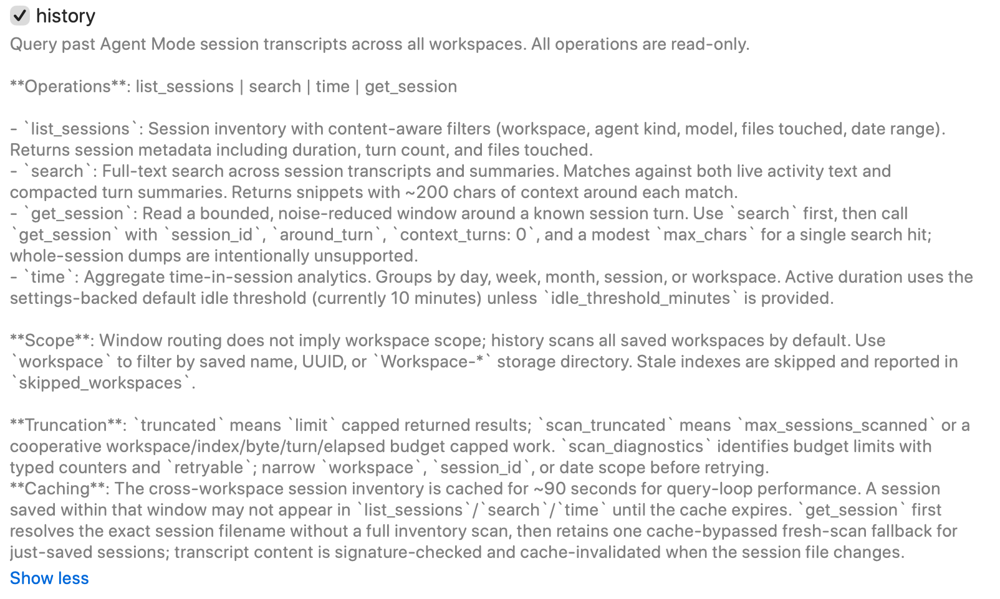

## manage_selection

Changes the file context used by tools: get, add, remove, replace, clear, preview, promote, or demote selections. Files can be represented by full content, line slices, or Code Maps.

`set` can replace a selection, so use incremental `add` and `remove` when preserving existing context matters. Multi-root paths can use a root-name prefix to disambiguate files. Git artifact paths have stricter matching and representation limits than ordinary workspace files.

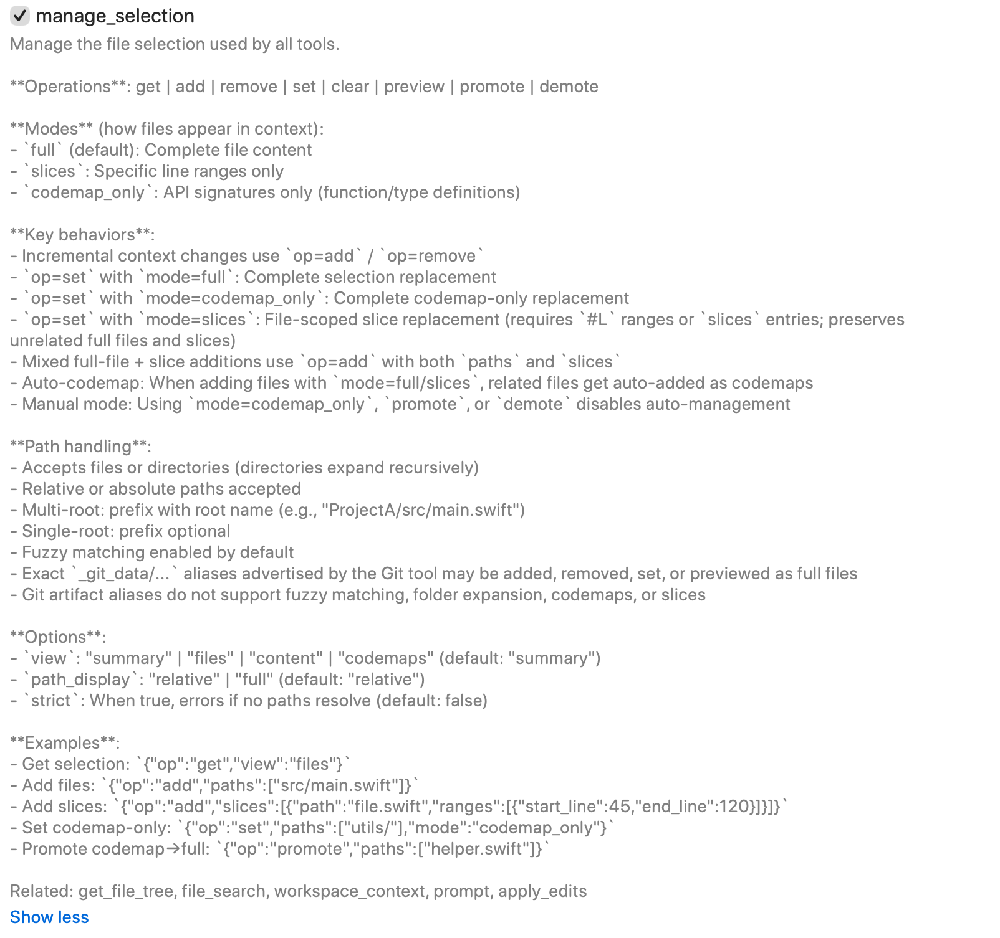

## manage_workspaces

Lists, creates, switches, hides, restores, and deletes workspaces, and manages their folders and Compose tabs. Hiding keeps a workspace recoverable; deleting a saved workspace is permanent.

`bind_context` is the canonical tool for connection binding. Legacy tab-listing and tab-selection operations remain compatibility paths. Background tab creation can avoid stealing focus; setting `focus=true` visibly switches the user's tab.

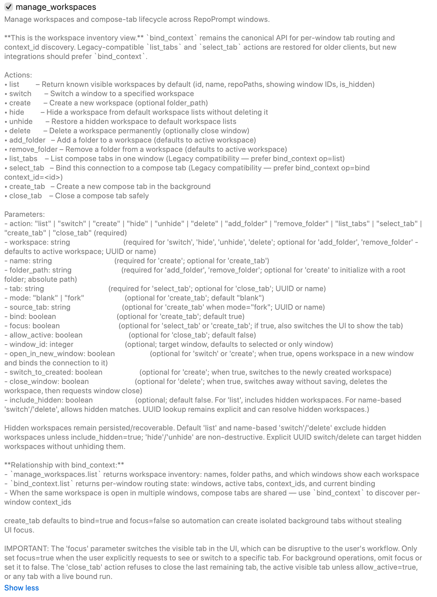

## manage_worktree

Lists, inspects, creates, and binds Git worktrees to Agent sessions. Merge operations use the session's bound source worktree and can preview, apply, inspect status, continue, or abort a merge.

Preview does not mutate the repository. Apply uses the returned operation identifier and requires the applicable confirmation; plain MCP callers use `confirm_preview=true`. Worktree binding is session-specific, so identify the intended session and repository when there is ambiguity.

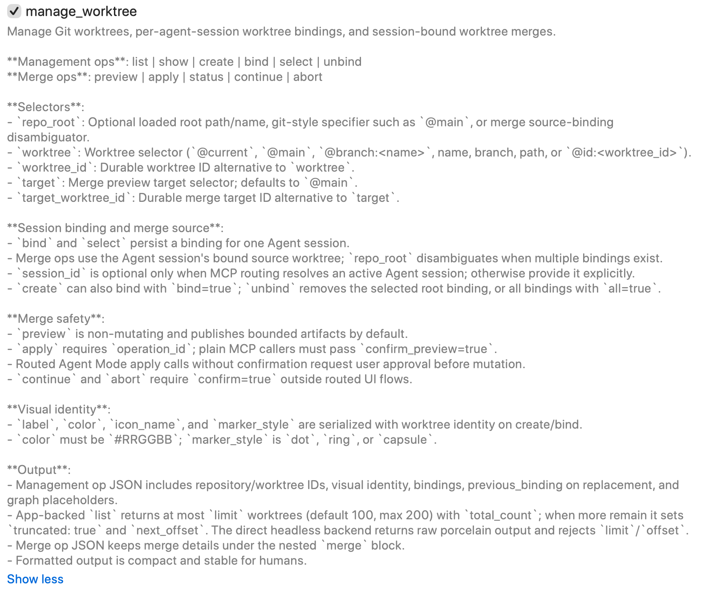

## oracle_send

Consults Oracle for questions, planning, or review. Without an explicit chat or new-chat request, it resumes the selected eligible conversation, falling back to the most recent eligible conversation. `new_chat=true` starts fresh.

A model override applies only to an explicit new conversation. Exposed Model Presets can select a complete Oracle roster and Chat Preset. Response export writes a shareable file for another agent. Agent Mode can expose `ask_oracle` for the corresponding task.

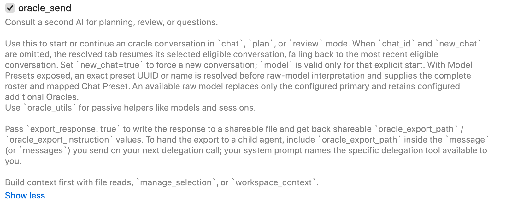

## oracle_utils

Provides read-only Oracle helpers: discover available model choices and list Oracle/chat sessions. It does not send an Oracle message. Use `oracle_send`, or `ask_oracle` when exposed in Agent Mode, to request a response.

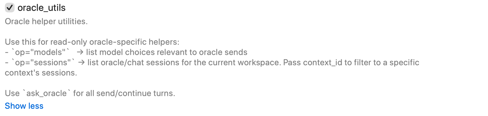

## prompt

Gets, replaces, appends to, clears, or exports the shared instructions text. It also lists and selects copy presets. Selecting a preset requires an explicitly bound tab context.

Export writes the formatted prompt to a file. It does not submit that file to another AI service. A copy-preset override changes the export format.

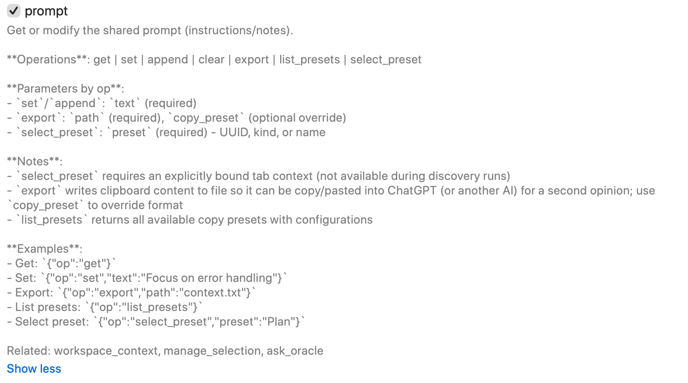

## read_file

Reads a file in full or by line range. Positive `start_line` values are one-based; a negative value reads from the end. With a positive start, `limit` bounds the number of lines.

Reuse returned file paths for reliable lookup, adding a root alias when needed. For worktree-bound sessions, reads use the bound worktree. Approved external read paths remain read-only.

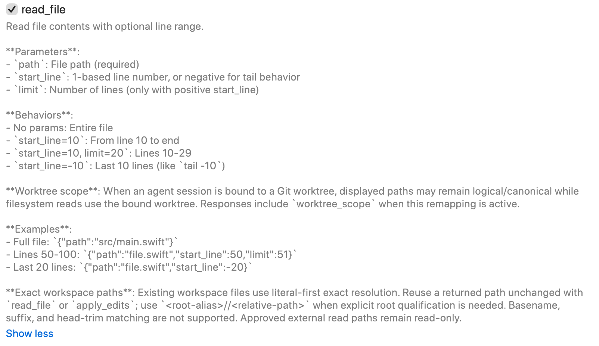

## workspace_context

Returns or exports the current workspace context. The default snapshot includes the prompt, selection, code structure, and token counts. Optional sections can include full file contents or a selected-file tree.

Use include options to control the payload, or a copy-preset override to change rendering and token calculation. `export` writes the rendered context to disk; it does not send that context to an external service.

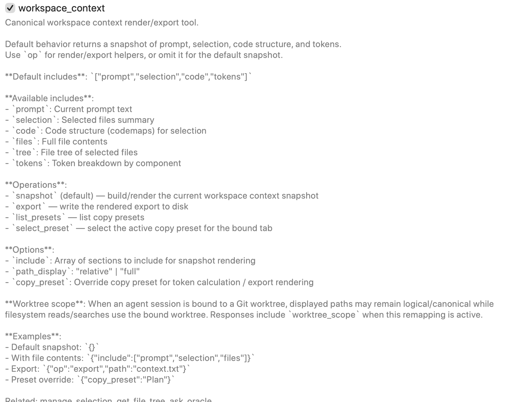

