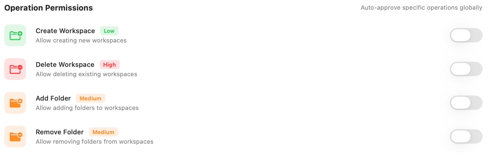
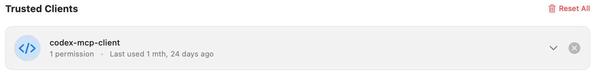

Manage approvals for operations that change RepoPrompt workspaces, such as creating folders or deleting workspaces. Configure global operation approvals and review or revoke trusted-client permissions.

Open **Settings → MCP Server → Workspace Approvals**. These controls govern requests to change RepoPrompt workspaces. CLI-agent tool permissions and sub-agent policies are configured separately in [Agent Permissions](../agent-mode/agent-permissions.mdx).

## Global Settings

**Auto-approve All Operations** skips workspace-operation approval prompts from every client. It is off by default. When enabled, the individual operation switches below are disabled because the global choice already approves them all.

This switch grants future requests approval; it does not itself create, remove, or change a workspace.

## Operation Permissions

Enable a switch to automatically approve that operation globally, without granting every operation. All four are off by default.

| Operation | Effect | Displayed risk |
| --- | --- | --- |
| **Create Workspace** | Creates a workspace record. | Low |
| **Delete Workspace** | Deletes an existing workspace. | High |
| **Add Folder** | Adds a folder to a workspace. | Medium |
| **Remove Folder** | Removes a folder from a workspace. | Medium |

Adding or removing a workspace folder changes its membership; it does not mean creating or deleting that project folder on disk. Workspace deletion can remove saved workspace state and history, so review the requested target.

## Trusted Clients

Clients appear here after you choose **Always Allow** for a workspace operation. Each row shows the client identifier, saved permission count, and last-used information. Expand a row to inspect and remove individual operation permissions, or use its removal control to clear all permissions for that client.

**Reset All** asks for confirmation before removing every client's saved auto-approvals. It does not turn off the global approval settings above: disable those separately if you want those operations to prompt again.

