

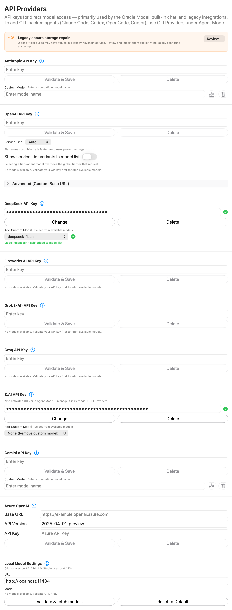

Configure direct API-provider credentials and provider-specific connections used by RepoPrompt’s model features. These API connections are separate from the coding-agent runtimes configured in CLI Providers.

Open **Settings → Models & Providers → API Providers**. These connections primarily serve the Oracle Model, built-in chat, and legacy integrations. For coding-agent runtimes, use [CLI Providers](../agent-mode/cli-providers.mdx). The masked keys and model selections in the screenshot are examples.

## Credentials and model choices

For a provider, enter its key and choose **Validate & Save**. A validated entry displays a checkmark and changes the button label to **Change**. **Delete** removes that stored provider credential. The information button opens the provider's reference page.

Where model discovery is supported, validate first to populate **Add Custom Model**. Select a model to add it to RepoPrompt's model choices; **None (Remove custom model)** clears that custom choice. Where the UI instead offers a text field, enter a compatible model identifier and use its save button. Validation contacts the selected provider; it is not an offline format check.

## Legacy secure storage repair

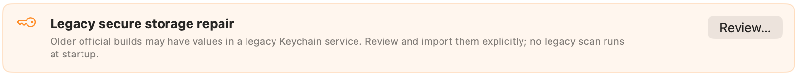

Older official builds may have credentials in a legacy Keychain service. **Review…** opens an explicit review/import flow; no legacy scan runs at startup. Imported values are verified, and legacy values are retained by default for rollback. Deleting a legacy value is a separate action.

## Anthropic

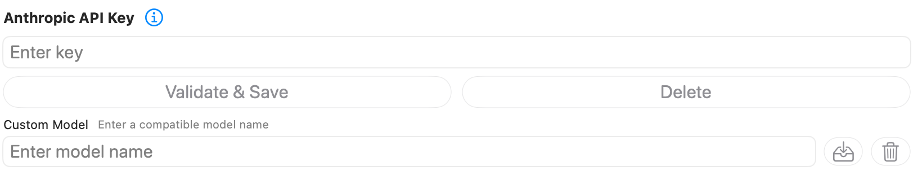

Configure the direct Anthropic API key here. The custom-model field accepts a compatible Anthropic model identifier. This is separate from signing into Claude Code in CLI Providers.

## OpenAI

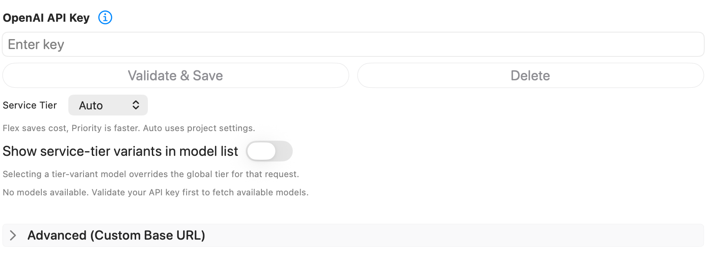

Validate the key to fetch available models. **Service Tier** offers **Auto**, **Default**, **Flex**, and **Priority**. Auto follows the API project's settings. The pane describes Flex as a cost-oriented option and Priority as a speed-oriented option; availability depends on the provider and model.

**Show service-tier variants in model list** exposes tier-specific model choices. Selecting one overrides the global tier for that request.

Expand **Advanced (Custom Base URL)** to configure and validate an alternate OpenAI endpoint. For a separate OpenAI-compatible provider configuration, use [Custom API](./custom-api.mdx).

## DeepSeek

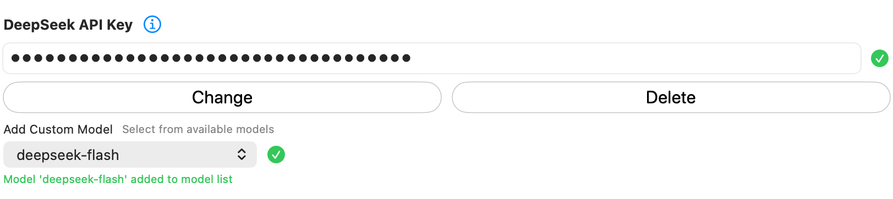

Validate the DeepSeek API key, then choose a discovered custom model if needed. The selected model and success message show what has been added to the model list; the pictured model is not a required default.

## Fireworks AI

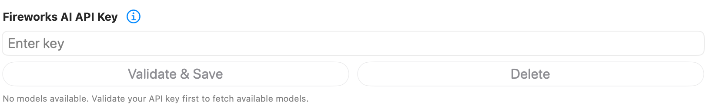

Configure a Fireworks AI key. Model choices become available after validation; an empty discovery list is shown with guidance to validate first.

## Grok (xAI)

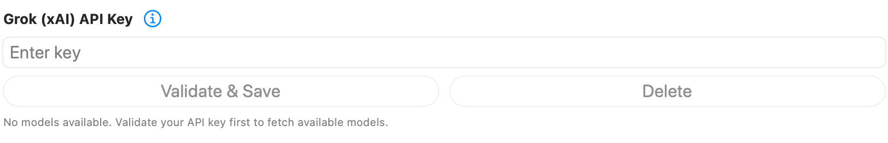

Configure direct xAI API access and discover available models. This credential is separate from the Grok Build CLI runtime configured in CLI Providers.

## Groq

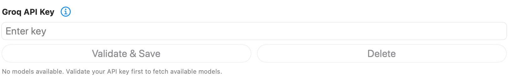

Configure a Groq API key and validate it before selecting a discovered model. **Groq** and **Grok (xAI)** are different provider entries.

## Z.AI

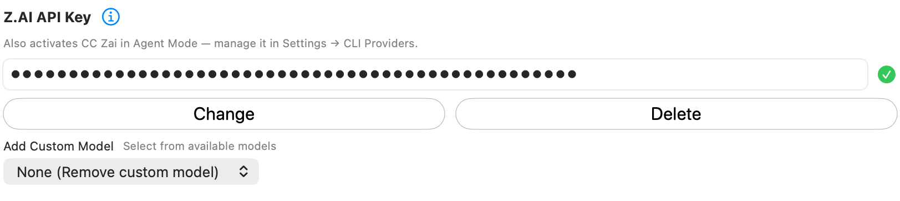

Configure the Z.AI key and optional custom model. Unlike most entries on this page, this credential also activates **CC Zai** in Agent Mode. Manage that runtime's configuration in [CLI Providers](../agent-mode/cli-providers.mdx).

## Gemini

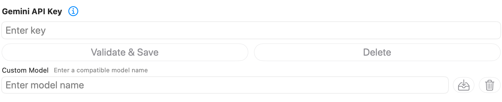

Configure the Gemini API key for direct model access. Use the custom-model field and its save control for a compatible model identifier. This is not the Google Antigravity CLI setup.

## Azure OpenAI

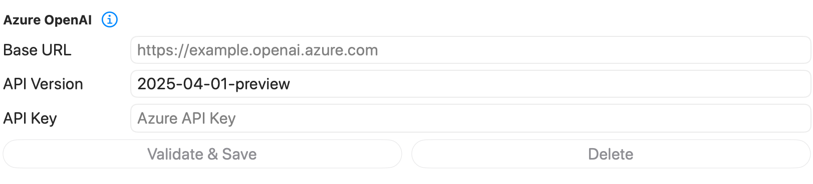

Enter the Azure resource **Base URL**, **API Version**, and **API Key**, then choose **Validate & Save**. The displayed API-version value is an example from the capture, not a recommendation for every Azure deployment.

After discovery, the implementation can offer **Add Custom Deployment** to pin a deployment. Clearing that choice returns to the discovered deployment priority.

## Local Model Settings

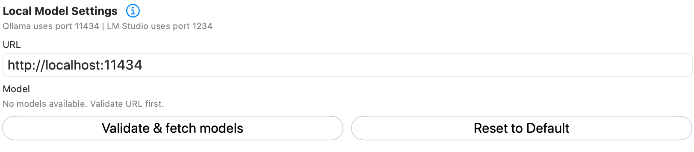

Enter the URL of your running local model server, then choose **Validate & fetch models**. Once discovery succeeds, select a model. For an already validated configuration, the button becomes **Refresh models**.

The pane identifies common ports: **11434** for Ollama and **1234** for LM Studio. **Reset to Default** restores the local configuration defaults. It does not install or start a model server.

