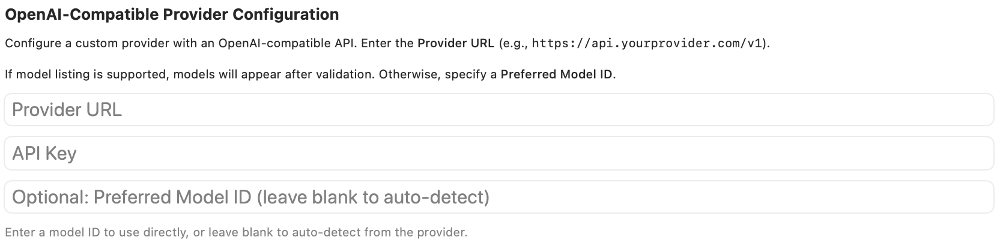

Add and manage custom OpenAI-compatible API endpoints, their authentication, and the models offered through each endpoint.

Open **Settings → Models & Providers → Custom API** to configure an OpenAI-compatible endpoint. This is a direct API connection, not a CLI-agent runtime.

## Endpoint, key, and preferred model

Enter the **Provider URL**, including the API version path where needed, and the provider's **API Key**. Endpoints that do not require authentication can use an empty key. Current builds may request explicit consent before sending credentials to a non-HTTPS endpoint.

Leave **Preferred Model ID** blank to discover models from the endpoint. If the provider cannot list models, enter an exact compatible model identifier instead.

## Default Output Max Tokens

This caps the requested output length. **0** or an empty saved limit uses the model/provider default. Increase a positive limit when outputs are cut off, subject to the model's actual limits. The displayed **8192** is an example value.

The adjacent save button updates the limit on an already validated configuration without another network validation.

## Validate, save, and remove

**Validate & Save** validates the endpoint and persists the configuration. With no preferred model, it fetches a nonempty model list. With a preferred model, it tests that model with a short completion request rather than relying on model discovery. That validation sends a small test prompt to the provider.

**Content-Type header** controls inclusion of that header in the saved custom-provider configuration. **Delete Provider** removes the custom configuration and its stored credential; it does not delete an account at the service.

After successful discovery, **Available Models** offers search and per-model enable controls, showing up to 20 matches with enabled models first. Previously enabled models are retained when they still exist in the refreshed catalog. A preferred model is stored separately from that enabled-model set.

