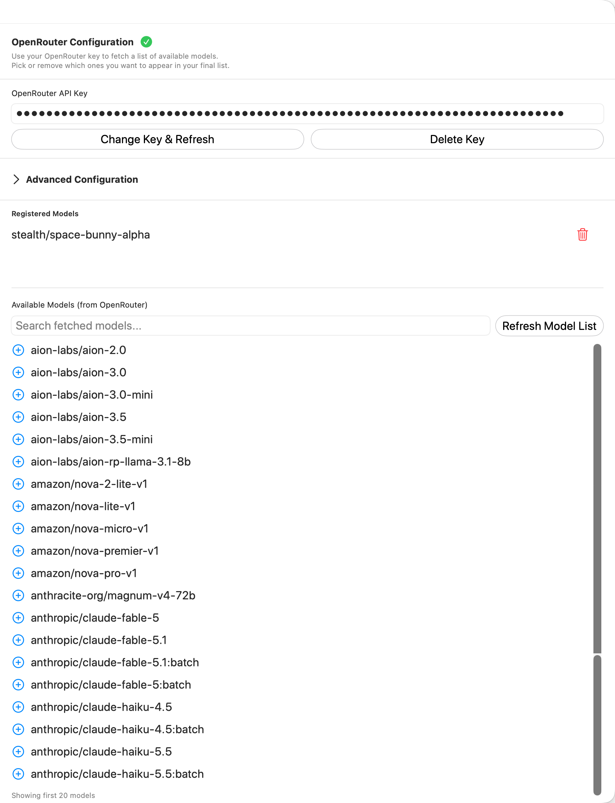
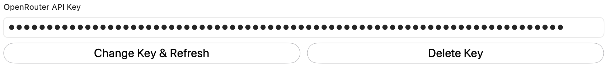
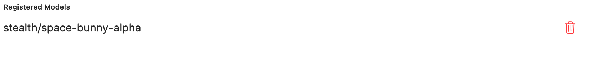
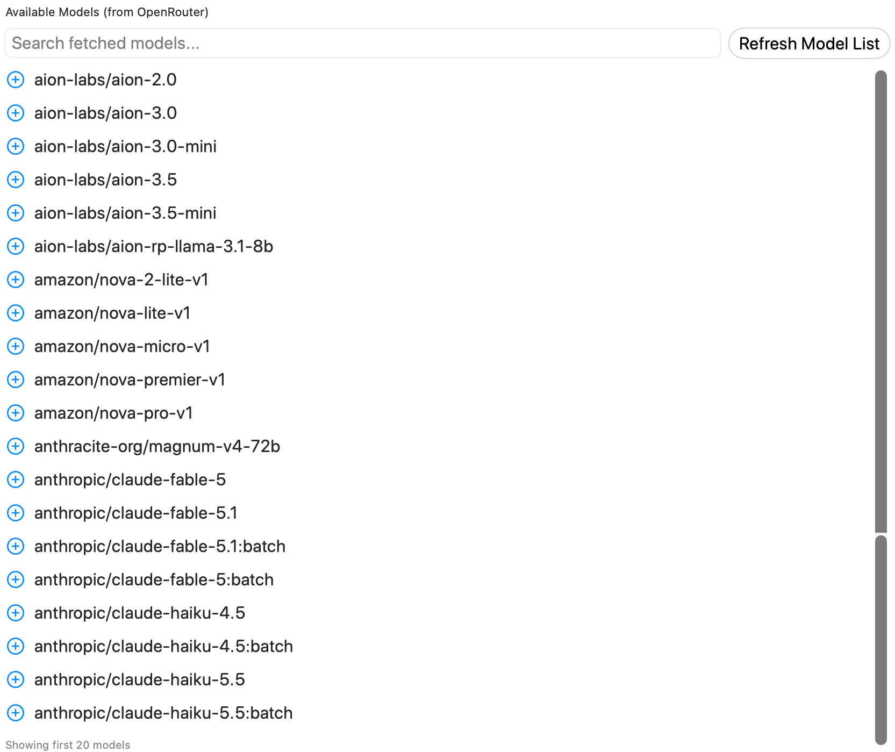

Manage the OpenRouter API key, fetch available models, and choose which models appear in RepoPrompt. Advanced configuration includes token limits and custom headers.

Open **Settings → Models & Providers → OpenRouter**. This page controls API access and which OpenRouter models appear in RepoPrompt. Models in the screenshot are examples of a fetched catalog, not fixed defaults.

For connection prerequisites, catalog references, capabilities, and account billing, see the [OpenRouter provider reference](../../providers/openrouter.mdx). The sections below describe this settings pane's controls.

## API key

Enter an OpenRouter key and choose **Validate & Fetch**. Once validated, the button reads **Change Key & Refresh**. **Delete Key** removes the stored credential. A green checkmark reports successful validation.

## Advanced Configuration

Expand this section for provider settings and custom headers. **Include default OpenRouter models** controls inclusion of the app's default OpenRouter choices. **Use Custom Settings** exposes **Max Tokens**; its reset button restores **8192**.

Custom headers are entered as a name/value pair and added with the plus button. Existing headers have individual delete controls. These are request settings, not additional model registrations.

## Registered Models

This list contains models you explicitly registered for RepoPrompt's model list. The trash button removes that registration; it does not remove the model from OpenRouter's service.

## Available Models

**Refresh Model List** fetches the provider catalog. **Search fetched models…** filters it by model identifier. The UI displays the first 20 matching models, so use search for identifiers farther down the catalog.

Use the plus button to register a model. Registered state changes the row's control so you can remove it again. Fetching a catalog does not automatically register every model in it.

