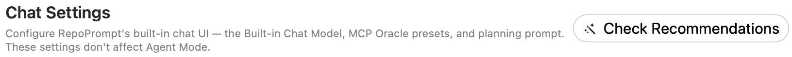
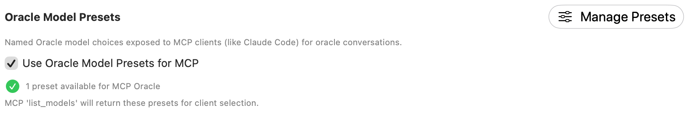
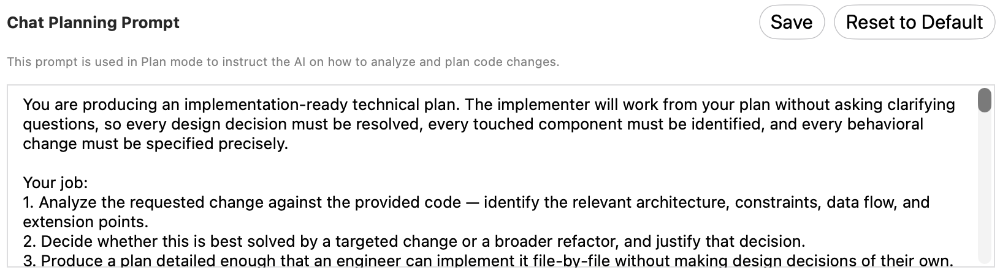
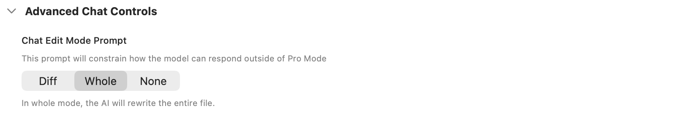
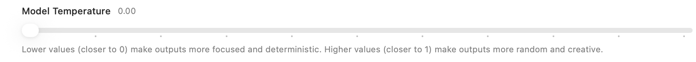

Configure the built-in chat model, the planning prompt, and named Oracle model presets exposed to MCP clients. Built-in chat settings are separate from Agent Mode configuration.

Open **Settings → Prompting → Chat Settings**. These controls configure RepoPrompt's built-in chat and MCP Oracle choices. Agent Mode uses its own configuration.

## Recommendations

**Check Recommendations** opens the recommendations flow for this window. Review the proposed setup there. The model and enabled options pictured on this page are examples, not recommendations for every task.

## Built-in Chat Model

Choose the model used by built-in chat. Available choices depend on configured providers and models. This picker does not replace your Agent Models role assignments.

## Oracle Model Presets

**Use Oracle Model Presets for MCP** exposes named presets to MCP clients. **Manage Presets** opens [Model Presets](../mcp-server/model-presets.mdx). This is the same enable setting shown on the MCP Server page, so it does not need to be configured twice.

If enabled with no presets defined, a fallback model picker is shown. If disabled, MCP uses the current Oracle model. The availability count is your current configuration, not a fixed preset limit.

## Chat Planning Prompt

Edit the instructions used by built-in chat's **Plan** mode, then choose **Save** to persist your draft. **Reset to Default** restores the shipped planning prompt and refreshes the editor. Copy any custom text you want to keep before resetting.

The text in the screenshot is the prompt being configured, not an instruction for someone reading this documentation.

## Advanced Chat Controls: edit mode

Expand **Advanced Chat Controls** to choose the response format used outside Pro Mode:

| Format | Behavior |
| --- | --- |
| **Diff** | Requests only the changes needed. |
| **Whole** | Requests complete replacement file contents. |
| **None** | Leaves chat unconstrained but does not support direct file editing through this format. |

The picker is disabled for a model that cannot use diff editing; selecting such a model switches the edit format to Whole.

## Model Temperature

The slider ranges from **0 to 1** in steps of **0.1**. Lower values request more focused output; higher values request more variation. The actual effect depends on the selected model and provider's support for temperature.

