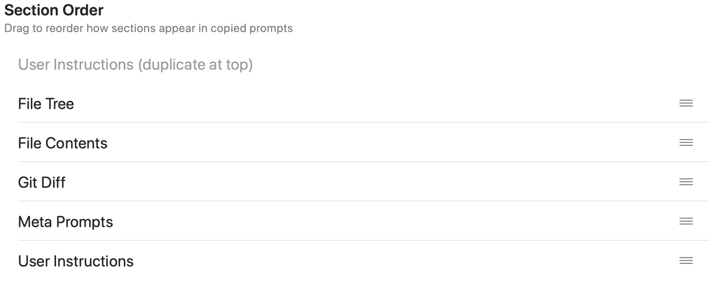
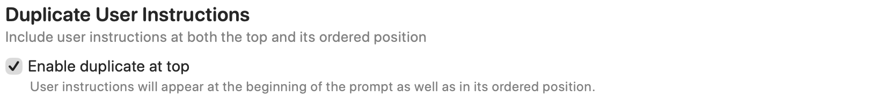

Set the order of sections in copied prompts and built-in chat context, and choose whether user instructions also appear at the top. Agent Mode assembles its own context independently.

Open **Settings → Prompting → Copy Prompt Order**. This affects copied prompts and built-in chat packaging. Agent Mode assembles its context separately.

## Section Order

Drag the section rows to change their order. The default is:

1. **File Tree**
2. **File Contents**
3. **Git Diff**
4. **Meta Prompts**
5. **User Instructions**

The order is saved when changed. Reordering does not enable a disabled content section or create missing content: disabled, empty, or unavailable sections are omitted during packaging.

## Reset to Default

**Reset to Default** restores and saves the five-section order above. It does not change the separate duplicate-instructions setting.

## Duplicate User Instructions

**Enable duplicate at top** adds user instructions at the start of the prompt as well as at their normal ordered position. The gray **User Instructions (duplicate at top)** row previews this fixed copy and cannot be dragged.

Turn the setting off to remove the extra top copy. The regular User Instructions row remains in the order you chose. No extra block is added when the instructions are empty.

