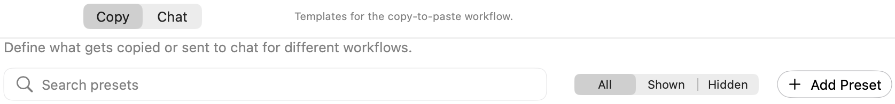
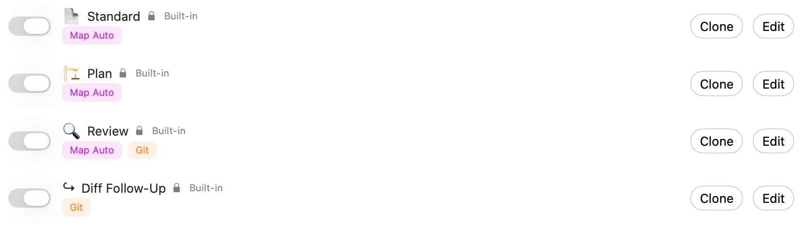
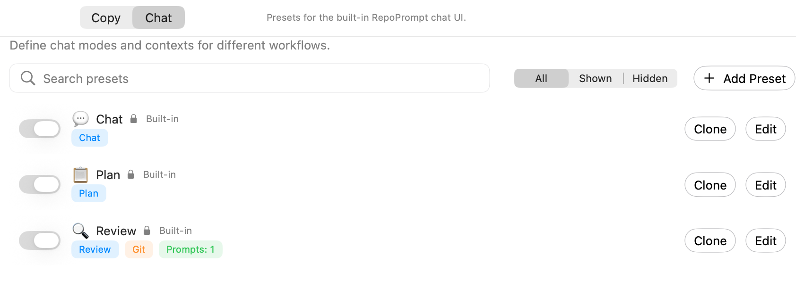
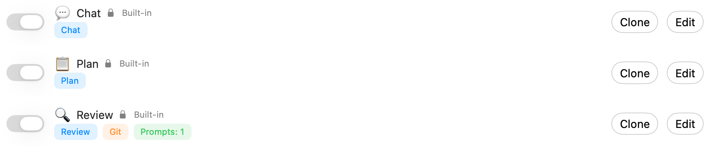

Manage reusable Copy and Chat presets that bundle prompts with Code Map, file-tree, and Git-diff options. These presets configure copied prompts and built-in chat rather than Agent Mode workflows.

Open **Settings → Prompting → Workflow Presets**. **Copy** and **Chat** use separate preset collections. These presets package copied context or configure built-in chat; they do not configure Agent Mode workflows.

## Choose a collection and find a preset

Switch between **Copy** and **Chat**, search by preset name, and filter **All**, **Shown**, or **Hidden**. Switching collection resets that list's search and filter state.

The switch beside each preset controls its visibility in the quick menu, not whether the preset is currently applied. **Add Preset** creates a custom preset. **Clone** starts a copy you can customize; **Edit** opens the selected preset's configuration.

## Copy presets

Copy presets bundle prompt packaging choices, including Code Maps, file-tree and Git-diff inclusion, and stored prompts. The captured built-ins are **Standard**, **Plan**, **Review**, and **Diff Follow-Up**.

Summary chips show non-default settings. **Map Auto** indicates automatic Code Map usage, and **Git** indicates Git content inclusion. The exact bundle can be inspected in the editor.

## Chat presets

Chat presets bundle the chat mode, optional model selection, context inclusion, and stored prompts. The pictured built-ins are **Chat**, **Plan**, and **Review**. Mode chips identify the chat mode; **Prompts: 1** reports one selected stored prompt, not one message in the conversation.

## Built-in and custom presets

The lock and **Built-in** label identify shipped presets. They can have saved overrides; a modified built-in is marked accordingly. **Reset Overrides**, where available, restores its shipped configuration. Built-ins cannot be deleted.

Custom presets have a delete action with confirmation. Hiding a preset keeps its saved configuration. Use [Copy Prompt Order](./copy-prompt-order.mdx) for the order of packaged sections, and [Chat Settings](./chat-settings.mdx) for the built-in model and planning prompt.

