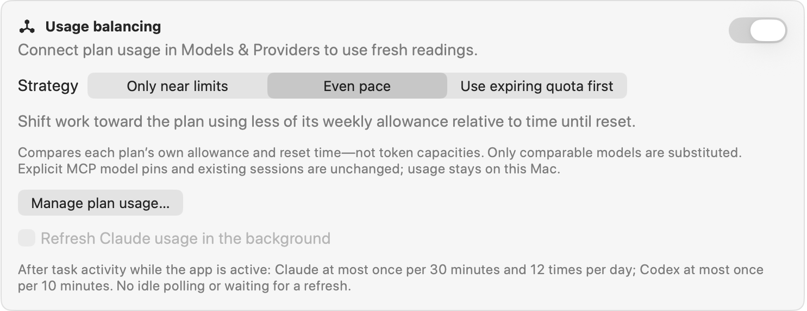
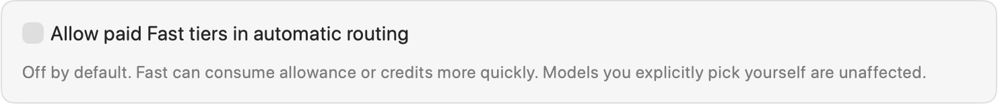
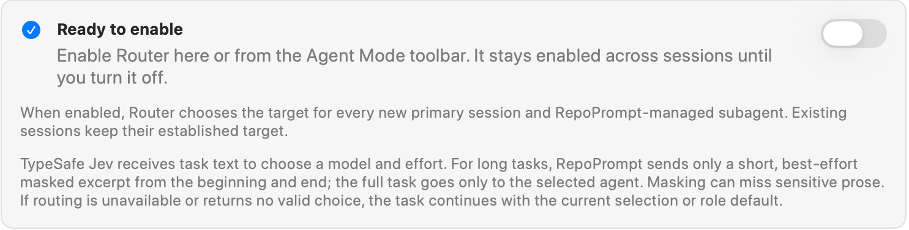
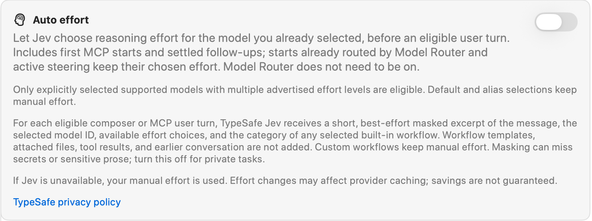
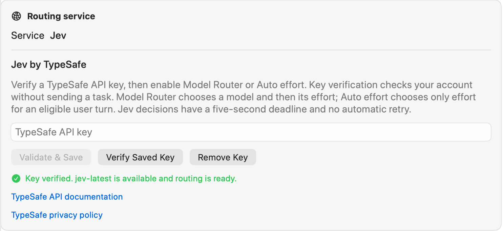
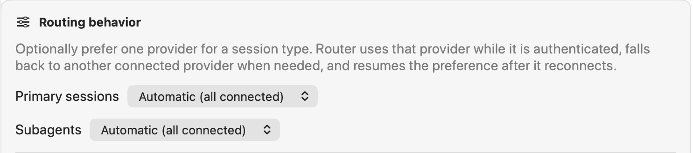
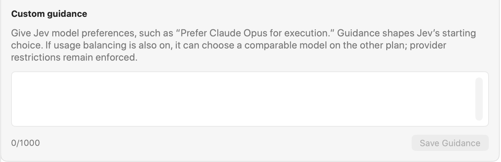
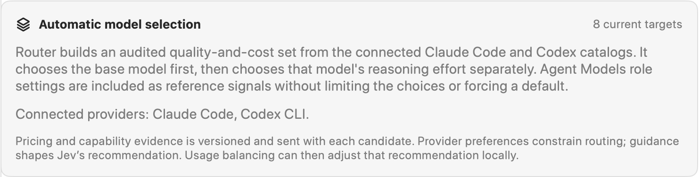

Configure how RepoPrompt chooses models and reasoning effort, balances connected plan usage, and connects to a decision service such as TypeSafe Jev.

These controls serve different purposes. You can balance usage locally, use a service to choose a model, let it choose only reasoning effort, or combine these features.

Open **Settings → Routing** in the version pictured here. Newer builds call this pane **Agent Decisions** and group the same features into **Model Router**, **Auto Effort**, **Usage Balancing**, and **Decision Services**. The screenshots show an example configuration, not recommended defaults; labels and placement can differ by build.

| Feature | What it changes | When it applies |
| --- | --- | --- |
| Usage balancing | Can substitute a comparable model on another connected plan | Eligible new tasks; usage decisions stay on your Mac |
| Model Router | Chooses a provider, model, and initial reasoning effort | New primary sessions and RepoPrompt-managed sub-agents |
| Auto effort | Chooses reasoning effort for the model you explicitly selected | Eligible user turns, including settled follow-ups |

## Usage balancing

Connect plan usage in [Models & Providers](../agent-mode/cli-providers.mdx), then turn on **Usage balancing**. **Manage plan usage…** opens the provider settings where you manage those connections.

Balancing compares each plan's own remaining allowance and reset time. It does not treat a percentage of one plan as the same token capacity as a percentage of another. Only comparable models are substituted. Existing sessions and explicit MCP model pins keep their targets.

Usage balancing is off by default. When enabled, the default strategy is **Even pace**:

| Strategy | Behavior |
| --- | --- |
| **Only near limits** | Keeps the starting model unless its plan is at least 90% used. |
| **Even pace** | Shifts work toward the plan with more unused weekly allowance relative to the time until reset. |
| **Use expiring quota first** | Favors spare weekly allowance resetting within a day; otherwise balances weekly pace. |

### Background usage refresh

**Refresh Claude usage in the background** requires a connected Claude usage source. Enabling it asks for consent to refresh through Claude Code's usage command and status line. It sends no model prompt, although Claude may retain normal session bookkeeping.

While the app is active, task activity can trigger refreshes: at most once per **30 minutes**, with **12 checks per rolling day** for Claude, and at most once per **10 minutes** for Codex. There is no idle polling, and routing does not wait for a refresh. Connected usage also supports a startup check and manual refresh.

Usage readings and balancing decisions stay on this Mac. This is separate from task excerpts sent when Model Router or Auto effort uses a decision service.

:::note[Additional control in newer builds]

**Override Model Router when usage is critical** is off by default. When enabled with usage balancing, it can restrict new tasks to one provider when a plan has at least 25% of its weekly allowance resetting within 48 hours, has 1.75 times the other plan's unused allowance relative to its remaining time, or the other plan is 90% used. Model Router then chooses within that provider, or is skipped if only one model qualifies. Primary sessions still require an eligible strong or frontier model; otherwise mixed routing remains in charge.

:::

## Paid Fast tiers

**Allow paid Fast tiers in automatic routing** is off by default. Enable it to make paid Fast variants eligible for automatic selection. These variants can consume plan allowance or credits more quickly. This setting does not change models you explicitly select yourself.

## Enable Model Router

First configure a decision service and connect a supported execution provider. **Ready to enable** means the service is ready and RepoPrompt can build an eligible set of models; it does not mean routing is already on.

Turn on the switch here or use **Router** in the Agent Mode toolbar. The setting stays enabled across sessions until you turn it off. It applies to each new primary session and RepoPrompt-managed sub-agent. Existing sessions keep their established targets, and explicit MCP model pins are respected.

Model Router chooses a model and then its initial reasoning effort, even if Auto effort is off. If routing is unavailable or returns no valid choice, the task continues with the current selection or its agent-role default.

## Auto effort

Turn on **Auto effort** to let the selected decision service choose reasoning effort before an eligible user turn. It keeps the selected model and works independently of the Model Router switch.

Eligible turns use a supported model you explicitly selected, with more than one advertised effort level. This includes first MCP starts and follow-up messages sent after the preceding turn has finished.

- Default selections, model aliases, and custom workflows keep manual effort.
- A start already handled by Model Router keeps its routed effort.
- Steering sent while a turn is running keeps the effort already in use; effort does not change between tool calls inside a turn.
- If the service is unavailable or cannot return a valid choice, RepoPrompt uses manual effort.

In newer builds, Auto Effort has its own **Decision service** selector. Changing Model Router's service does not change Auto Effort's service.

For each eligible message, the service receives a short, best-effort-masked excerpt, the selected model ID, available effort choices, and the category of any selected built-in workflow. Workflow templates, attached files, tool results, and earlier conversation are not added. Masking can miss sensitive text; turn this feature off for private tasks. Effort changes can affect provider caching, and savings are not guaranteed.

## Routing service: Jev by TypeSafe

The pictured configuration uses **Jev by TypeSafe**. In newer builds, open its card under **Decision Services** and select it for the feature you want to use.

1. Enter your **TypeSafe API key**.
2. Choose **Validate & Save** to verify and save it.
3. After verification succeeds, enable Model Router or Auto effort.

**Verify Saved Key** checks the stored credential again. **Remove Key** removes it; features that depend on that credential cannot make service decisions until a valid key is configured again.

Key verification checks account access without sending a task. For actual decisions, Jev chooses a model and then effort for Model Router, or only effort for Auto effort. Each Jev decision request has a **five-second deadline** and is **not retried automatically**.

The service card links to TypeSafe's API documentation and privacy policy. A verified key is only part of readiness: Model Router also needs an eligible execution model from a connected provider.

## Routing behavior

The pictured **Primary sessions** and **Subagents** menus set provider preferences separately for the two session types. **Automatic (all connected)** allows all eligible connected providers.

When you prefer a provider, routing uses it while it is authenticated and eligible. If it is unavailable, routing can fall back to another connected provider and resume the preference when the preferred provider reconnects. A preference does not establish a provider connection; manage that in [CLI Providers](../agent-mode/cli-providers.mdx).

Newer builds place model availability and guidance under **Routing configuration**; the provider preference menus shown here may not be exposed in that layout.

## Custom guidance

Use **Custom guidance** for model preferences, such as “Prefer Claude Opus for execution.” Saved guidance shapes the service's starting recommendation among eligible models. It does not add unavailable models or bypass provider restrictions. With usage balancing enabled, RepoPrompt may subsequently choose a comparable model on another plan.

The editor accepts up to **1,000 characters**. **Save Guidance** is available when the draft has changed and is within the limit. Clear the text and save to remove saved guidance.

Guidance is sent with routing requests. Avoid putting credentials or private information in it.

## Automatic model selection

RepoPrompt builds a curated set of eligible models from the connected Claude Code and Codex catalogs, using quality, cost, capability, and availability information. It chooses the base model first, then that model's reasoning effort separately.

[Agent Models](../agent-mode/agent-models.mdx) role settings are reference signals, not a fixed shortlist or forced default. Provider preferences constrain candidates, custom guidance shapes the recommendation, and local usage balancing may adjust it afterward.

The **8 current targets** shown in the screenshot is an example, not a fixed limit or guaranteed list. Available targets depend on connected providers, model availability, and routing settings such as paid Fast eligibility. Newer builds show **Available models** and reasons for unavailable models under Routing configuration.

## What gets shared

For a new routed session, the decision service receives a short task excerpt, saved custom guidance, Agent Models role references, and descriptions of candidate providers, models, and effort levels. RepoPrompt attempts to mask sensitive information; for long tasks it uses an excerpt from the beginning and end. The full task goes to the selected execution agent.

Attached files, workspace context, file paths, chat history, tool results, and execution-provider credentials are not automatically included in the routing request. Text you put directly into the task or guidance can still be shared, including sensitive information the masking misses.

Auto effort sends the narrower message-and-effort information described above. Usage balancing itself stays local. Review the service's privacy policy and turn off service-based decisions for tasks you do not want excerpted to that service.

