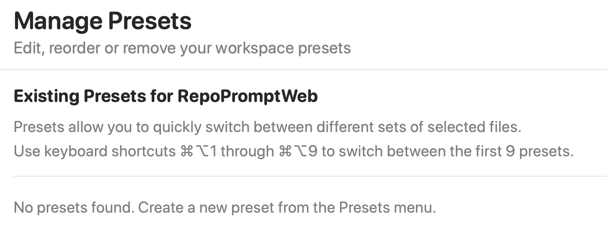
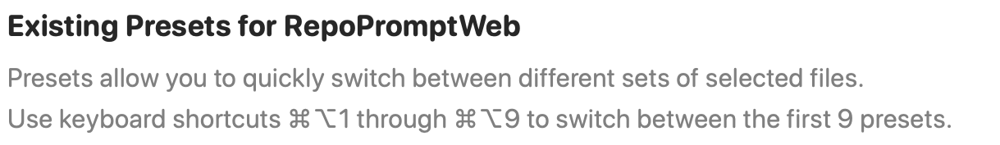

Manage saved workspace presets so you can restore reusable file selections and context configurations.

Open **Settings → Workspaces → Manage Presets** for the workspace you want to organize. These presets restore workspace file selections. They are separate from [Oracle Model Presets](../mcp-server/model-presets.mdx) and [Workflow Presets](../prompting/workflow-presets.mdx).

## Workspace scope

The heading identifies the workspace whose presets you are editing. The first nine presets can be selected with **Option+Command+1–9**, unless you remapped them in [Keyboard Shortcuts](../general/keyboard-shortcuts.mdx).

## Create the first preset

The screenshot shows an empty list. Create a preset from the workspace's **Presets** menu after preparing the selection you want to reuse. The new-preset shortcut is **Option+Command+P** by default.

## Manage existing presets

Once presets exist, each row offers switching, renaming, reordering, and deletion. Moving a preset up or down changes its position and therefore its numbered shortcut. A rename must contain non-whitespace text.

Switching applies the preset and closes the management sheet. Deleting removes the saved preset from that workspace; it does not delete the selected project files.

