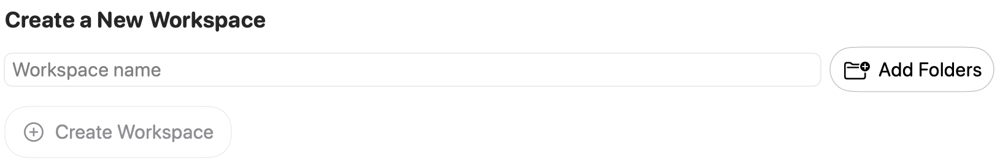

Organize the workspaces that group your project folders and context. Use this page to manage workspace entries and their associated folders.

Open **Settings → Workspaces → Manage Workspaces**. A workspace groups project folders and saved RepoPrompt context; it is not the project directory itself.

## Restore workspaces on launch

**Restore workspaces on launch** controls restoration of workspace windows when RepoPrompt starts. It does not create a new workspace or delete existing saved workspaces.

## Global Storage Location

Expand this section to see the custom storage path or **Using Default Storage**. **Set Storage Location** chooses where RepoPrompt stores workspace data. **Reset to Default** appears when a custom location is configured.

Changing this setting can migrate saved workspace data. It is separate from adding project folders to a workspace; it does not relocate your source-code directories.

## Create a New Workspace

Enter a **Workspace name**, choose **Add Folders** to select one or more directories, then choose **Create Workspace**. You can create from a name without folders, or from selected folders with an automatically supplied name. The button is disabled while both name and folder selection are empty.

The app creates the workspace and requests a switch to it. Adding folders references existing directories; it does not copy the project files.

## Browse and manage the library

Use **Saved**, **Temporary**, or **All** to choose the workspace collection, and **Search workspaces…** to filter the list. **Select** opens the multi-selection controls for bulk actions.

Existing workspace rows provide management actions such as renaming and hiding. Hidden workspaces remain recoverable. Deleting a workspace removes its saved state, tabs, and history; project folders are kept. Bulk deletion asks for confirmation and stops running work in affected workspaces.

When duplicate records share project roots, newer builds can offer **Consolidate Duplicates…**. Its confirmation explains the backup and preservation of records still in active use. Workspace operations requested by clients can also be governed by [Workspace Approvals](../mcp-server/workspace-approvals.mdx).

