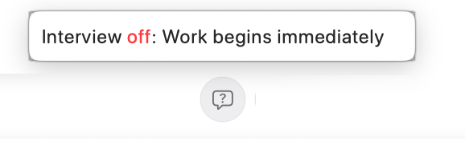

The **Interview** control is the question-bubble icon above the editor. Turn it on when your initial request needs a few decisions resolved before the agent starts. It is useful when you know the outcome you want but have not decided the scope, preferred approach, or tradeoffs.

## Enable before the first task

Write your request, turn **Interview** on, and send. The control's tooltip distinguishes **Interview on: Asks questions before starting** from **Interview off: Work begins immediately**. When enabled for the first task, RepoPrompt asks the agent to interview you before beginning substantive work.

The interview instructions call for one question at a time, normally with two to four concrete answer choices. The agent should adapt each question to your previous answer, ask one to three questions in total, and stop sooner when the task is clear. It should then summarize what it learned and proceed.

Use the question card to select an answer or supply your own explanation. Give answers about the intended result and constraints: for example, whether a change should affect one screen or the entire application, or whether you want a proposal before implementation.

## Understand the scope

Interview is a first-task instruction, consumed when used; it is not a requirement to interview you on every follow-up. Turning it on after the conversation already contains an assistant response does not retroactively restart the opening interview. You can always ask a follow-up such as “Before continuing, clarify the remaining decisions with me.”

Interview guides model behavior, so the exact questions depend on the provider and task. It does not change the session's tool permissions or promise that the agent will pause before every later action. Approval requests remain governed by [Tools and permissions](./tools.mdx).

## Combine it with a workflow

Choose the [execution location](./execution-location.mdx), then a [Workflow Template](./workflow-templates.mdx), and enable Interview if you want a short clarification step before that method begins. **Deep Plan** also has its own instructions for establishing how involved you want to be. Choose the combination that matches your task rather than assuming every template needs an interview.

[Re-Prompter](./re-prompter.mdx) serves a different stage: it helps rewrite the draft in your editor before the execution agent receives it.
