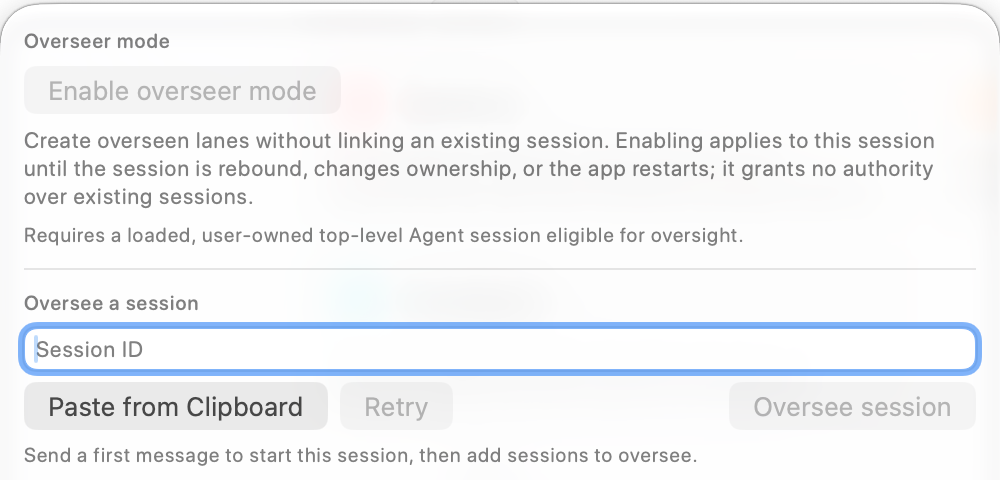

The oversight control sits between **Workflow** and **Interview** above the message editor. Open it to manage the current session's relationships with other Agent sessions, including sessions in other RepoPrompt windows. The screenshot shows the control's earlier branching-symbol appearance; newer builds use oversight role marks and counts.

## Start with a loaded session

Send a first message so the session exists and is loaded. A blank composer can display **Send a first message to start this session, then add sessions to oversee**. Overseer activation requires an eligible, user-owned top-level Agent session. When the session is unavailable or ineligible, the popover explains why its controls are disabled.

**Enable overseer mode** lets the session create managed lanes without first linking an existing conversation. Enabling it grants no access to unrelated sessions. The activation applies to this session until it is rebound, changes ownership, or the app restarts.

## Add an existing session

Copy the target's session ID from its sidebar controls, enter it under **Oversee a session**, or choose **Paste from Clipboard**. Check the preview and choose **Oversee session**. The confirmation explains what the overseer will be allowed to read and control. Choose **Retry** if a session has just become available and the candidate information needs refreshing.

This relationship can allow the overseer to read status and conversations, send instructions, steer or stop work, answer questions and applicable one-time approval requests, compact context, and receive updates. Treat the confirmation as a delegation decision.

## Organize and delegate

Beyond a single link, an overseer can request a scope for organizing sessions, controlling work, creating nested coordinators, or managing worktrees on behalf of member sessions. Review the proposed coverage and permissions before granting it. A scope and a link serve different purposes; linking one session does not give access to every session in its workspace.

See [delegated permissions](../overseer/overview.mdx#organize-sessions-with-delegated-permissions) for the available capabilities, nested-scope limits, and actions that remain with you.

## Read and manage relationships

The popover lists sessions this agent oversees and sessions overseeing it. Role marks and counts help distinguish the two directions. Open a linked session to inspect its work; **Unlink** removes the relationship without deleting the conversation. Automatic wake controls decide when updates can start follow-up work and therefore affect model usage.

For the full feature, continue with [Overseer Mode Overview](../overseer/overview.mdx), [Lanes](../overseer/lanes.mdx), [Linking Sessions](../overseer/linking-sessions.mdx), and [Best Practices](../overseer/best-practices.mdx).
