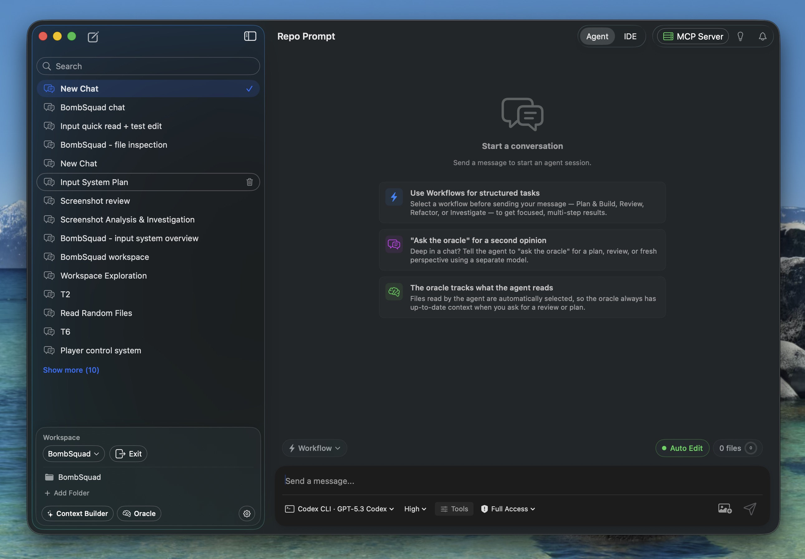

Agent Mode hands off RepoPrompt's context engineering to your coding agents. The same best practices that make IDE Mode in the older Classic Edition powerful — codemaps, file slicing, token-budgeted selection, structured prompts for reasoning models — are managed by agents on your behalf, inside a native macOS session host.

## What Is Agent Mode?

Agent Mode runs CLI coding agents directly inside RepoPrompt, giving them full access to the same context tools you used in the Classic Edition's IDE Mode — file search, code structure, codemaps, Context Builder, and Oracle Chat. The agents apply RepoPrompt's best practices for context engineering automatically: curating token-efficient selections, using codemaps for architectural awareness, and structuring prompts for optimal reasoning. You watch their work stream in real time, review changes, and guide them as needed.

## Supported Providers

Choose a coding-agent integration from the [Providers & Models directory](../providers/overview.mdx#coding-agents). Each provider's reference explains setup prerequisites, authentication, capabilities, and account boundaries. Configure the corresponding fields and controls in [CLI Providers settings](../settings/agent-mode/cli-providers.mdx).

Use the models actually offered by that connection. The [Models guide](../providers/models.mdx) explains availability, identifiers, reasoning effort, and separate choices for execution, Oracle, and Context Builder.

## Key Capabilities

- **Per-Tab Sessions:** Each compose tab gets its own agent session. Run multiple agents in parallel across different tasks with isolated context
- **Context Builder Integration:** Agents trigger Context Builder directly — a discovery agent curates the right files, then an analysis model generates plans, reviews, or deep answers grounded in your actual code
- **Oracle Chat:** Consult separately configured reasoning models for plans, reviews, and answers based on prepared task context.
- **Token-Efficient Tools:** Use Code Maps and line slices to supply relevant structure and implementation without including every file in full.
- **Edit Review:** Inspect edits and control approval behavior through the provider's permissions and Auto Edit setting.
- **File Attachments:** Attach supported images and files to a message, with delivery determined by the selected provider. See [Message Editor](../sessions/message-editor.mdx).
- **Re-prompt Before Sending:** Rewrite a draft inline, review clarifications, and choose the model and guidance used to prepare it.
- **Overseer Coordination:** Organize sessions, delegate within approved scopes, and manage worktrees for linked agents.
- **Session Management:** Resume sessions, track token usage, and manage multiple agent conversations

## How It Works

The typical Agent Mode flow looks like this:

1. **Open a workspace** and start a session for the task.
2. **Choose its execution location** — work in the workspace checkout, create a new worktree, or choose an existing worktree.
3. **Select a workflow template** from the **What are we building?** cards or the **Workflow** selector, then write your goal and constraints. The template wraps that message in a method for the task.
4. **Check the model, effort, tools, and permissions**, then send.
5. **Watch and guide** through conversation, tool cards, live questions, and approval requests. Inspect the resulting changes before accepting the result.

Read [Sessions & Interface](../sessions/overview.mdx) for the complete composer walkthrough and individual control guides. For coordinated top-level sessions and managed lanes, see [Overseer Mode](../overseer/overview.mdx).

## Getting Started

Open **Settings → Agent Mode → CLI Providers** and connect the provider you intend to use. Codex includes a managed runtime; other integrations may require an installed CLI or a managed runtime installation. Use **Test Connection** and complete any authentication the selected provider requests.

Open your project, choose the session's location and workflow, and send a specific task. Model availability and permission behavior depend on the connected provider.

:::tip

**Onboarding Wizard:** When you first launch RepoPrompt, the onboarding wizard will guide you through setting up Agent Mode and testing your CLI providers.

:::
