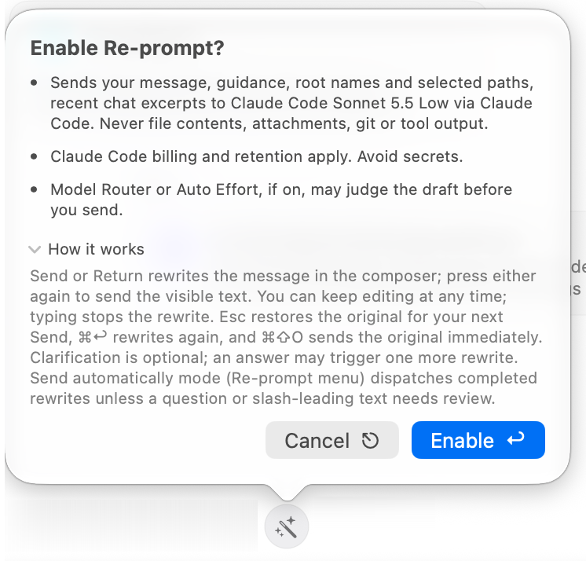

**Re-prompt** is the wand control above the message editor. It asks a separate model to improve your draft before you send it to the session's execution agent. Use it to make a rough request clearer, organize constraints, or turn an informal description into a more useful task brief.

## Rewrite, review, then send

Enable Re-prompt and read its first-use disclosure. Write the request and press **Return** or click **Send**. In the normal review mode, this first action rewrites the text in the composer. Review and edit the visible draft, then press Return or Send again to submit it.

You remain in control of the draft. Typing stops an in-progress rewrite. **Escape** restores the original for your next Send. By default, **⌘Return** asks for another rewrite, and **⌘⇧O** sends the original immediately. You can remap the two composer commands in [Keyboard Shortcuts](../settings/general/keyboard-shortcuts.mdx). Use these controls according to the current composer state rather than repeatedly pressing Send while a rewrite is still arriving.

The rewriter can offer an optional clarification question. Answering can produce another revision. You can also continue with the visible draft without answering. This clarification happens before submission; [Interviewer](./interviewer.mdx) asks the execution agent to clarify the task after submission.

## Choose a model and mode

Open the control's context menu to select an available Re-prompt model, restore its automatic default, change **Mode**, or toggle **Include recent chat context**. **Agent Models Settings** opens the related configuration. If no usable model is connected, the control offers **Choose model** instead of silently selecting an unavailable provider.

**Send automatically** mode dispatches completed rewrites unless a clarification question or slash-leading text needs review. Use review mode when you want to inspect every rewritten request. Your Re-prompt model is separate from the model that ultimately performs the task.

### Set rewrite guidance

Open **Agent Models Settings** from the Re-prompt control, then expand **Rewrite guidance (advanced)** in the Re-prompt configuration. Describe how the rewriter should prepare your requests—for example, preserve acceptance criteria, keep file paths unchanged, or separate required changes from open questions. Choose **Save** to apply the draft settings; **Restore Default** restores the built-in guidance to the draft.

Guidance changes how the draft is prepared; it does not grant the execution agent extra permissions. Review the rewritten text and any clarification before sending, especially when the request contains strict scope limits. See [Re-prompt settings](../settings/agent-mode/agent-models.mdx#re-prompt) for model and context options.

## Know what is shared

The rewriting provider receives your message, rewriting guidance, workspace root names and selected paths, and recent chat excerpts when enabled. File contents, attachments, Git output, and tool results are not included in that rewriting request. The screenshot's model name is an example; provider billing and retention apply to the configured route.

Paths, names, excerpts, and anything you type can still be sensitive. Read the disclosure when changing providers. If model routing or [Auto Effort](./auto-effort.mdx) is enabled through [Agent Decisions](./model-router.mdx), the resulting task can also be evaluated by its configured decision service before the execution agent starts.
