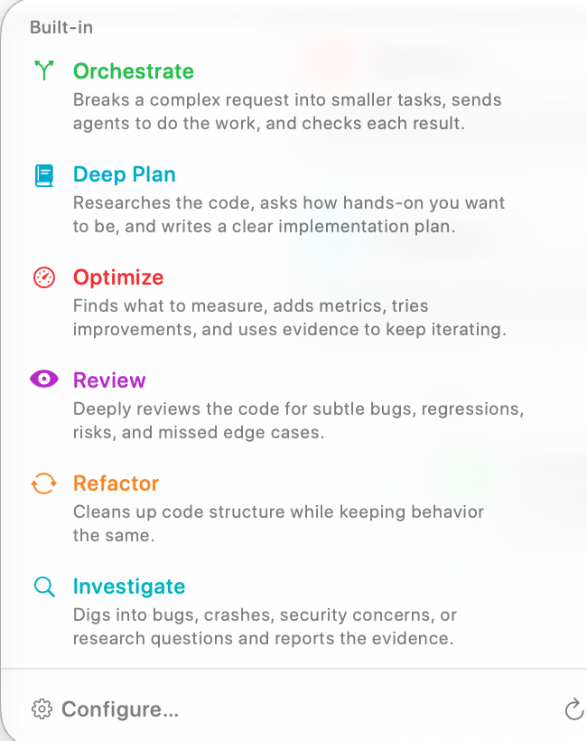

A workflow template gives the agent a method for handling your request. You provide the task; the template supplies instructions about research, planning, delegation, implementation, or review. Choose a workflow when you want that structure without writing the full procedure yourself.

## Choose from the welcome screen

On an empty session, select a card under **What are we building?**. The selected card prepares the next message and focuses the editor. Selecting it again clears that choice. Use the arrows or page dots to browse more cards; the cards reflect your visible workflows and featured choices.

## Choose from the Workflow selector

Open the lightning-bolt **Workflow** control above the editor. This selector offers the workflow catalog while you compose, including custom workflows you have added. The name and short description help you choose a method before sending. **Configure…** and the welcome screen's **Edit** control open workflow configuration; the refresh control reloads the available definitions.

| Template | What it asks the agent to do |
| --- | --- |
| **Orchestrate** | Break a complex request into tasks, delegate work, and check the results. |
| **Deep Plan** | Research the code, establish how involved you want to be, and produce a detailed implementation plan. |
| **Optimize** | Establish measurements, instrument the relevant behavior, and iterate using evidence. |
| **Plan & Build** | Research the request, plan the change, and implement it step by step. |
| **Review** | Examine code for bugs, regressions, risks, and missed edge cases. |
| **Refactor** | Improve code structure while preserving its intended behavior. |
| **Investigate** | Research a bug, crash, security concern, or question and report supporting evidence. |
| **ChatGPT Export** | Assemble code and context into a prompt you can take to ChatGPT. |

The list depends on visibility settings; a hidden built-in template remains configurable. See [Agent Workflows settings](../settings/agent-mode/agent-workflows.mdx) to show, hide, feature, reorder, or clone templates and create custom Markdown workflows.

## Send the request through the template

Select the template, then write a specific request: “Review the checkout changes for cancellation bugs; focus on session cleanup” is more useful than “Review.” Choose the [execution location](./execution-location.mdx), check the model and permissions, and send. RepoPrompt wraps the message in the selected template and clears the selection after accepting the submission. Select another template when a later message needs a different method.

Templates are instructions to an agent, so the actual work depends on the task, connected models, tools, and permissions. Selecting **Orchestrate** does not itself start other sessions, and selecting **Review** does not grant additional repository access.

These Agent Mode templates are configured separately from [Copy/Chat Workflow Presets](../settings/prompting/workflow-presets.mdx) and external [Skills & Slash Commands](../agent-mode/skills.mdx). For external command syntax and installation, see [MCP Workflow Commands](../mcp-server/workflow-commands.mdx).

## Built-in workflow procedures

These templates describe an intended process. The agent follows their instructions using its available tools and permissions; selecting a template does not enforce every step or guarantee a result. For the Explore, Engineer, Pair, and Design roles, see [Agent Models](../settings/agent-mode/agent-models.mdx#sub-agent-role-defaults).

### Orchestrate

Plans a complex task, decomposes it into discrete work items, and dispatches sub-agents (`pair`, `engineer`, `design`, `explore`) to implement each one. The orchestrator stays lean — it coordinates and monitors, while worker agents handle the actual implementation in fresh context windows. Works with both UI-started and MCP-started sessions.

**Flow:** Workspace verification → Contextualize task & Context Builder (`plan` + export) → Decompose into work items → Dispatch sub-agents → Monitor and verify

### Deep Plan

Produces a polished, ready-to-execute architectural specification at `docs/plans/<topic>-<YYYY-MM-DD>.md` without implementing code. The workflow asks for your preferred involvement level (**Up front**, **Mid-flow**, or **Hands-off**), dispatches parallel `explore` agents across workspace seams, external research, and prior art, runs Context Builder (`plan` mode with export) to build a coverage ledger, dispatches a `design` agent to write an independent critique under `docs/reviews/`, and performs a fidelity-preserving editorial pass.

**Flow:** Involvement decision (`ask_user`) → Map seams (`explore` agents) → Scaffold plan → Context Builder (`plan` + coverage ledger) → Design critique (`design` agent) → Editorial polish & fidelity verification

### Optimize

Runs a delegation-first, evidence-driven performance optimization loop. The agent scouts bottleneck candidates with parallel `explore` agents, plans debug-gated instrumentation and a baseline procedure via Context Builder, dispatches a `pair` agent to capture baseline metrics in a persistent scoreboard (`prompt-exports/optimize-<slug>-runs.md`), and iterates one attributed change at a time — consulting the Oracle after each run until the target metric is met, diminishing returns are reached, or the 5-iteration cap is hit.

**Flow:** Bottleneck scouting (`explore` agents) → Plan metrics & instrumentation (Context Builder) → Land debug instrumentation & baseline (`pair` agent) → Serial optimization loop (Plan → Implement & measure → Verify scoreboard → Consult Oracle) → Final rollup

### Plan & Build

The comprehensive end-to-end implementation workflow. The agent does a quick scan of your codebase, calls Context Builder to gather deep context and generate an architectural plan, refines the plan through Oracle Chat when ambiguities arise, and then implements the solution directly.

**Flow:** Quick scan → Context Builder (with `plan`) → Refine with Oracle Chat → Implement with editing tools

### Review

Surveys your git changes, determines the comparison scope (uncommitted, staged, vs `main`, etc.), and uses Context Builder to produce a thorough code review grounded in your full codebase — not just the diff.

**Flow:** Survey git state → Confirm scope → Context Builder (with `review`) → Clarify findings via Oracle if needed

### Refactor

Analyzes your code for redundancies and complexity using parallel `explore` scouts and Context Builder's `review` mode, generates an incremental refactoring plan via Context Builder's `plan` mode, and dispatches `pair` or `engineer` sub-agents to implement improvements step by step while verifying that existing behavior and tests are preserved.

**Flow:** Scope & analyze (`explore` + Context Builder `review`) → Plan improvements (Context Builder `plan`) → Decompose & dispatch (`pair`/`engineer`) → Verify tests and diffs

### Investigate

Systematic codebase exploration for debugging and root-cause analysis. The workflow template calls for read-only source inspection while creating and updating an investigation report; it explicitly rules out source-code changes. The coding agent triages symptoms into `docs/investigations/<topic>-<YYYY-MM-DD>.md`, optionally dispatches `explore` agents for git blame archaeology and external research, uses Context Builder for broad discovery, dispatches a `pair` investigator to test hypotheses, and synthesizes findings with the Oracle until the root cause is confirmed with line-level evidence.

**Flow:** Triage & scaffold report → External fact-gathering (`explore`) → Broad discovery (Context Builder) → Deep investigation (`pair`) → Oracle synthesis & final report

### ChatGPT Export

Builds focused context for your task using Context Builder (`clarify` mode), checks selection and token counts, and exports a self-contained Markdown prompt file under `prompt-exports/`. Use it with a model available in ChatGPT or another external AI service for a second opinion; the export does not select or grant access to a model.

See [How Do I Find the ChatGPT Pro Interface?](../faq/chatgpt-pro.mdx) for the browser workflow, account/model distinction, and how to return the analysis to a coding session.

**Flow:** Classify intent → Context Builder (`clarify` mode) → Verify workspace context → Export prompt file to `prompt-exports/`

## Clarify the task and prepare context

Enable [Interviewer](./interviewer.mdx) in the composer when you want questions before work begins. Use [Re-prompt](./re-prompter.mdx) to improve a draft before the execution agent receives it. Deep Plan also asks how involved you want to be during planning.

[Context Builder](./context-builder.mdx) discovers and curates relevant files; [Oracle](./oracle.mdx) reasons over prepared context. Read [How It Works](../overview/how-it-works.mdx) for the discovery and handoff pipeline, and configure Oracle rosters in [Agent Models](../settings/agent-mode/agent-models.mdx#oracle-models).
