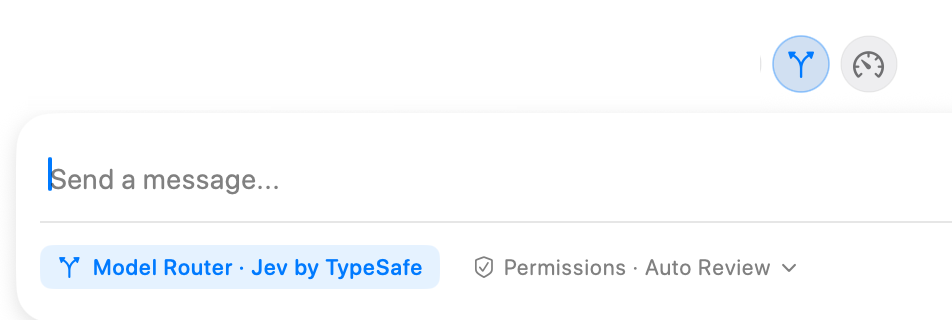

**Agent Decisions** brings together automatic model routing, Auto Effort, local Usage Balancing, and decision-service configuration. Open [Settings → Agent Mode → Agent Decisions](../settings/agent-mode/agent-decisions.mdx) to configure these features.

For a new task, use the branching-arrow routing control above the message editor to let RepoPrompt choose an execution model and initial reasoning effort. Routing uses your connected providers, decision settings, and task description. [Auto Effort](./auto-effort.mdx) separately chooses effort for eligible turns while keeping the selected model.

## Read the composer state

An enabled control is highlighted, and the composer can show **Model Router · [service]** where the ordinary model choice would appear. The screenshot shows the routing control’s **Model Router** label. The pictured service is **Jev by TypeSafe**, but **Decisions by OpenAI** (the OpenAI Decisions API) is also available. Select either service in Agent Decisions settings. Click the service label to open Agent Decisions settings. If the service is unavailable, the control directs you to configuration.

Configure and verify the decision service and connect an eligible execution provider before enabling routing. The decision service chooses among execution models; it is not itself the coding agent that edits your repository. Available candidates depend on provider connections, model support, and routing configuration.

## New tasks and existing sessions

The model-routing switch is global and stays enabled across sessions until you turn it off. It applies to new primary sessions and eligible RepoPrompt-managed sub-agents. It does not replace an established session's model on every follow-up. Explicit model pins in agent launches remain respected.

If routing fails or yields no valid choice, the task continues with the current selection or applicable role default. Local usage balancing can adjust a recommendation to a comparable eligible model. Paid Fast variants require separate eligibility settings; the router does not make those costs disappear.

## Balance usage across connected plans

The new-task defaults and routing candidates favor capable models for the requested work. Inspect the effective defaults in [Agent Models](../settings/agent-mode/agent-models.mdx), and use [Providers & Models](../providers/overview.mdx) for model availability.

Optional **Usage Balancing** compares connected plans' remaining allowance and reset times locally. Choose **Only near limits**, **Even pace**, or **Use expiring quota first** according to how you want to use those plans. Connect the usage sources through **Manage plan usage…**; a working coding connection alone does not establish usage readings.

Balancing can substitute a comparable eligible model for a new task, including after a router recommendation. **Override Model Router when usage is critical** is a separate opt-in that can narrow the provider choices when allowance is near its limit or would otherwise expire. Established sessions and explicit MCP model pins keep their targets. See [Usage balancing settings](../settings/agent-mode/agent-decisions.mdx#usage-balancing) for thresholds and refresh behavior.

## Review information sent for a decision

Routing sends a short task excerpt, custom routing guidance, role references, and descriptions of candidate models and effort levels to the selected service. RepoPrompt attempts to mask sensitive text, but masking is best effort. Attached files, repository context, chat history, tool results, and execution-provider credentials are not automatically included. Sensitive information typed directly into the task or guidance can still be shared.

The full task is then sent to the chosen execution agent. Review service privacy details and disable routing for tasks you do not want excerpted to that service.

See [Agent Decisions settings](../settings/agent-mode/agent-decisions.mdx) for service verification, available models, usage balancing, Fast-tier eligibility, and guidance. [Auto Effort](./auto-effort.mdx) makes a narrower decision for eligible turns on a model you selected.

## Choose a decision service

Use the [Decisions by OpenAI and Jev comparison](../settings/agent-mode/agent-decisions.mdx#choosing-decisions-by-openai-or-jev) to compare account setup, verification, data handling, and the capabilities RepoPrompt actually uses. Choose routing and Auto Effort services independently; evaluate them on representative tasks rather than assuming one is universally faster, cheaper, or more accurate.
