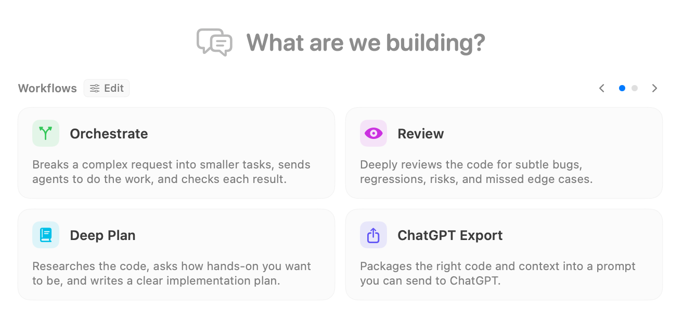

A session is a conversation with a coding agent, together with its execution location, selected context, tool activity, and results. Start a separate session for a separate task. Sessions can use different providers and models, but two sessions working in the same checkout still share the files in that checkout.

Before your first message, make two deliberate choices: **where the work will happen** and **which workflow, if any, should structure the request**. These choices give the agent a place to work and a method to follow.

## 1. Choose the execution location

Open **Work locally** above the message editor. Choose **Workspace checkout** to work directly in the open workspace, **New worktree** for a separate Git checkout, or one of the **Existing worktrees** to continue work there. Your initial worktree choice is applied when you first send a message.

Use the workspace checkout for changes you want in the files already open. Prefer a separate worktree when several agents will edit the same repository, when you want to compare approaches, or when the current checkout contains unrelated work. Choosing a separate conversation alone does not isolate file changes.

Read [Execution Location](./execution-location.mdx) before changing the location of an established session: that change can stop an active run and restart its provider context.

## 2. Wrap the message in a workflow template

The **What are we building?** screen offers workflow cards. Select a card such as **Orchestrate**, **Review**, **Deep Plan**, or **ChatGPT Export**, then write your actual request. The arrows and page dots reveal more cards. Selecting a card prepares the workflow; it does not start the task.

You can make the same choice from the lightning-bolt **Workflow** selector above the editor. Its catalog includes built-in and custom templates. A template wraps your message in instructions for how to approach it: for example, investigate and plan before implementing, or inspect changes and report review findings. Include your goal, constraints, and acceptance criteria in the message itself.

The selected workflow applies to the submitted message and is cleared after submission. Select it again for another message that needs the same structure. You can also send a plain request with no template selected. See [Workflow Templates](./workflow-templates.mdx) for the catalog and configuration controls.

## Send, watch, and guide

Choose a connected provider and model below the editor, then an available reasoning effort. The screenshots show particular models and settings; your choices depend on your connected runtimes. **Tools** controls provider capabilities, and **Permissions** controls how tool requests are approved. Review both before giving the agent a task with significant file or shell work.

Send with **Return** or the paper-plane button. The conversation shows replies, tool cards, file reads, edits, and requests for input. Expand a tool card to inspect what happened. Respond to live questions or approval requests in their cards. Provider permissions determine which actions require your approval; review changes in the transcript and repository even when edits were applied automatically.

Continue in the same session when the next message depends on the conversation. Use [Session History](./session-history.mdx) to find earlier work or start another session for an independent task.

## Find the control you need

| Goal | Guide |
| --- | --- |
| Ask questions before work begins | [Interviewer](./interviewer.mdx) |
| Improve a draft before sending it | [Re-Prompter](./re-prompter.mdx) |
| Let a service choose a new task's model | [Agent Decisions](./model-router.mdx) |
| Let a service choose effort for eligible turns | [Auto Effort](./auto-effort.mdx) |
| Let a supported Codex session interact with desktop apps | [Computer Use](./computer-use.mdx) |
| Write messages, attach context, and send follow-ups | [Message Editor](./message-editor.mdx) |
| Pick the execution model and reasoning budget | [Model and Effort](./model-and-effort.mdx) |
| Configure tools and approvals | [Tools](./tools.mdx) |
| Respond to a tool decision, edit review, or hook request | [Approvals and Paused Sessions](./approvals.mdx) |
| Consult other models or assemble repository context | [Oracle](./oracle.mdx) and [Context Builder](./context-builder.mdx) |
| Prepare a package for an external model | [Prepare and Copy Context](./context-composer.mdx) |
| Integrate completed worktree changes | [Review and Merge](../worktrees/review-and-merge.mdx) |
| Coordinate multiple sessions | [Overseer](./overseer.mdx) and [Overseer Mode](../overseer/overview.mdx) |
| Provide a screenshot or mockup | [Image Support](./image-support.mdx) |
