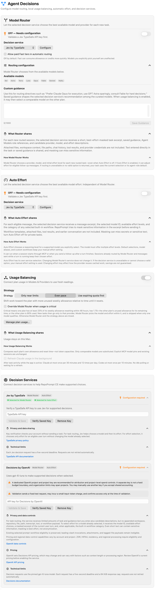
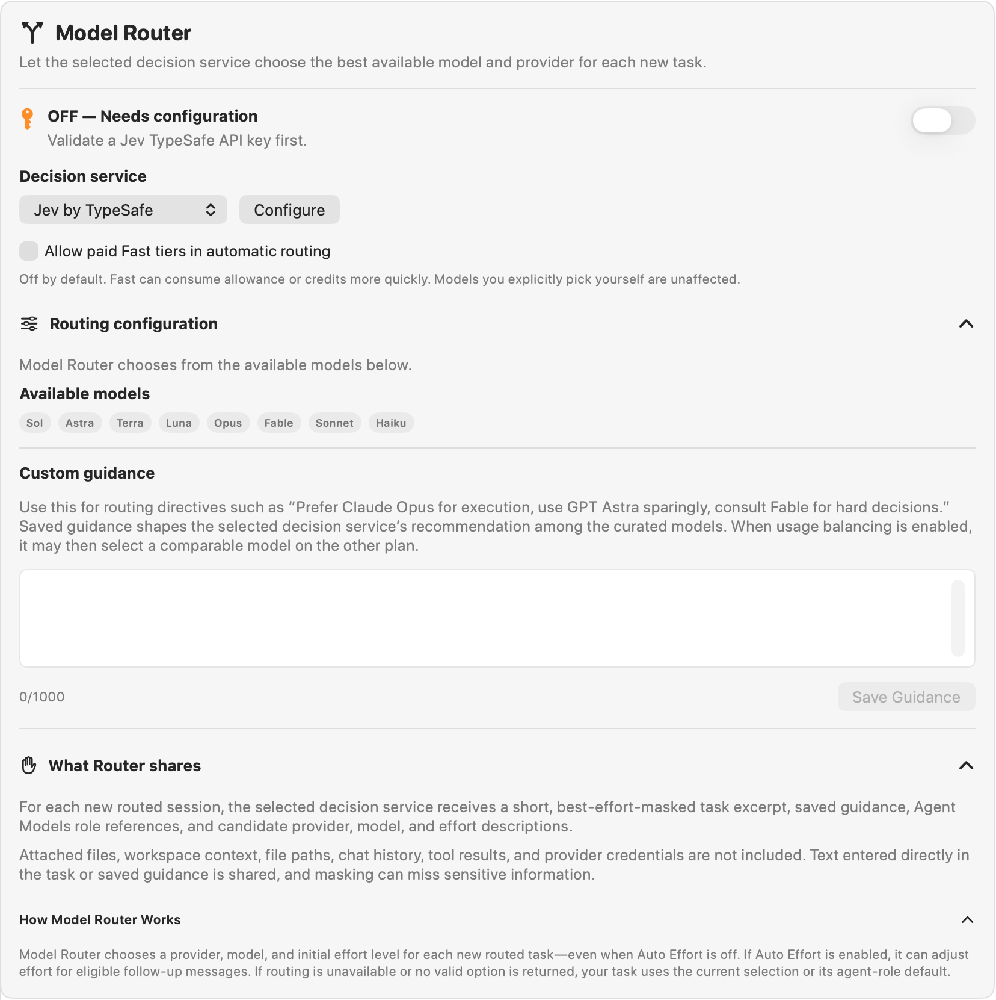
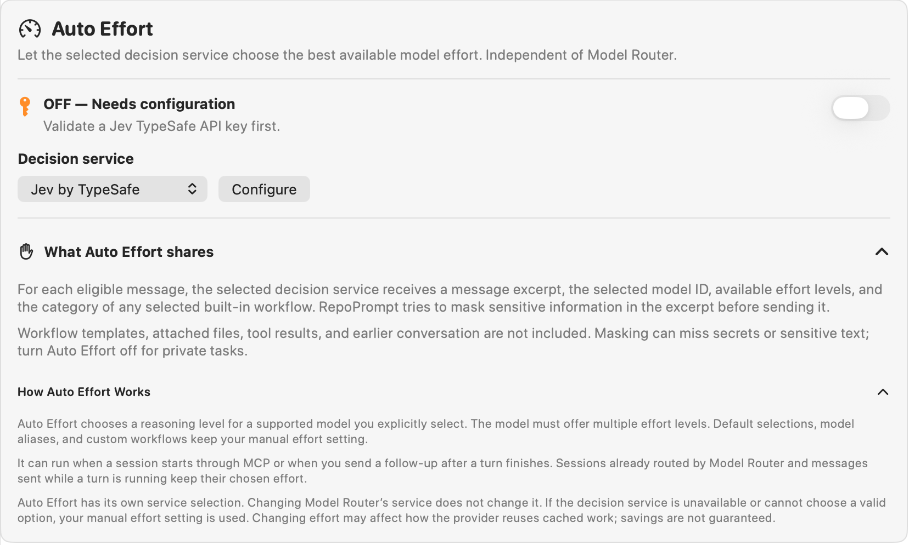
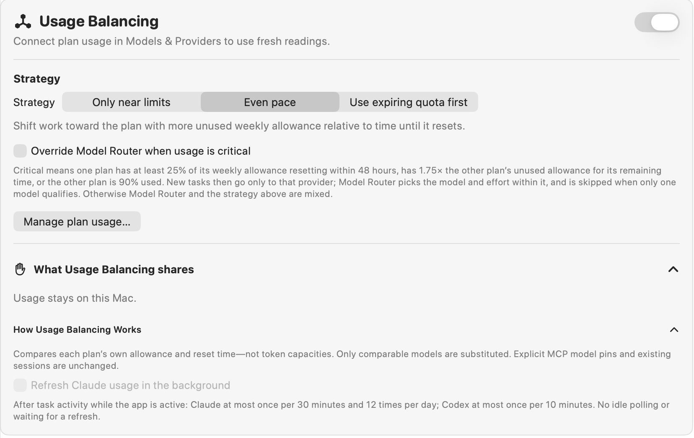
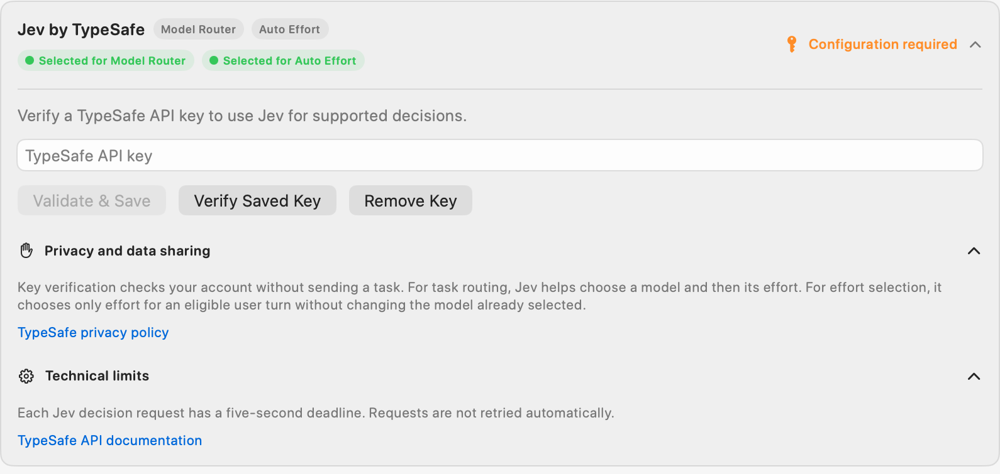
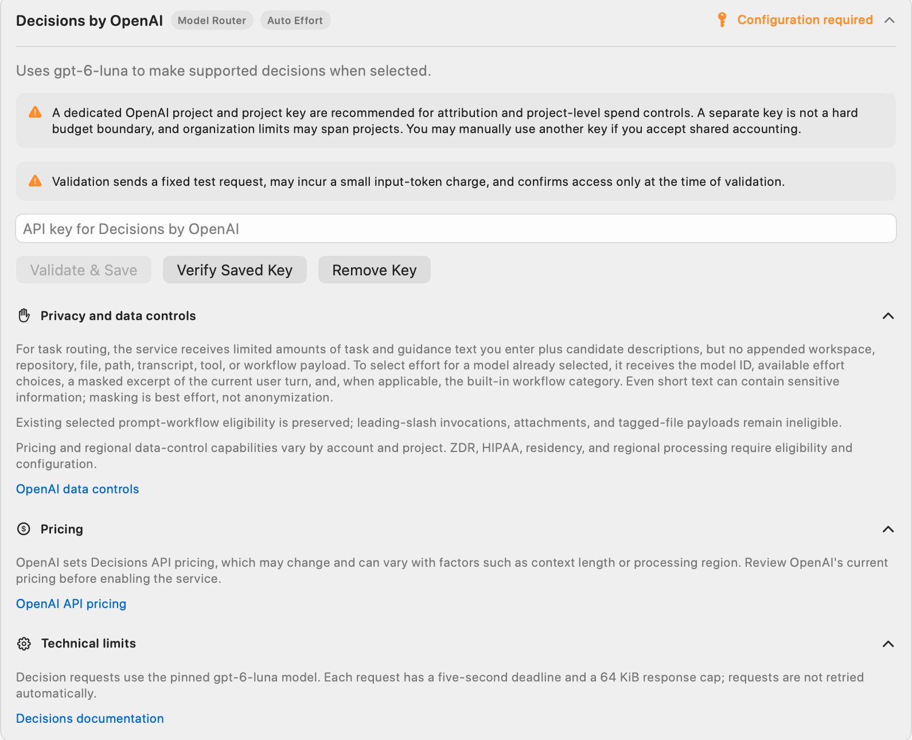

Open **Settings → Agent Mode → Agent Decisions**, between **Agent Workflows** and **Context Builder**.

Choose how RepoPrompt selects execution models and reasoning effort, balances plan usage, and connects to decision services. These controls have separate responsibilities:

| Feature | What it changes | When it applies |
| --- | --- | --- |
| Model Router | Selects a provider, model, and initial reasoning effort | Eligible new primary sessions and managed sub-agents |
| Auto Effort | Selects reasoning effort while keeping your chosen model | Eligible user turns, including follow-ups after a turn finishes |
| Usage Balancing | Can substitute a comparable model on another connected plan | Eligible new tasks; usage decisions stay on your Mac |
| Decision Services | Supplies the service used by Model Router or Auto Effort | When selected and configured for that feature |

The screenshots show the 1.7.0 interface with unconfigured services. Captured model names and selections are examples, not recommended defaults. Use [Providers & Models](../../providers/overview.mdx) for connection requirements and the [Models reference](../../providers/models.mdx) for availability, effort, and service tiers.

View the complete Agent Decisions settings pane

## Enable Model Router

Select a **Decision service** and choose **Configure** to open its configuration card. Configure the service and connect a supported execution provider before enabling the switch. **OFF — Needs configuration** means the selected service still needs setup. A paused or unavailable state needs attention even if you previously enabled routing.

Model Router stays enabled across sessions until you turn it off. It selects a provider, model, and initial reasoning effort for eligible new tasks, even when Auto Effort is off. Existing sessions and explicit MCP model pins retain their targets. If routing cannot return a valid choice, the task uses the current selection or its agent-role default.

### Paid Fast tiers

**Allow paid Fast tiers in automatic routing** is off by default. Enable it to include eligible paid Fast variants in automatic selection. They can consume allowance or credits more quickly. This option does not change models you explicitly select yourself.

### Routing configuration

Expand **Routing configuration** to inspect **Available models** and edit **Custom guidance**. The available-model chips reflect the current catalog and connected providers. They are not a fixed roster. [Agent Models](./agent-models.mdx) role settings supply reference signals rather than forcing every routing decision to a role's default model.

Use guidance for preferences such as “Prefer my connected coding provider for implementation.” The editor accepts **1,000 characters**. **Save Guidance** saves a changed draft within that limit; clear the text and save to remove it. Guidance shapes recommendations among eligible models. It does not add unavailable models or bypass provider restrictions. Usage Balancing can subsequently select a comparable model on another plan.

### What gets shared

**What Router shares** explains that the selected service receives a short, best-effort-masked task excerpt, saved guidance, Agent Models role references, and descriptions of candidate providers, models, and effort levels. Attached files, workspace context, file paths, chat history, tool results, and execution-provider credentials are not appended to that request.

Text you type into the task or guidance can still contain sensitive information. Masking can miss it. Review the selected service's own privacy disclosure as well. The complete task goes to the selected execution agent separately.

## Auto effort

Auto Effort has its own **Decision service** selector and **Configure** button. Changing Model Router's service does not change Auto Effort's service. Configure the selected service, then enable Auto Effort when you want automatic reasoning-level selection for a model you explicitly chose.

The model must support multiple effort levels. Auto Effort can run when a session starts through MCP or when you send a follow-up after the preceding turn finishes:

- Default model selections, model aliases, and custom workflows retain manual effort.
- A session already handled by Model Router keeps its routed effort for that start.
- Messages sent while a turn is running keep the effort already in use; effort does not change between tool calls.
- If the service is unavailable or cannot select a valid option, RepoPrompt uses your manual effort setting.

**What Auto Effort shares** describes a message excerpt, the selected model ID, available effort levels, and the category of any selected built-in workflow. Workflow-template bodies, attached files, tool results, and earlier conversation are not included. Masking is best effort; turn Auto Effort off for private tasks. Effort changes can affect provider caching, and savings are not guaranteed.

## Usage balancing

Connect plan usage through **Manage plan usage…** before relying on readings. Usage-source setup is separate from connecting the coding runtime; see [Plan usage controls](./cli-providers.mdx#plan-usage).

Balancing compares each plan's remaining allowance and reset time, not token capacities. Only comparable models are substituted. Existing sessions and explicit MCP model pins keep their targets. Usage readings and balancing decisions stay on your Mac.

Usage Balancing is off by default. Its default strategy when enabled is **Even pace**:

| Strategy | Behavior |
| --- | --- |
| **Only near limits** | Keeps the starting model unless its plan is at least 90% used. |
| **Even pace** | Favors the plan with more unused weekly allowance relative to time until reset. |
| **Use expiring quota first** | Favors spare weekly allowance resetting within a day; otherwise balances weekly pace. |

**Override Model Router when usage is critical** is off by default. When enabled with Usage Balancing, it can restrict new tasks to a provider whose plan has at least 25% of its weekly allowance resetting within 48 hours, has 1.75 times the other plan's unused allowance relative to time remaining, or when the other plan is 90% used. Model Router chooses within that provider, or is skipped if only one model qualifies. Primary sessions still require an eligible strong or frontier model; otherwise mixed routing remains in charge.

### Background usage refresh

**Refresh Claude usage in the background** requires a connected Claude usage source and consent. Refreshes use Claude Code's usage command and status line without sending a model prompt; Claude may retain normal session bookkeeping.

With the app active, task activity can trigger checks at most once per **30 minutes**, with **12 checks per rolling day** for Claude, and at most once per **10 minutes** for Codex. There is no idle polling, and routing does not wait for a refresh. Connected usage also supports a startup check and manual refresh.

## Decision Services

Each service card shows supported features, selection badges, and configuration status. Expand a card to review its credential controls and disclosures. Configuring a service does not automatically select it for both features; use each feature's **Decision service** menu.

### Choosing Decisions by OpenAI or Jev

Both integrations can select a model for a new task or select effort for an eligible turn. They make a decision from RepoPrompt's supplied choices; they do not execute the coding task. You can choose one service for routing and another for Auto Effort.

**Consider Decisions by OpenAI** when your team already manages OpenAI API projects and wants decision usage within that account structure. OpenAI documents typed choices, probabilities, and scores in its [Decisions guide](https://developers.openai.com/api/docs/guides/decisions). Check its [data-control documentation](https://developers.openai.com/api/docs/guides/your-data) against your account's requirements; documented service options do not mean this RepoPrompt integration enables them automatically.

**Consider Jev** when you already use TypeSafe or want a separately managed decision service. TypeSafe describes Jev as designed for [typed decisions and calibrated confidence](https://typesafe.ai/). Its [System One API reference](https://docs.typesafe.ai/api/system-one) documents named questions and structured answers. That focus is a reason to evaluate Jev on your tasks, not proof it will choose better models than OpenAI.

#### Account setup

- **Jev by TypeSafe:** TypeSafe API key; configure and verify it in the Jev card.
- **Decisions by OpenAI:** OpenAI API key; the settings card recommends a dedicated project and project key for attribution.

#### Verification in RepoPrompt

- **Jev by TypeSafe:** Checks account/model access without sending a task for evaluation.
- **Decisions by OpenAI:** Sends a fixed test decision, which may incur an input-token charge.

#### Provider's API focus

- **Jev by TypeSafe:** Named, typed questions over supplied state, with calibrated confidence as a stated design goal.
- **Decisions by OpenAI:** Typed classification, choices, and scoring, including probability estimates.

#### Data handling

- **Jev by TypeSafe:** TypeSafe's policy says it does not train or fine-tune models on submitted input; retention is governed separately by that policy.
- **Decisions by OpenAI:** API input is not used to train models by default unless you opt in. Retention and additional data controls depend on the endpoint and account configuration.

#### What RepoPrompt uses

- **Jev by TypeSafe:** The same text-based decision roles; the provider's additional question types are not separate settings here.
- **Decisions by OpenAI:** Text-based choices for routing and effort; broader API capabilities do not automatically become app features.

#### Failure behavior

- **Jev by TypeSafe:** The same deadline and fallback approach; choosing Jev does not remove RepoPrompt's eligibility checks.
- **Decisions by OpenAI:** Five-second deadline without automatic retries; invalid or unavailable decisions fall back to the applicable selection.

The account, verification, and app-behavior comparisons describe RepoPrompt's integrations. Provider capabilities come from the guides linked above. For TypeSafe's input-use and retention terms, read its [privacy policy](https://typesafe.ai/legal/privacy-policy); a no-training commitment is not a zero-retention commitment.

For either service, compare actual decision quality, response time, and billed usage on representative tasks. Neither provider's general speed claims establish which is faster or cheaper for your workflow. Check current pricing and account terms before enabling automatic decisions. Keep the comparison fair by using the same candidates and guidance; local Usage Balancing can change the final execution choice after the service responds.

### Jev by TypeSafe

Enter a **TypeSafe API key**, then choose **Validate & Save**. **Verify Saved Key** rechecks the stored credential; **Remove Key** removes it. Features depending on that credential need a valid configuration before they can make decisions.

Jev chooses a model and initial effort for Model Router, or only effort for Auto Effort. Key verification checks account access without sending a task. Decision requests have a **five-second deadline** and are not retried automatically. Review the card's **Privacy and data sharing** and **Technical limits**, including its links to TypeSafe's privacy policy and API documentation.

### Decisions by OpenAI

Enter the **API key for Decisions by OpenAI** and choose **Validate & Save**. **Verify Saved Key** checks it again; **Remove Key** removes it. Validation sends a fixed test request, may incur a small input-token charge, and confirms access only at that time.

The card recommends a dedicated OpenAI project and project key for attribution and project-level spending controls. A separate key is not a hard budget boundary, and organization limits can span projects. Another key can be used if you accept shared accounting. This service credential is separate from choosing the session's execution provider.

Read the expanded disclosures before enabling the service:

- **Privacy and data controls:** Routing sends limited task and guidance text with candidate descriptions, without appended repository or workspace payloads. Effort selection sends the selected model ID, effort choices, a masked message excerpt, and an applicable built-in workflow category. Leading-slash invocations, attachments, and tagged-file payloads remain ineligible under this service's prompt-workflow rules. Masking is not anonymization. Account and project configuration determine eligibility for regional processing, residency, and other data controls.
- **Pricing:** Decisions API charges are set by OpenAI and can vary with context length or processing region. Use the card's current pricing link rather than assuming execution-plan allowance covers these requests.
- **Technical limits:** The service uses an implementation-pinned decision model, with a **five-second deadline** and **64 KiB response cap**. Requests are not retried automatically. The model name in the screenshot describes that captured implementation, not a model you must select for coding.

The card links to [Decisions documentation](https://developers.openai.com/api/docs/guides/decisions), [OpenAI data controls](https://developers.openai.com/api/docs/guides/your-data), and [API pricing](https://developers.openai.com/api/docs/pricing). Consult the [Models reference](../../providers/models.mdx) for the separate execution-model choices.

