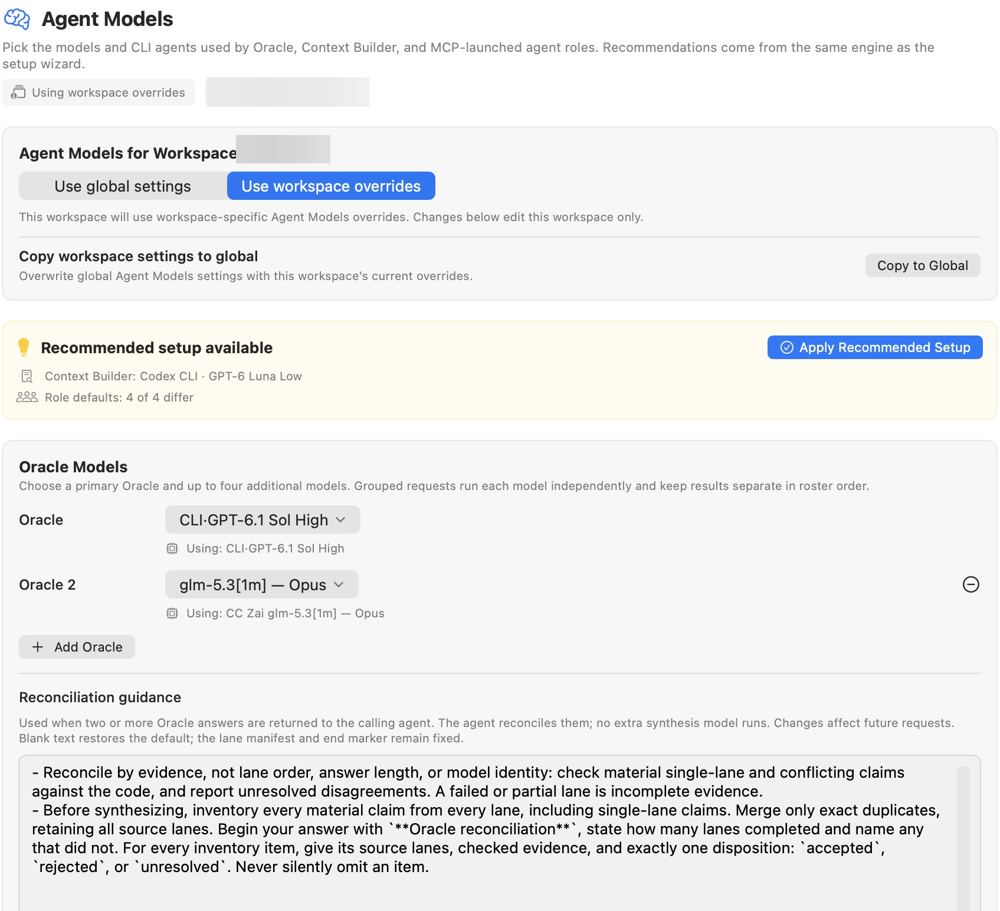
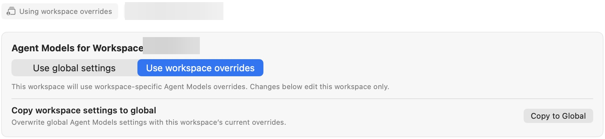
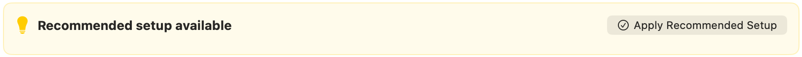
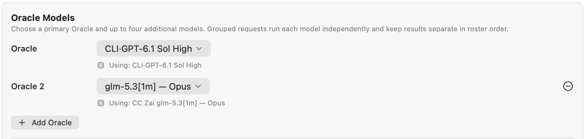
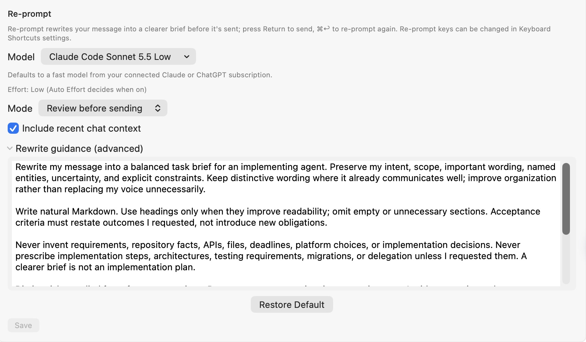
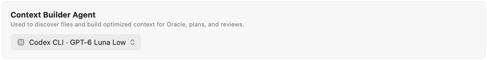
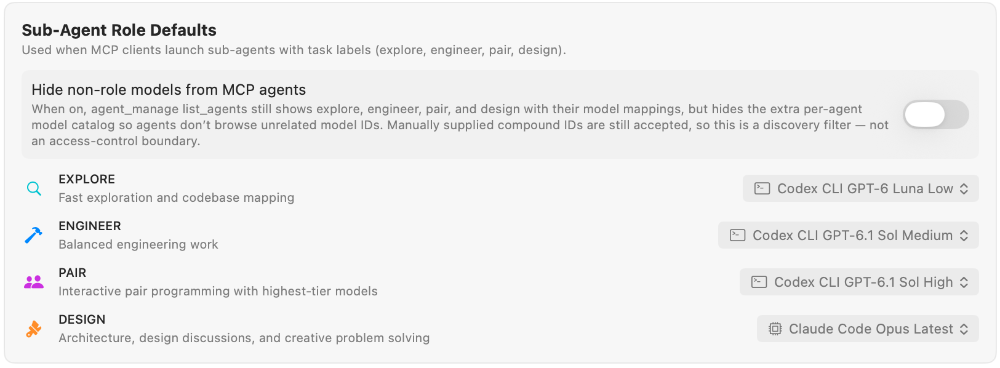
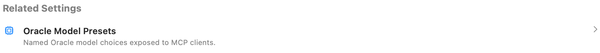

Choose the Oracle analysis model, the Context Builder agent and model, and model defaults for sub-agent roles such as Pair, Design, Explore, and Engineer.

Open **Settings → Agent Mode → Agent Models**. This page chooses the models used by Oracle, Context Builder, and MCP-launched agent roles. The model names and connected providers shown are examples, not fixed defaults.

Use the [Models reference](../../providers/models.mdx#model-roles) for the meaning of these model roles and shared selection concepts, and the [provider directory](../../providers/overview.mdx) for connection requirements. The sections below explain settings scope and controls.

## Global settings and workspace overrides

With a workspace open, choose where edits apply:

- **Use global settings**: this workspace inherits the global Agent Models profile, and changes below edit that profile.
- **Use workspace overrides**: changes below apply to this workspace's profile.

**Copy to Workspace** copies the current global profile and switches this workspace to overrides. When editing overrides, the corresponding **Copy to Global** action overwrites the global profile after confirmation, affecting other workspaces that inherit it. The scope chips at the top show the active profile and workspace.

## Recommended setup

Recommendations come from the same engine as the setup wizard. **Apply Recommended Setup** applies the recommended configuration to the scope you are editing. Individual rows can also offer **Apply** when their current choice differs. If everything matches, the page reports that the models are up to date.

## Oracle Models

Choose a primary Oracle and up to **four additional models**. **Add Oracle** adds another entry; the minus control removes an additional entry. Grouped requests run each model independently and retain separate results in roster order.

Set **Reconciliation guidance** for the calling agent when multiple answers return. The calling agent reconciles those answers; this does not launch another synthesis model. Saved guidance affects future requests, and blank guidance restores the default. The response-lane manifest and end marker remain fixed.

For named configurations exposed to MCP clients, see [Oracle Model Presets](../mcp-server/model-presets.mdx).

## Re-prompt

Re-prompt turns your draft message into a clearer task brief before sending it to the agent. Its settings follow the global or workspace scope selected at the top of this page.

- **Model** selects the model that rewrites the draft. The default uses a fast model from a connected Claude or ChatGPT subscription. See [Providers & Models](../../providers/models.mdx) for model availability.
- **Effort** is Low unless [Auto Effort](./agent-decisions.mdx#auto-effort) chooses the level.
- **Mode → Review before sending** lets you inspect the rewritten draft before sending. **Send automatically** sends the completed rewrite without that review step.
- **Include recent chat context** supplies recent conversation context to help interpret the draft.
- **Rewrite guidance (advanced)** lets you customize the rewriting instructions. **Restore Default** loads the default guidance into the draft.

Choose **Save** to store changes. Guidance must fit within **16 KiB**; an oversized draft is not truncated or saved. If settings or scope change while you edit, use **Reload Current Settings** before saving; this discards your draft.

While reviewing a rewrite, press **Return** to send it, **Command+Return** to rewrite again, or **Shift+Command+O** to send the original text. These shortcuts can be changed in [Keyboard Shortcuts](../general/keyboard-shortcuts.mdx#composer).

## Context Builder Agent

Choose the CLI agent and model that discover files and build context for Oracle, plans, and reviews. If no suitable agent is connected, use **Connect in CLI Providers** first. Token budgets and prompt-enhancement behavior belong on [Context Builder](./context-builder.mdx).

## Sub-Agent Role Defaults

These mappings supply models when an MCP client launches an agent using a role label:

| Role | Intended work |
| --- | --- |
| **Explore** | Fast, read-only exploration and codebase mapping. |
| **Engineer** | Balanced engineering and implementation work. |
| **Pair** | Interactive pair programming with highest-tier models (default when `model_id` is omitted in `agent_run op="start"`). |
| **Design** | Architecture, design critique, and creative problem solving (produces Markdown design/review documents under `docs/`). |

Choose the provider/model from each row's menu. **Reset All to Recommended** appears when role defaults have overrides.

**Hide non-role models from MCP agents** limits model discovery: `agent_manage` still exposes role labels and their mappings but omits the extra per-agent model catalog. Explicit compound model identifiers remain accepted. This is not an access-control boundary. [Model Router](../agent-mode/agent-decisions.mdx) can separately route eligible role-based starts.

## Advanced: synchronize built-in chat

**Keep Built-in Chat Model synced with Oracle Model** makes choosing an Oracle update the built-in chat model to match. Turn it off to choose the chat model independently. This does not make the chat model the same thing as a sub-agent role mapping.

## Related settings

Use [CLI Providers](./cli-providers.mdx) for connections, [Agent Permissions](./agent-permissions.mdx) for execution permissions, and [Oracle Model Presets](../mcp-server/model-presets.mdx) for named MCP Oracle configurations.

