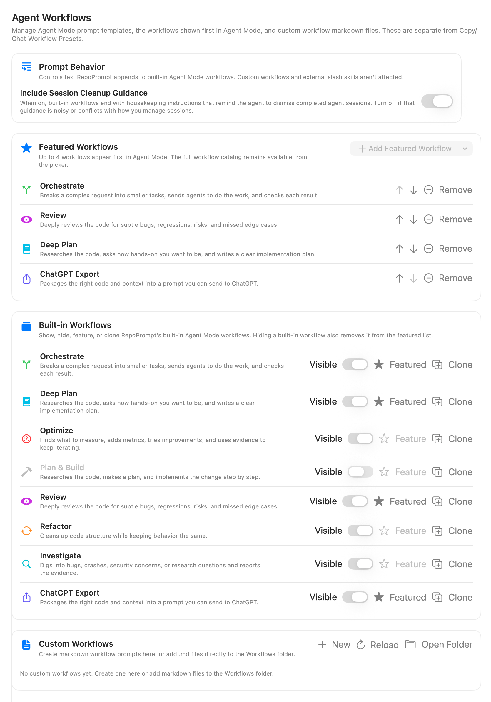
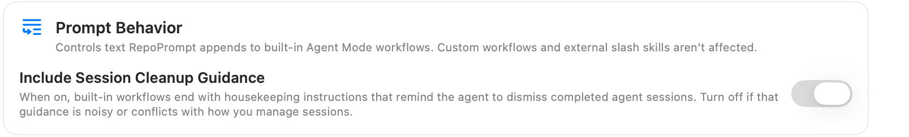
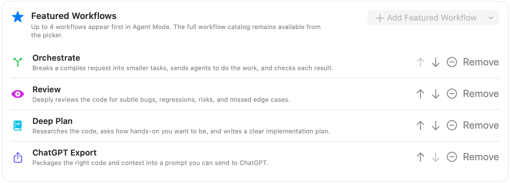
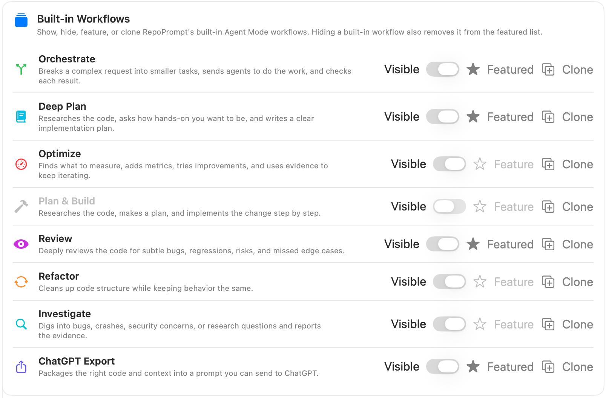
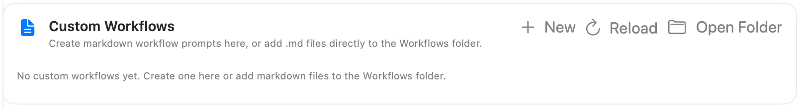

Manage the built-in workflows shown in Agent Mode, featured workflows, custom Markdown workflows, and cleanup guidance included with workflows.

Open **Settings → Agent Mode → Agent Workflows**. These are Agent Mode prompt templates, separate from [Copy/Chat Workflow Presets](../prompting/workflow-presets.mdx). Select a workflow in Agent Mode before sending a task.

## Prompt Behavior

**Include Session Cleanup Guidance** controls housekeeping instructions appended to built-in workflow templates, reminding the coding agent to dismiss completed sessions. Turn it off if that text conflicts with your session-management process. It does not change custom workflow templates or separately installed external workflow instructions, and it does not immediately dismiss sessions itself.

## Featured Workflows

Up to **four** workflows appear first in Agent Mode. **Add Featured Workflow** chooses from eligible workflows; it is disabled when the list is full or there are no more available choices.

Use the up and down arrows to reorder this list. **Remove** removes a workflow from the featured list without deleting the workflow. The full visible catalog remains available in the workflow picker.

## Built-in Workflows

The built-in catalog includes:

| Workflow | Purpose |
| --- | --- |
| **Orchestrate** | Break work into smaller tasks, delegate, and check results. |
| **Deep Plan** | Research the code and produce an implementation plan. |
| **Optimize** | Measure, add metrics, and iterate on improvements. |
| **Plan & Build** | Plan and implement a change step by step. |
| **Review** | Look for bugs, regressions, risks, and missed cases. |
| **Refactor** | Improve structure while preserving behavior. |
| **Investigate** | Investigate problems or research questions and report evidence. |
| **ChatGPT Export** | Prepare code and context for a prompt to use in ChatGPT. |

**Visible** shows or hides a built-in workflow in the picker. Hiding it also removes it from Featured Workflows. **Feature** adds a visible workflow to the featured list, subject to the four-item limit. **Clone** creates an editable custom Markdown copy; it does not modify the shipped template.

## Custom Workflows

Choose **New**, enter a name, and select **Create** to create a Markdown workflow. Alternatively, clone a built-in and edit the resulting file.

**Open Folder** opens the Workflows folder. You can add `.md` files there directly; **Reload** refreshes the catalog after external changes. Files can include optional frontmatter for a name, icon, accent color, tooltip, or description; otherwise the filename supplies the display name.

Custom rows provide their own management actions. Deleting a custom workflow asks for confirmation and removes its file from the Workflows folder; it cannot be undone from RepoPrompt.

