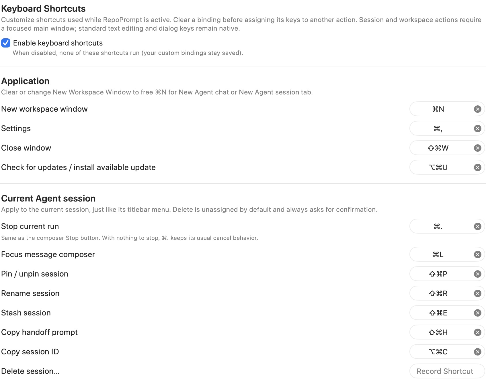
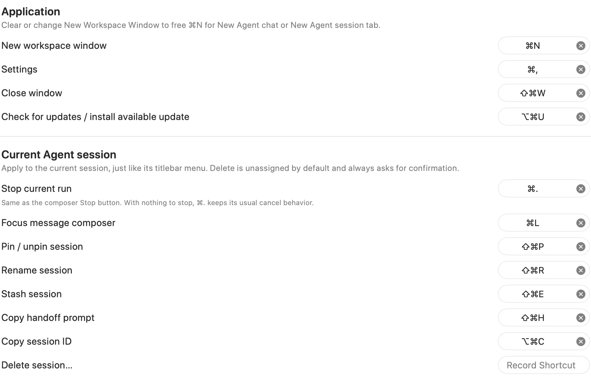
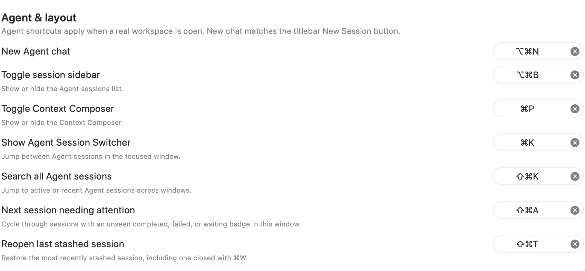
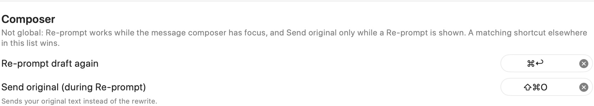
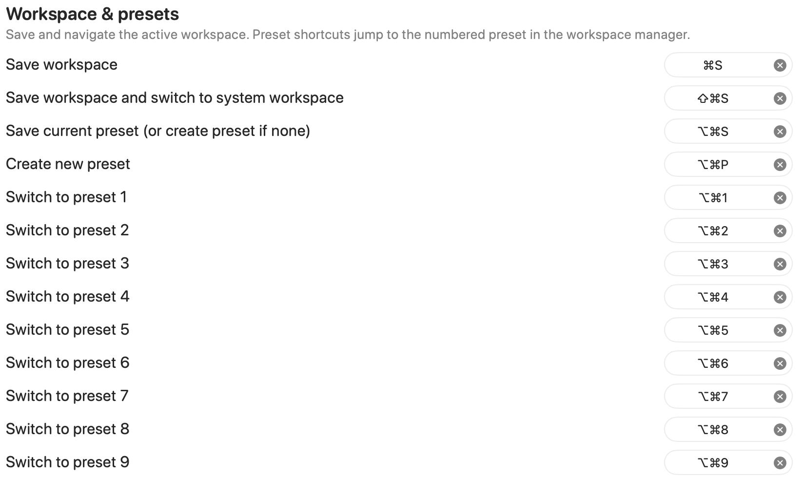
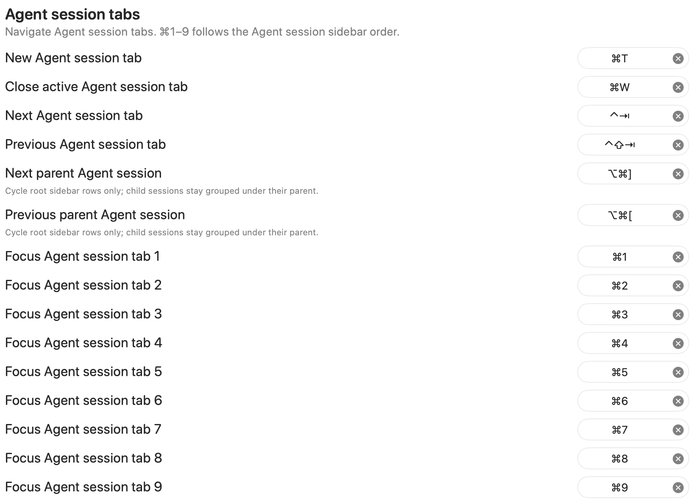
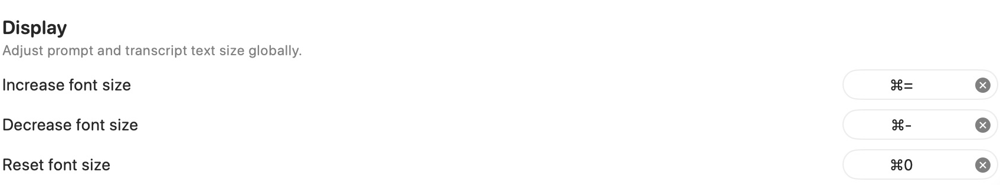

Review and customize keyboard shortcuts for RepoPrompt actions, including workspace, Compose, preset, and agent commands.

Open **Settings → General → Keyboard Shortcuts**. Click a shortcut recorder and press the desired key combination to change that action's binding. Use its clear button to remove a binding. Bindings are stored per app; menu-bar shortcuts or other apps can conflict with them.

The tables below list the implementation defaults. Your current bindings can differ. On a Mac, **Command** is ⌘, **Option** is ⌥, **Control** is ⌃, and **Shift** is ⇧.

## Enable keyboard shortcuts

Turn off **Enable keyboard shortcuts** to stop these registered shortcuts from running while keeping your custom bindings saved. [Advanced](./advanced.mdx#keyboard-shortcuts) exposes the same master setting.

These shortcuts apply while RepoPrompt is active; standard text-editing and dialog keys retain their native behavior. Workspace and session actions need an appropriate focused RepoPrompt window; agent shortcuts need a real workspace.

## Application

| Action | Default |
| --- | --- |
| New workspace window | Command+N |
| Settings | Command+, |
| Close window | Shift+Command+W |
| Check for updates / install available update | Option+Command+U |

Clear or change **New workspace window** before assigning Command+N to a new Agent chat or session tab.

## Current Agent session

| Action | Default |
| --- | --- |
| Stop current run | Command+. |
| Focus message composer | Command+L |
| Pin / unpin session | Shift+Command+P |
| Rename session | Shift+Command+R |
| Stash session | Shift+Command+E |
| Copy handoff prompt | Shift+Command+H |
| Copy session ID | Option+Command+C |
| Delete session… | Unassigned |

These actions target the current session, matching its titlebar menu. Delete always asks for confirmation. With no run to stop, Command+. keeps its normal cancel behavior.

## Agent & layout

| Action | Default |
| --- | --- |
| New Agent chat | Option+Command+N |
| Toggle session sidebar | Option+Command+B |
| Toggle Context Composer | Command+P |
| Show Agent Session Switcher | Command+K |
| Search all Agent sessions | Shift+Command+K |
| Next session needing attention | Shift+Command+A |
| Reopen last stashed session | Shift+Command+T |

**New Agent chat** follows the titlebar's New Session action. The session switcher navigates sessions in the focused window; searching all sessions includes active and recent sessions across windows.

**Next session needing attention** cycles through sessions with unseen completed, failed, or waiting badges in the current window. **Reopen last stashed session** restores the most recently stashed session, including one closed with Command+W.

## Composer

| Action | Default |
| --- | --- |
| Re-prompt draft again | Command+Return |
| Send original (during Re-prompt) | Shift+Command+O |

Re-prompt shortcuts apply while the message composer has focus. **Send original** applies while a rewrite is shown and sends your original draft instead. A matching shortcut elsewhere in this settings list takes priority. Configure rewriting in [Agent Models → Re-prompt](../agent-mode/agent-models.mdx#re-prompt).

## Workspace & presets

| Action | Default |
| --- | --- |
| Save workspace | Command+S |
| Save workspace and switch to system workspace | Shift+Command+S |
| Save current preset, or create one if none exists | Option+Command+S |
| Create new preset | Option+Command+P |
| Switch to preset 1–9 | Option+Command+1–9 |

Preset numbers follow the workspace manager's preset order. Saving the current preset opens the creation flow if the workspace has no presets. See [Manage Presets](../workspaces/manage-presets.mdx) for preset configuration.

## Agent session tabs

| Action | Default |
| --- | --- |
| New Agent session tab | Command+T |
| Close active Agent session tab | Command+W |
| Next Agent session tab | Control+Tab |
| Previous Agent session tab | Control+Shift+Tab |
| Next parent Agent session | Option+Command+] |
| Previous parent Agent session | Option+Command+[ |
| Focus Agent session tab 1–9 | Command+1–9 |

Numbered session shortcuts follow the Agent session sidebar order. Parent-session navigation cycles only root rows; child sessions stay grouped under their parent.

## Display

**Command+=** increases text size and **Command+-** decreases it. **Command+0** resets text size. These shortcuts use the same global text-size presets as [Appearance](./appearance.mdx#text-size).

