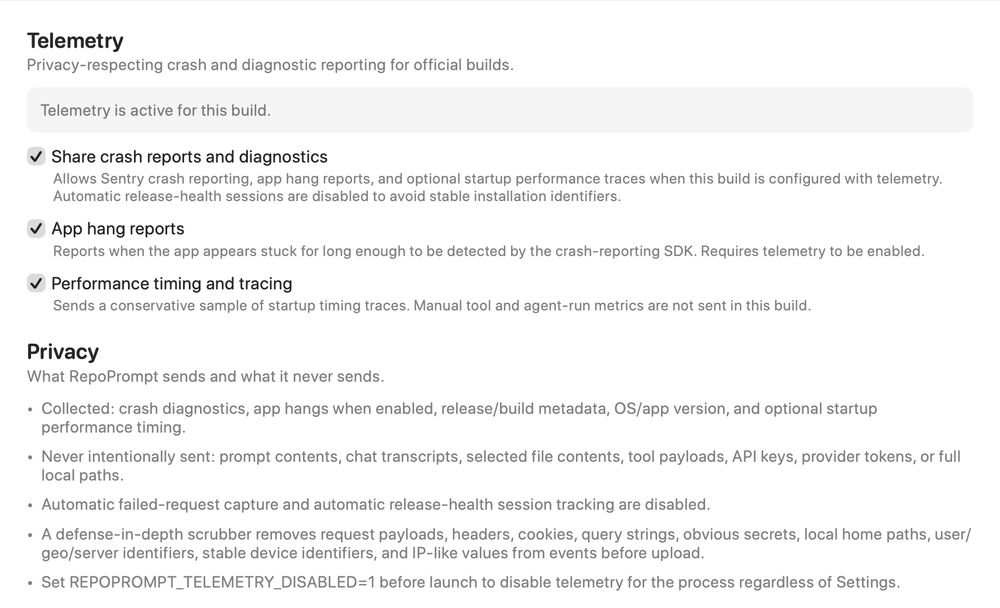
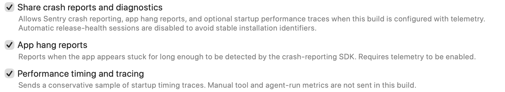
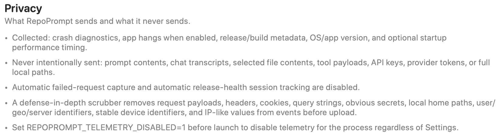

Control sharing of crash reports and diagnostics, app-hang reports, and performance timing and tracing.

Open **Settings → General → Telemetry**. Reporting depends on both your preferences and whether the build includes a configured telemetry service.

## Build status

The banner explains the effective state. Telemetry can be inactive because the Sentry SDK is absent, no Sentry DSN is configured, reporting is disabled in Settings, or the process was launched with `REPOPROMPT_TELEMETRY_DISABLED=1`.

A stored preference alone does not mean data is being sent. The master control is unavailable in builds without the SDK.

## Reporting controls

- **Share crash reports and diagnostics** is the master permission for configured Sentry reporting.
- **App hang reports** allows reporting when the SDK detects that the app has been stuck long enough. It requires the master setting.
- **Performance timing and tracing** allows a conservative sample of startup traces. The implementation sets a 5% trace sample rate when enabled; manual tool and agent-run metrics are not sent by this build.

Turning off the master setting disables the subordinate controls. Automatic release-health session tracking and failed-request capture are disabled.

## Privacy

Reported information can include crash diagnostics, enabled hang reports, release/build metadata, OS and app versions, and optional startup timing.

RepoPrompt does not intentionally send prompt contents, chat transcripts, selected file contents, tool payloads, API keys, provider tokens, or full local paths through telemetry. Before upload, a scrubber removes request payloads, headers, cookies, query strings, obvious secrets, local home paths, user/location/server identifiers, stable device identifiers, and IP-like values.

To disable telemetry for an entire process regardless of Settings, set **`REPOPROMPT_TELEMETRY_DISABLED=1` before launching it**. This telemetry preference does not control information sent to execution providers or to [Model Router](../agent-mode/agent-decisions.mdx) decision services.

