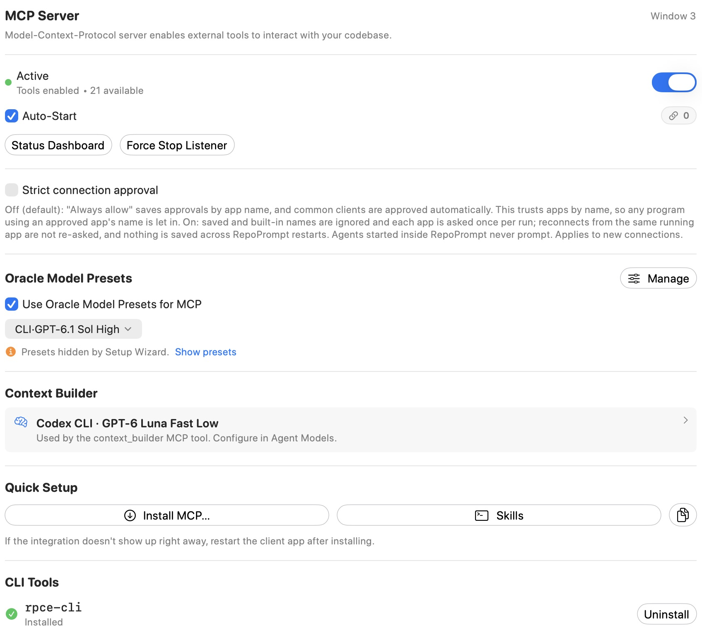
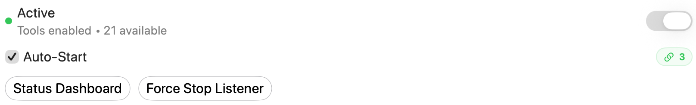
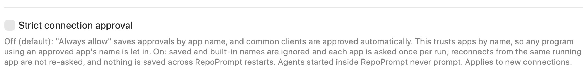
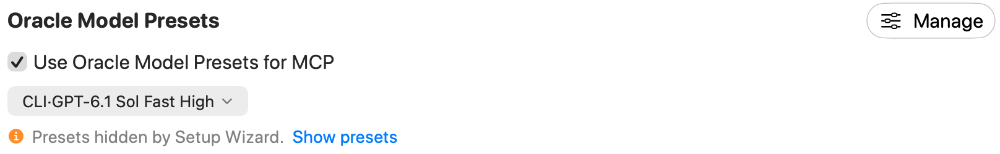
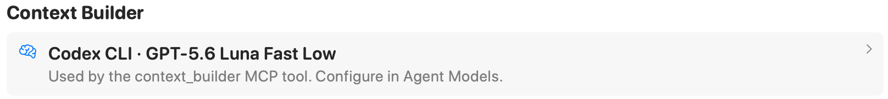
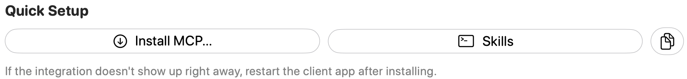
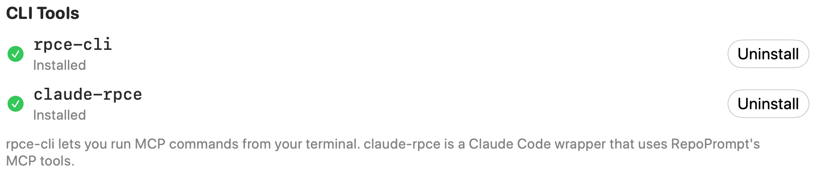

Manage RepoPrompt’s Model Context Protocol server, inspect connection status, configure external clients, and access CLI installation and JSON configuration tools.

Open **Settings → MCP Server**. The window number identifies the workspace window whose MCP access you are configuring. Connection counts and available tool counts reflect the running app and enabled tools.

## Status and window access

The main switch enables or disables MCP tools **for this window**. A running listener and enabled window access are different states: the page can report **Active**, **Waiting for listener…**, **Listener active** with tools disabled for the window, or **Inactive**.

**Auto-Start** controls automatic MCP server startup when RepoPrompt launches. The connection badge summarizes connected clients. **Status Dashboard** opens diagnostics, and an error indicator, when present, opens error details.

**Force Stop Listener** shuts down the shared listener for **every window and client**. Use the window switch when you only intend to disable access to the current window. A **Cancel** button can appear while a tool is running to abort that call.

## Strict connection approval

**Strict connection approval** controls admission of external MCP clients and applies to new connections:

- **Off (default):** common client names are approved automatically. **Always allow this client** saves approval by app name. A program using an approved name can also be admitted, so name-based trust does not verify its executable identity.
- **On:** saved and built-in approved names are ignored. Each app is asked once per run; reconnects from the same running app do not ask again. These approvals do not survive a RepoPrompt restart.

Agents started inside RepoPrompt do not show connection prompts. Connection admission is separate from [workspace-operation approvals](./workspace-approvals.mdx) and [agent permissions](../agent-mode/agent-permissions.mdx).

## Oracle Model Presets

**Use Oracle Model Presets for MCP** controls whether MCP exposes configured Oracle presets. **Manage** opens [Model Presets](./model-presets.mdx).

When presets are disabled, MCP uses the current Oracle model. If no presets are defined, the page offers a model choice and uses the Oracle fallback. If Setup Wizard temporarily hid presets, **Show presets** restores their visibility. The selected model in the screenshot is an example, not a requirement.

## Context Builder

This row displays the agent and model used by the `context_builder` MCP tool. Open it to change the selection in [Agent Models](../agent-mode/agent-models.mdx). It is separate from Oracle Model Presets.

## Quick Setup

**Install MCP…** offers setup for supported clients, including Cursor, VS Code, Codex CLI, OpenCode, Claude Desktop, and per-project Claude Code configuration. Choose the client you intend to connect. If it does not discover the integration immediately, restart that client after installation.

**Skills** installs or removes integration instructions for supported locations, including shared `.agents/skills`, Claude Code commands, and RepoPrompt's isolated Codex prompts. Choose the MCP or CLI variant for the integration you use. These are separate from installing the MCP client configuration.

The copy button copies the generated MCP configuration for manual setup.

## CLI Tools

**`rpce-cli`** runs MCP commands from a terminal. **`claude-rpce`** wraps Claude Code so it can use RepoPrompt's MCP tools.

Each row reports whether its command is installed and offers **Install**, **Update**, or **Uninstall** as appropriate. Debug builds use their debug command names. Installing a CLI command and enabling a window's MCP access are separate steps.

## JSON Configuration

Expand **JSON Configuration** to inspect and copy the JSON for an external client's MCP configuration. The generated command normally uses a managed link that survives app updates, with a bundled-path fallback. Add the configuration in your client, then connect it to RepoPrompt. If the client cannot find the generated command after moving the app or switching app builds, copy the configuration again from the intended running app and update the client.

Use [Tools](./tools.mdx) to control individual tool availability. Tool access also remains subject to the target workspace and applicable approval rules.

